# Where can a young person afford to live in the Basque Country?

**252 municipalities. 159 with official rent data. 93 with a gap we declare. 4 where a ranking holds.**

`bigdata-vivienda-euskadi` is an end-to-end data pipeline: it extracts 1,828 rental listings and
public series, freezes them with a hash, models them in MongoDB and produces the figures behind a
report, a 26-slide defence deck and this README. No figure is typed by hand; a verifier compares 159
checks against the gold CSVs and fails when anything stops matching.

[Versión en español](README.md) · Last review: 2026-11-16

[](https://github.com/mikelrh-dev/bigdata-vivienda-euskadi/actions/workflows/quality-gate.yml)

| | |
|---|---|
| Stack | Python 3.12, MongoDB 9.0.2, Kafka, HDFS/WebHDFS, pandas, matplotlib |
| Scale | 355 raw files (895 MB in HDFS), 183 silver entries, 17 collections, 55 gold artefacts |
| Quality | 298 tests, 159/159 figure checks, 56 figures sealed by vintage |
| Deliverables | Report in 4 formats, 26-slide deck plus 12 backups, v13 audit (2026-11-15): 184/190 (96.8 %), SBD 100 %, Tema 8 9.40/10 |

## 1. The problem in one number

Answering whether a young person can afford to move out means dividing two things nobody publishes
together: what a rental costs and what someone aged 18 to 34 earns. The Basque Country has 252
municipalities and the answer takes four shapes depending on what exists in each one.

**159** have rent registered by Eustat, so the ratio can be computed. **93** have none: they are
filled from neighbouring municipalities, drawn with hatching and used only as a sensitivity check.
**188** have not a single listing, so the label is "no data" rather than zero. **4** have enough
listings to rank municipalities without the order being noise.

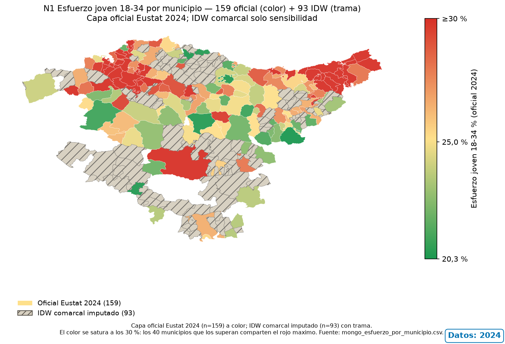

*Effort ratio for 18–34 in 2024 (n=159). The scale runs from 20.3 % to 30 % or more, with colour
saturated above the threshold. Hatching marks the 93 municipalities imputed by IDW.*

The median is **26.61 %** of annual income across the 159 municipalities with official rent; across all 252 it is 25.37 %. Forty municipalities exceed 30 % and fourteen exceed
35 %. The indicator measures effort, not price, which reorders the map: Barakaldo leads with a
746 € rent against Donostia's 995 €, because its income is considerably lower.

## 2. Who cannot pay

The full ranking with the threshold drawn exposes two things an average hides: the gap between first
and fourteenth is 3 points, and all fourteen sit in Bizkaia or Gipuzkoa.

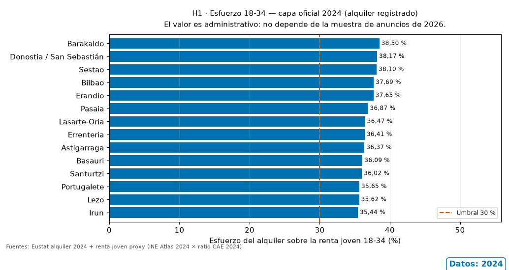

*Official 2024 layer. The administrative value does not depend on the 2026 listing sample, which is
why it can be defended municipality by municipality.*

Barakaldo (38.50 %), Donostia (38.17 %) and Sestao (38.10 %) are three tenths apart. Bilbao comes
fourth at 37.69 %. The other 119 municipalities do not pass 30 %.

## 3. What is being asked in 2026

The second layer changes source: listing prices from Fotocasa, Pisos and RealtyAPI, with the youth
salary from the Basque Youth Observatory carried from 2024 to 2026 using CPI. The municipal median
rises to **78.6 %** across 50 municipalities, and **98.3 %** of the 287 valid listings exceed 30 %.
Two figures coexist and they are not the same: 78.6 % is the median of the 50 municipal medians, with
each municipality weighing the same; **87.3 %** is the median of the 287 listings, where each listing
weighs the same. Each answers a different question.

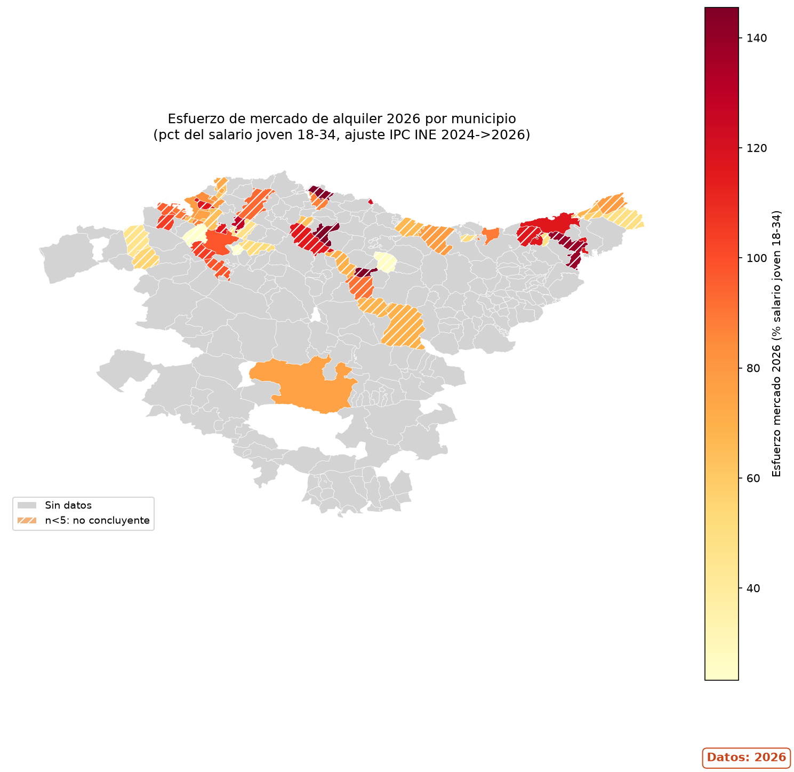

*2026 (n=287 listings in 50 municipalities). The scale reaches 140 % of the youth salary. Grey means
no data and hatching marks municipalities with fewer than 5 listings, which are not conclusive.*

Choices inside that layer change the result, so they are reported separately. The same portal mixes
whole flats with rooms: **201** room listings were detected; **140** are plausible because their price
sits below the municipal median rent, **60** are dropped on price and **1** has no price. A room costs
a median of 545 €, 31.7 % of the youth salary, and in Bilbao (580 €) and Donostia (600 €) it competes
with a full rental in the same municipality.

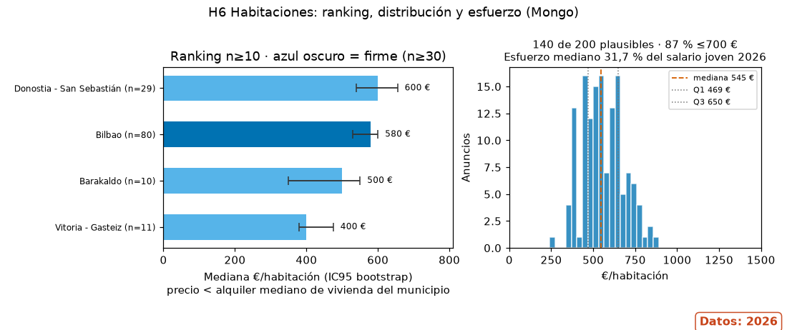

*Rooms with n≥10. The median is 545 €, with quartiles at 469 € and 650 €. 87 % of plausible listings
cost 700 € or less.*

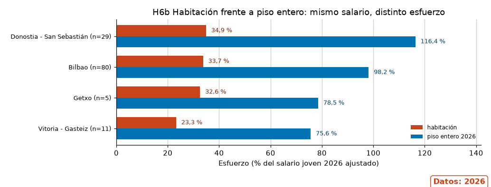

*Effort of a room against a whole flat in the same year, on the same adjusted 2026 youth salary.
Only municipalities with at least 5 room listings and 30 flat listings; the sample is firm in Bilbao
and indicative in Getxo and Vitoria-Gasteiz.*

Rental type matters too, and not through the median price: temporary and long-term lets both cost
1,500 € per month, but the temporary one pays 18.95 €/m² against 16.67 €/m² for long-term. Same bill,
13.7 % less home.

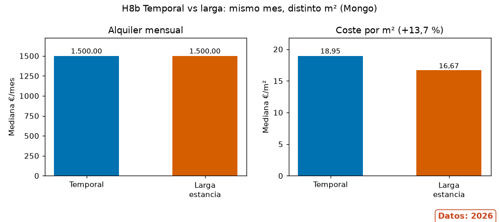

*Temporary versus long-term in 2026. The bill is identical and the price per m² is not.*

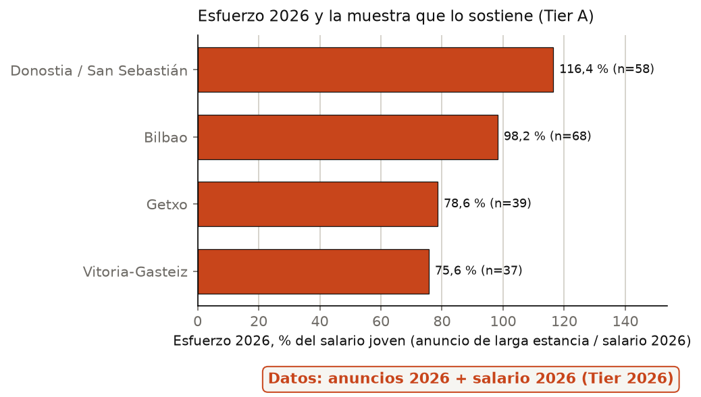

*2026 effort with the sample behind it, Tier A only. Each bar uses long-stay listings with a valid
price, so `n` is smaller than the Tier count (Bilbao, 68 against 204; Donostia, 58 against 126). No
threshold line: numerator and denominator change here.*

## 4. The gap that is not a time series

Between 2024 and 2026 two things change at once: the source (signed contract versus asking price) and
the size of the dwelling (90.0 m² in listings versus 80.7 m² registered). The difference cannot be
split between "rent went up" and "we are measuring something else", so it is published as a level.

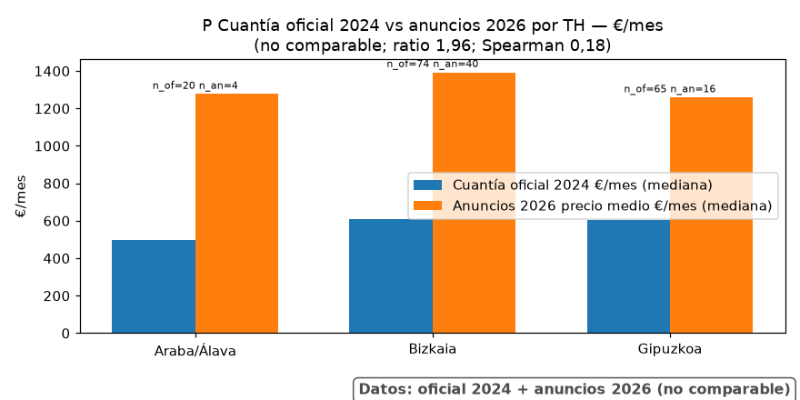

*Each bar carries its own seal: `Datos: oficial 2024 + anuncios 2026 (no comparable)`. They do not
form a time series.*

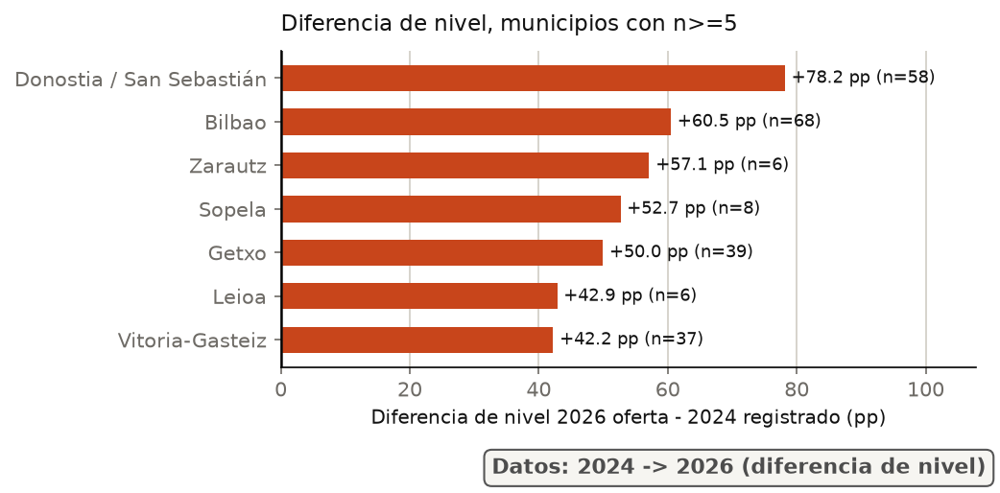

*Seven municipalities with at least 5 listings. All in the same direction, from +42.2 points in
Vitoria-Gasteiz to +78.2 in Donostia. Data: 2024→2026 (level difference); flattened copy on a white
background of the sealed figure `docs/memoria/figuras/fig-brecha-2026.png`, a transparent PNG
meant for the deck.*

While the effort ratio rose, subsidised housing fell. Social housing completed per thousand
inhabitants went from **11.5 ‰ in 2011 to 2.7 ‰ in 2024**, and Álava, which reached 40.1 ‰, gets its
own panel so it does not flatten the rest of the scale.

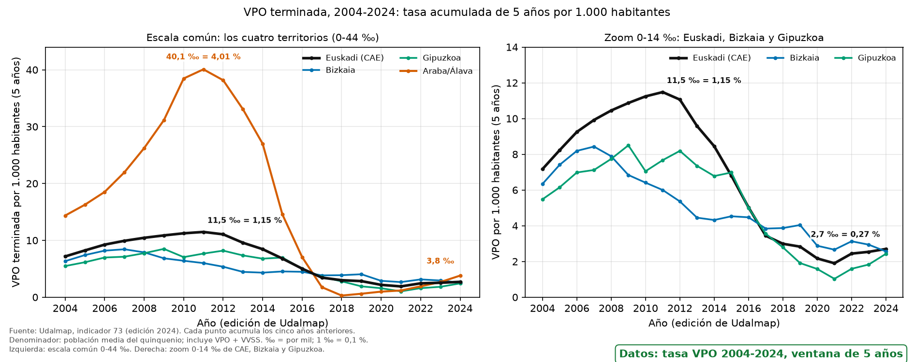

*Each year summarises the previous five (Udalmap rolling window), so it is not a single year's flow.
It measures subsidised supply, not stock.*

## 5. What each dot on the map is worth

A ranking built on three listings is an anecdote. Below 30 the confidence interval opens so wide that
two municipalities cannot be ordered, so the Tier measures confidence only, and the confidence map is
almost entirely "no data".

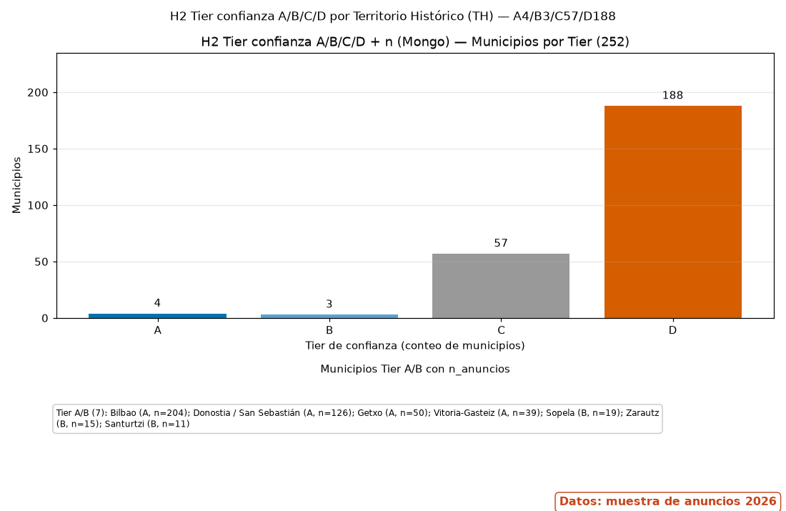

*Tier A: Bilbao (204 listings), Donostia (126), Getxo (50) and Vitoria-Gasteiz (39). Tier B reaches
Sopela (19), Zarautz (15) and Santurtzi (11). C and D are 245 municipalities with no municipal price.*

Of the 50 municipalities with a 2026 median, **43 have fewer than five listings** and are not
published. With the four Tier A municipalities the comparison is between intervals, not a podium:
Bilbao (33.75–40.95), Getxo (27.54–31.77) and Donostia (32.4–45.8) overlap. The defensible claim is
that all three cross 30 %.

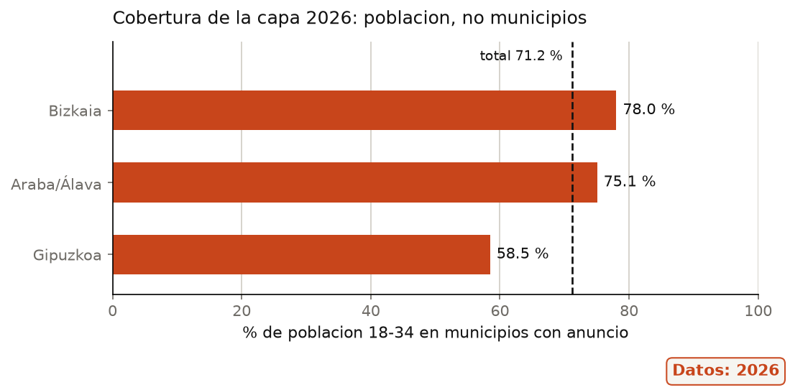

*Coverage of the 2026 layer by population aged 18-34, not by municipality: the 50 municipalities with
data cover **71.2 %** of young people (334,753 of 470,083).*

## 6. What this project does not answer

The indicator measures effort, not quality of life. These limits shape what can be concluded:

| Limit | What it means |
|---|---|
| Youth income is a proxy | Net median household income × 56.9 % (CAE 18-34 ratio), not individual salary. The 2026 salary is an autonomous-wide constant (1,719 € per month), so the municipal ranking moves with income. |
| Rent in the 93 municipalities is imputed | Filled by IDW from neighbouring municipalities and never enters the conclusion. Across all 252 municipalities the median effort is 25.37 %; across the 159 official ones, 26.61 %, and that is the figure defended. |
| The 2026 CPI is the year-to-date annual average | 107.2 in 2024 and 117.8 in 2026. It is not the closing value for the year. |
| `nivel_geografico` "comarcal" is inherited from the name | The actual method is distance between centroids, not a county average. |
| Functional area is assigned by centroid | A municipality crossing two areas takes the one its centre falls in. |
| Listings are not the housing stock | They measure advertised supply on three portals, not the full stock or regulated rent. |
| 2024 and 2026 do not form a series | Source and dwelling size change; they are published as levels, not as evolution. |
| Social housing is flow, not stock | It counts completed promotions, not available dwellings. |

The figures show territorial associations, not causation: high effort depends at once on prices, incomes, employment and supply. The tier ranks the available evidence; it does not classify municipalities by quality of life.

## 7. Decisions and debt

Every known difficulty has a decision taken and a declared cost.

| Difficulty | Decision | Declared cost |
|---|---|---|
| No municipal youth salary | Median income as a proxy, declared | Possible ecological fallacy |
| 2026 listings against 2024 income and rent | Two separate layers, never subtracted | No time series |
| Three inventories: disk, manifest and HDFS | Kept for different purposes | The difference must be explained |
| HDFS keeps raw only | Challenge scope requirement | Silver and gold are not in HDFS |
| Two 2026 indexes defined but not built | Declared; left unbuilt until there is a maintenance window | The 2026 pipeline is not optimised |
| Missing `auditoria_lagunas_silver.csv` | Not regenerated so gold stays at 55 artefacts rather than 56 | One check stays red |
| Legacy topic `anuncios_inmobiliarios` | Not deleted: the cluster is shared | 1,420 test messages coexist with the live topic |

Infrastructure also carries dates. On 12 November the WebHDFS `OPEN` failed due to datanode DNS and Kafka returned no metadata; on 13 November recovery by SHA returns `HDFS_REC OK SHA_TAMANO_IGUALES` and the topic answers with one partition and replication factor 1. A network outage does not become a claim about the code.

Five debts remain: two unbuilt 2026 indexes, two duplicated room collections, the legacy topic, one pipeline outside the main order and one red silver check. None of them prevents answering the question, but all of them bound what can be claimed about performance and consistency. Planned improvements: finish those two indexes, unify the room collections, and replace median income with a municipal youth income when one exists.

## 8. How it is built

A listing enters through scraping or an API, is frozen with its SHA, normalised, loaded into Mongo
and ends up in the CSVs and figures behind the report and the deck. The original is never overwritten.

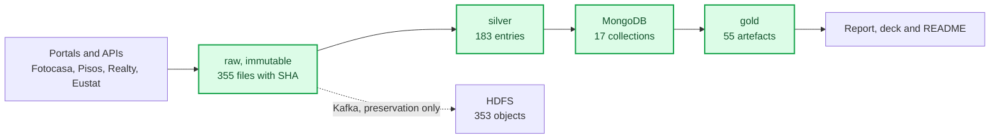

The funnel explains the later choices: **1,828** raw records, **639** after deduplication, **594**
current and **287** valid for the calculation. Only **424** of the 594 carry coordinates, because
Fotocasa is the only portal publishing latitude and longitude; the other 170 stay out of the
geospatial index rather than being invented.

### The data model

A five-digit `codigo_ine` is the natural key of `municipios` and the reference everywhere else. What
is read together and changes slowly stays embedded (`demografia`, `empleo`, `demanda_social`); what
grows and is queried per municipality stays referenced (`anuncios`, `alquiler_municipal`,
`etxebide_promociones`).

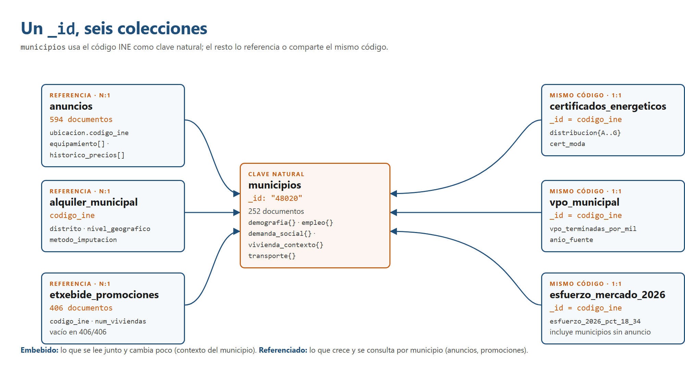

*17 live collections plus 15 backups. `municipios` holds 252 documents; `anuncios`, 594;
`etxebide_promociones`, 406, all with the dwelling count empty.*

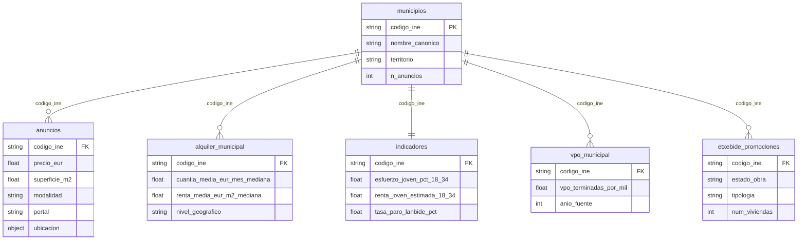

### What makes it reproducible

`data/raw/` is immutable by design. Only `extract/` writes there; `transform/` needs
`assert_raw_writable(reason)` and a test blocks the exception. The silver DAG declares 40 nodes with
typed inputs and outputs (`raw:`, `proc:`, `res:`) and derives execution order with Kahn's algorithm,
using group order as a stable tie-break; 7 scripts stay out with a written reason.

Mongo runs 11 pipelines in `PIPELINE_ORDER` and defines 10 indexes, 8 of them materialised. The ESR
index `{ubicacion.codigo_ine: 1, modalidad: 1, precio_eur: 1}` turns the canonical query from a
`COLLSCAN` over 594 documents into an `IXSCAN` over 1, and `explain_before_after()` shows it in
read-only mode. Price-per-m² medians are winsorised at p1-99 and the mean price drops IQR outliers,
with the n of every step exposed in the CSV.

The archive branch publishes the originals to HDFS with a `{rel, size, sha256}` manifest: Kafka
transports, HDFS preserves, Mongo serves queries. Kafka never writes to Mongo; the analytical load is
batch and idempotent per batch through `replace_collection`.

## 9. What this repository demonstrates

| Skill | Where it shows |
|---|---|
| Heterogeneous ingestion | 41 extractors over APIs, scraping, XLSX and GeoJSON, with entity resolution and quarantine |
| Data engineering | Declarative 40-node DAG with topological ordering and SHA-based staleness checks |
| NoSQL modelling | 17 collections, embedded versus referenced, ESR indexes and measured `explain()` |
| Reproducibility | 355 raw SHAs, 183 silver hashes, gold fingerprint identical across two runs |
| Quality | 298 tests, offline end-to-end gate, governance and vintage verification |
| Technical communication | Report in Markdown, HTML, DOCX and PDF, 26-slide deck, audit against the rubric |

## 10. Do not take my word for it

```bash
.venv/Scripts/python.exe -m pytest tests
.venv/Scripts/python.exe scripts/verificar_cifras_deck.py
.venv/Scripts/python.exe scripts/verificar_vintage_figuras.py
.venv/Scripts/python.exe scripts/verificar_gobernanza.py
.venv/Scripts/python.exe scripts/gate_extremo_a_extremo.py --offline
.venv/Scripts/python.exe scripts/verificar_reproducibilidad.py
.venv/Scripts/python.exe scripts/run_pipeline.py --check
.venv/Scripts/python.exe transform/run_all.py --check
.venv/Scripts/python.exe scripts/verificar_fase_datos.py
```

| Command | Output as of 2026-11-15 |
|---|---|
| `pytest tests` | `298 passed, 2 skipped` |
| `verificar_cifras_deck.py` | **159/159** checks against gold CSVs, the ratio formula, GeoJSON and Mongo counts |
| `verificar_vintage_figuras.py` | `56 figures declared · gold, deck and report sealed and consistent` |
| `verificar_gobernanza.py` | `TODO OK`: 53 headers / 49 with ID, 47 scripts, 183 silver, 11 pipelines |
| `gate_extremo_a_extremo.py --offline` | `RESULTADO gate: OK` (355 SHAs, 183 silver, 17 collections, 0 duplicates) |
| `verificar_reproducibilidad.py` | `RESULTADO: OK`, fingerprint `983fa53f…` identical across two runs |
| `run_pipeline.py --check` | 355 and 183 entries, 0 errors |
| `transform/run_all.py --check` | All `[OK]` except `auditoria_lagunas_silver.csv`, which exits with rc 1 |
| `verificar_fase_datos.py` | 21 PASS and **1 known FAIL 07**: zero-unemployment in Aramaio 0.28 / Gaintza 1.45 / Usansolo 3.26 |

The sources under `docs/` and `openspec/` are not versioned: they live in the local checkout, which is
what these verifiers require.

The known failure is documented without imputation, and so are the gaps: 2 of the 10
`esfuerzo_mercado_2026` indexes are missing, WebHDFS `OPEN` depends on datanode DNS (the gate compares
size and SHA instead of restoring) and the old `anuncios_inmobiliarios` topic still holds 1,420 test
messages the current chain does not use.

## 11. Running it

Requirements: Python 3.12, [uv](https://docs.astral.sh/uv/), MongoDB on `localhost:27017` and network
access for live extraction. On Linux or macOS replace `.venv/Scripts/python.exe` with
`.venv/bin/python`.

```bash
uv venv --python 3.12 .venv
uv pip install --python .venv/Scripts/python.exe -r requirements.txt
cp .env.example .env

curl -L -o data/raw/shp_euskadi.zip \
  "https://www.geo.euskadi.eus/cartografia/DatosDescarga/Limites/MUNICIPIOS_5000_ETRS89.zip"
cd data/raw && unzip -o shp_euskadi.zip -d shp_euskadi && cd ../..

# 1. Extract and freeze raw (or replay if it already exists)
.venv/Scripts/python.exe extract/main_ingest.py
.venv/Scripts/python.exe extract/main_ingest.py --mode replay-raw

# 2. Silver + quality
.venv/Scripts/python.exe scripts/run_pipeline.py --fase silver,quality

# 3. Mongo (destructive: requires the flag)
.venv/Scripts/python.exe scripts/run_pipeline.py --fase mongo --allow-mongo-write

# 4. Gold: 2026 layer, Mongo analysis, deck assets and figures
.venv/Scripts/python.exe scripts/run_pipeline.py --fase gold
```

`gold` runs, in order: `capa_2026` (silver only), `run_analisis_mongo`, `comparativa_mongo`,
`assets_presentacion`, `sensibilidad`, `generar_figuras_N` and `sincronizar_figuras`. The deck's
`M26_*` assets belong to `assets_presentacion` because they read
`data/resultados/mongo_tier_confianza.csv`; that is why `regenerar_capa_2026.py` no longer generates
them.

`--fase all` equals `silver,quality,gold` and never includes `mongo`, which is destructive and
requires `--allow-mongo-write`. `--dry-run` prints the plan without writing.

If you only need to rebuild the 2026 layer, use `--fase gold` (recommended: it also runs analysis
and assets) or, separately, `python scripts/regenerar_capa_2026.py` for the CSVs and base figures
and then `python docs/presentacion_v2/assets_presentacion_esfuerzo_mercado_2026.py` for the deck
assets. The latter requires `analysis/run_analisis_mongo.py` to have run first.

| Symptom | Cause | Action |
|---|---|---|
| `ping=False` or timeout | Mongo is not running | Start `mongod`, check `MONGO_HOST` and `MONGO_PORT` |
| `NameResolutionError hadoop-worker*` | Datanode DNS | Add the hosts; `ContentSummary` does not depend on `OPEN` |
| `NodeNotReadyError` | Broker without metadata | Retry and recreate the topic with `scripts/ensure_topic.py` |
| `.env` ignored | Running outside the root | Run every script from the repository root |

## 12. Layout and documentation

| Path | Contents |
|---|---|
| `extract/` | 41 capture scripts; the only layer that writes to raw |
| `transform/` | 47 scripts and the silver DAG (`run_all.py`) |
| `storage/` | Mongo loading, Kafka producer, HDFS upload |
| `analysis/` | 11 pipelines, queries, indexes and sensitivity analysis |
| `scripts/` | Phase orchestrator and verification gates |
| `docs/memoria/` | Technical report as PDF with sealed figures |
| `docs/presentacion_v2/` | Defence deck as PDF: 26 slides and 12 backups |
| `data/resultados/README.md` | Gold index and the 8 `mongo_*` CSVs |

### Live documentation

| Document | Contents |
|---|---|
| [Technical report (PDF)](docs/memoria/memoria.pdf) | Chapters 1-8 and annexes |
| [Defence deck (PDF)](docs/presentacion_v2/presentacion_v2.pdf) | 26 slides plus 12 backups |
| [Raw manifest](docs/raw_manifest_sha256.txt) | SHA-256 of the 355 source files |
| [Gold baseline](docs/baseline_gold_sha256.json) | Fingerprint used to check reproducibility |
| [Comparability matrix](docs/matriz-comparabilidad.md) | Which metric is comparable with which, and why |
| [Docs index](docs/README.md) | What remains versioned under `docs/` |
| [Gold index](data/resultados/README.md) | CSVs and figures that make up the gold layer |
| [AGENT.md](AGENT.md) | Pointers for agents |

## 13. Glossary

| Term | Meaning in this project |
|---|---|
| Youth effort | Share of youth income consumed by rent. The main indicator. |
| IDW | Inverse-distance weighting raised to the square. Uses the 5 nearest official municipalities and haversine distance between centroids. |
| Winsorise | Trim the tails of a distribution to a percentile (p1-p99 here) before computing the median. |
| Tier A/B/C/D | Confidence level based on how many listings support the municipal figure. It ranks evidence, not quality of life. |
| ESR index | A MongoDB index in Equi-Sort-Range order. Here `{ubicacion.codigo_ine, modalidad, precio_eur}`: it filters, sorts and ranges without scanning the collection. |
| `COLLSCAN` / `IXSCAN` | `explain()` outcomes: scan the whole collection or enter through the index. |
| Proxy | Variable used because the desired one does not exist. Here youth income and the CPI-updated 2026 salary. |
| Vintage | Data cut behind a figure. Sealed figures carry theirs in the PNG metadata. |
| VPO | Protected housing (official and social). Indicator 73 counts homes completed over five years per 1,000 inhabitants; it is a flow, not stock. 1 ‰ = 0.1%. |

## 14. Context and citation

Academic project for the **SBD + BDA** intermodal challenge (Basque Country, 2026). Every source is
public and listed in `config/fuentes.yaml`. There is no `LICENSE` file; intended use is academic.

Suggested citation: bigdata-vivienda-euskadi team (2026), "Where can a young person afford to live in
the Basque Country?", data pipeline for the SBD+BDA intermodal challenge, academic repository.
