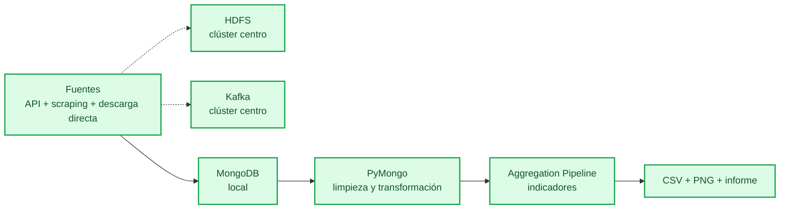
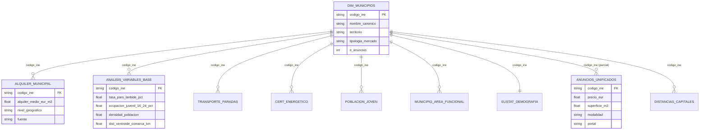

# bigdata-vivienda-euskadi: ¿Dónde pueden vivir los jóvenes en Euskadi?

Pipeline en Python para el reto intermodal **SBD + BDA**: extrae datos públicos reales, conserva
los originales en HDFS vía Kafka, los modela en MongoDB y responde con indicadores verificables
contra el contrato del reto. Ninguna cifra del informe ni del deck se teclea: salen de un CSV del
gold y un verificador falla si dejan de coincidir.

> El esfuerzo mediano de un joven de 18–34 años es **26,61 %** de su renta en los 159 municipios con
> alquiler oficial; **40 de 159** superan el umbral del 30 %. El ranking municipal fino solo es
> defendible en **4 municipios** con n≥30 anuncios.
>
> Estado: pipeline completo (extracción, silver, MongoDB y gold), memoria, deck v3 con 26
> diapositivas y 12 backups, auditoría v13. `pytest`: 298 passed, 2 skipped. Última revisión:
> 2026-11-15.

## Índice

1. [La respuesta en una pantalla](#1-la-respuesta-en-una-pantalla)
2. [Cómo leer este README](#2-cómo-leer-este-readme)
3. [Qué responde el proyecto](#3-qué-responde-el-proyecto)
4. [Puesta en marcha](#4-puesta-en-marcha)
5. [Arquitectura](#5-arquitectura)
6. [Las dos capas: por qué no hay serie](#6-las-dos-capas-por-qué-no-hay-serie)
7. [Datos y cifras](#7-datos-y-cifras)
8. [Verificación](#8-verificación)
9. [Límites y decisiones](#9-límites-y-decisiones)
10. [Documentación](#10-documentación)
11. [Problemas frecuentes](#11-problemas-frecuentes)
12. [Contexto](#12-contexto)

## 1. La respuesta en una pantalla

El alquiler se lleva algo más de una cuarta parte de la renta joven. La mediana es **26,61 %** en
los 159 municipios con dato oficial (Eustat 2024 y renta INE Atlas, ajustada al reparto por edad de
la CAE). Cuarenta municipios pasan del umbral del 30 % y catorce del 35 %.


*Esfuerzo 18–34 en 2024 (n=159). El color se satura al 30 %: los 40 municipios que lo superan
comparten el rojo máximo. Trama = IDW, no dato oficial.*

Lo que ordena el ranking es el esfuerzo, no el precio: Barakaldo encabeza con 746 € porque su renta
es más baja que la de Donostia, que tiene 995 €. El mapa colorea por esfuerzo y raya los 93
municipios sin alquiler oficial, imputados por IDW solo como sensibilidad.

La capa de 2026 es otra fotografía, no una serie. Con anuncios de oferta, la mediana municipal sube
a **78,6 %** en 50 municipios. No se puede decir «subió X puntos», porque cambian a la vez el
numerador y la fuente. Lo que sí se sostiene es la diferencia de nivel en los 7 municipios con n≥5:
entre **+42,2 pp** (Vitoria-Gasteiz) y **+78,2 pp** (Donostia).

## 2. Cómo leer este README

| Si eres… | Empieza por | Tiempo |
|---|---|---|
| Tribunal o evaluador | [§1](#1-la-respuesta-en-una-pantalla) → [§6](#6-las-dos-capas-por-qué-no-hay-serie) → [§9](#9-límites-y-decisiones) | 10 min |
| Auditor técnico | [§8 Verificación](#8-verificación) → [§7 Datos](#7-datos-y-cifras) → `openspec/audit/v13_2026-11-15/` | 20 min |
| Quien va a ejecutarlo | [§4 Puesta en marcha](#4-puesta-en-marcha) → [§5 Arquitectura](#5-arquitectura) → [§11](#11-problemas-frecuentes) | 30 min |

Las cifras aparecen en negrita una vez, con su fuente en [§7](#7-datos-y-cifras). Si una cifra se
repite en dos sitios y no coincide, es un error del documento.

## 3. Qué responde el proyecto

| Pregunta | Respuesta | Límite |
|---|---|---|
| O1 · ¿Puede un joven independizarse? | No de forma general: mediana **26,61 %** de la renta; **40/159** municipios oficiales por encima del 30 %. Sensibilidad IDW-252: **25,37 %** (47/252). | La renta municipal es un proxy; no hay salario individual por edad y municipio. |
| O2 · ¿Qué municipios son viables? | Solo **4** con n≥30 anuncios: Bilbao (204), Donostia (126), Getxo (50) y Vitoria-Gasteiz (39). | El resto es indicativo (Nivel 2/3); no se rankea. |
| O3 · ¿Trabajo y vivienda barata? | No hay trade-off simple: paro y precio suben juntos donde hay demanda, y la correlación más fuerte es con la distancia a la capital (negativa). | Correlación, no causalidad; se usan conteos de paro, no tasas. |
| O4 · ¿Qué límites tiene? | 93 municipios sin alquiler directo, mezcla de años, emancipación solo a nivel CAE y falacia ecológica. | Detalle en [§9](#9-límites-y-decisiones). |

## 4. Puesta en marcha

Requisitos: **Python 3.12**, [uv](https://docs.astral.sh/uv/), **MongoDB local** en
`localhost:27017` y red para la extracción viva y el clúster del centro.

> En Linux/macOS sustituye `.venv/Scripts/python.exe` por `.venv/bin/python`.

```bash
uv venv --python 3.12 .venv
uv pip install --python .venv/Scripts/python.exe -r requirements.txt
cp .env.example .env          # ajusta MONGO_*, HDFS_*, KAFKA_* y GATE_LIVE
```

Descarga la cartografía municipal:

```bash
curl -L -o data/raw/shp_euskadi.zip \
  "https://www.geo.euskadi.eus/cartografia/DatosDescarga/Limites/MUNICIPIOS_5000_ETRS89.zip"
cd data/raw && unzip -o shp_euskadi.zip -d shp_euskadi && cd ../..
```

Extrae los originales. `--mode replay-raw` valida los SHA sin red:

```bash
.venv/Scripts/python.exe extract/main_ingest.py
.venv/Scripts/python.exe extract/main_ingest.py --mode replay-raw
```

Reconstruye por capas. La fase `mongo` es **destructiva** (recarga la base) y exige
`--allow-mongo-write`; el resto no toca `data/raw`:

```bash
.venv/Scripts/python.exe scripts/run_pipeline.py --fase silver,quality
.venv/Scripts/python.exe scripts/run_pipeline.py --fase mongo --allow-mongo-write
.venv/Scripts/python.exe scripts/run_pipeline.py --fase gold
```

`--fase all` equivale a `silver,quality,gold` y **nunca** incluye `mongo`.
`--fase full` equivale a `silver,quality,mongo,gold`: reconstrucción completa desde raw y, al
incluir `mongo`, también exige `--allow-mongo-write`. `--dry-run` lista el plan (también el de
una fase destructiva, porque no escribe) y `--check` valida los hashes de raw y silver.

Para comprobar que la cadena sigue siendo reproducible **sin reconstruir nada**:

```bash
.venv/Scripts/python.exe scripts/verificar_reproducibilidad.py
```

## 5. Arquitectura



Flujo en una línea:
`Fuentes → extract/ → data/raw [inmutable] → transform/ → data/procesado [silver] → storage/load_mongo.py → MongoDB → analysis/run_analisis_mongo.py → data/resultados [gold]`.

Hay dos ramas sobre los mismos originales. La analítica va de raw a MongoDB y de ahí a gold. La de
archivo publica `data/raw` en HDFS: `storage/kafka_raw_producer.py` emite un manifiesto
`{rel, size, sha256}` y `storage/kafka_hdfs_uploader.py` consume y sube, descartando por SHA lo que
ya coincide. Kafka no escribe en Mongo: la carga analítica es batch.

La base es MongoDB 9.0.2 standalone local, sin replica set. Eso da atomicidad de documento único e
idempotencia por lotes, sin transacciones multidocumento. La unidad de integración es `codigo_ine`
de 5 dígitos. Hay **11 pipelines** en `PIPELINE_ORDER` más `pipeline_esfuerzo_mercado_2026` fuera de
orden; **10 índices** definidos en `analysis/mongo_indexes.py`, de los que **8** están
materializados. Los índices ESR `{ubicacion.codigo_ine: 1, modalidad: 1, precio_eur: 1}` convierten
la consulta canónica de `COLLSCAN` (594 examinados) a `IXSCAN` (1 examinado);
`explain_before_after()` lo demuestra en solo lectura y `tests/test_mongo_indices.py` lo blinda.

### Modelo de datos (relaciones por `codigo_ine`)



> HDFS guarda solo `raw`, y es una excepción de alcance declarada. Se publican los 353 ficheros
> canónicos de `data/raw`; `data/procesado` no se sube. El criterio se cubre con la organización de
> originales, la recuperación verificada con `scripts/hdfs_recuperacion_un_fichero.py` (cotejo de
> tamaño y SHA, solo lectura) y el `GETCONTENTSUMMARY /data/raw` en vivo (353 ficheros,
> 895.597.901 B).
>
> `data/raw/` es inmutable por diseño: solo `extract/` escribe ahí; `transform/` necesita
> `assert_raw_writable(reason)` y está bloqueado por `tests/test_raw_guardrails.py`, no por
> convención.

## 6. Las dos capas: por qué no hay serie

| | Capa oficial 2024 | Capa de oferta 2026 |
|---|---|---|
| Numerador | alquiler registrado (Eustat EMAL/SERPAVI) | precio de anuncio en portal |
| Denominador | renta joven estimada por municipio | salario joven OVJ + IPC |
| Unidad | municipio | anuncio (y municipio) |
| Cobertura | 159 con dato + 93 IDW | 287 anuncios válidos en 50 municipios |
| Qué mide | lo que se firmó | lo que se pide |

Cambian **dos** cosas a la vez (la fuente y el tamaño de la vivienda: 90,0 m² de anuncio frente a
80,7 m² registrado), así que la diferencia no se puede repartir entre «subida de precio» y «cambio
de fuente». Lo único que se afirma es el nivel:


*La figura lleva su propio sello: `Datos: oficial 2024 + anuncios 2026 (no comparable)`. Las dos
barras no forman una serie.*


*Siete municipios con n≥5: todos en el mismo sentido, de +42,2 pp a +78,2 pp. Se llama brecha de
nivel, nunca evolución.*

Dos cifras de 2026 conviven y no son lo mismo. El **78,6 %** es la mediana de las 50 medianas
municipales, donde cada municipio pesa igual; el **87,3 %** es la mediana de los 287 anuncios, donde
pesa cada anuncio. Cada una responde a una pregunta distinta.

El desarrollo completo, con las respuestas a las preguntas incómodas, está en
`docs/memoria/06-resultados.md` y en el guion del deck (`docs/presentacion_v2/guion.md`, bloque D3).

## 7. Datos y cifras

Cada cifra tiene una única fuente; el resto del documento no las repite.

| Métrica | Valor | Fuente |
|---|---:|---|
| Municipios de referencia | 252 | `data/procesado/dim_municipios.csv` |
| Raw en disco | 357 (355 sin `.FROZEN`/`.gitkeep`) | `find data/raw -type f` |
| Raw canónico en HDFS | 353 | `GETCONTENTSUMMARY /data/raw` |
| Manifest raw | 355 SHA | `docs/raw_manifest_sha256.txt` |
| Silver | 183 entradas de manifest (187 ficheros en disco, 65 en `_meta`) | `data/procesado/manifest_sha256.txt` |
| Anuncios unificados | 594: 326 larga estancia (53 muns) + 268 temporal (38 muns); 64 muns con anuncio | Mongo `anuncios`, `data/resultados/mongo_modalidades.csv` |
| Habitaciones | 201 en 9 municipios | Mongo `anuncios_habitaciones_unificados` |
| Municipios sin anuncio | 188 | `data/resultados/mongo_tier_confianza.csv` |
| Precio observable | 60/252 | `data/resultados/mongo_esfuerzo_por_municipio.csv` (`precio_medio_eur`) |
| Alquiler oficial | 159/252; 93 imputados por comarca | `data/resultados/mongo_esfuerzo_por_municipio.csv`, `data/resultados/mongo_alquiler_por_municipio.csv` |
| Tier A/B/C/D | 4 / 3 / 57 / 188 | `data/resultados/mongo_tier_confianza.csv` |
| Tipología de mercado | Nivel 1: 4 / Nivel 2: 54 / Nivel 3: 194 | `data/procesado/dim_municipios.csv` |
| VPO | 406 promociones; `NumViviendas` vacío en 406/406 | Mongo `etxebide_promociones` |
| MongoDB | 17 colecciones vivas + 15 `__backup` = 32; 8/10 índices | PyMongo `list_collection_names()`, `list_indexes()` |
| Pipelines / export | 11 en `PIPELINE_ORDER` + 1 fuera de orden; 8 CSV `mongo_*` | `analysis/run_analisis_mongo.py` |
| Gold | 55 artefactos (24 CSV + 31 PNG) + 8 PNG en `anexo/` | `data/resultados/` |
| Tests | 298 passed, 2 skipped (300 collected) | `pytest tests` |

> Los tres recuentos de raw no coinciden. El manifest tiene 355 entradas (351 canónicas y 4 de
> `legacy_obsoleto_no_usar/`); el canónico publicado en HDFS es 353 porque incluye `.FROZEN` y
> `.gitkeep`, que el manifest excluye; en disco hay 357 ficheros contando los dos ocultos.
> En silver pasa algo parecido: el manifest cuenta 183 entradas (incluye 65 sidecars `_meta`) y
> `find` ve además `data/procesado/manifest_sha256.txt`, `data/procesado/run_manifest.json`,
> `data/procesado/log_filtrado.txt` y `.gitkeep`.
>
> `viviendas = 0` en VPO significa **«sin dato»**: `NumViviendas` viene vacío en todas las
> promociones, así que no es stock cero. Los municipios sin anuncios se marcan «sin dato», no se
> imputan.

## 8. Verificación

```bash
.venv/Scripts/python.exe -m pytest tests
.venv/Scripts/python.exe scripts/verificar_gobernanza.py
.venv/Scripts/python.exe scripts/gate_extremo_a_extremo.py --offline
.venv/Scripts/python.exe scripts/run_pipeline.py --check
.venv/Scripts/python.exe scripts/verificar_fase_datos.py
.venv/Scripts/python.exe scripts/verificar_cifras_deck.py
.venv/Scripts/python.exe scripts/verificar_vintage_figuras.py
.venv/Scripts/python.exe transform/run_all.py --check
```

Resultados comprobados a **2026-11-15**:

| Comando | Salida |
|---|---|
| `pytest tests` | `298 passed, 2 skipped` |
| `verificar_gobernanza.py` | `TODO OK`: 53 cabeceras / 49 con ID, 47 scripts / 40 nodos DAG, 183 silver, 0 env sin declarar, 11 pipelines |
| `verificar_reproducibilidad.py` | `RESULTADO: OK`: 355 SHA de raw, DAG cerrado, 17 colecciones con loader y huella `983fa53f…` idéntica en dos pasadas con los 8 CSV iguales al baseline |
| `gate_extremo_a_extremo.py --offline` | `RESULTADO gate: OK` (355 SHA, 183 silver, 17 colecciones, 0 duplicados, lag 0) |
| `run_pipeline.py --check` | 355 y 183 entradas, 0 errores |
| `verificar_fase_datos.py` | 21 PASS y **1 FAIL 07 conocido**: paro-cero en Aramaio 0,28 / Gaintza 1,45 / Usansolo 3,26, documentado sin imputar |
| `verificar_cifras_deck.py` | **`159/159 comprobaciones pasan`**: lee las cifras de los CSV gold, la fórmula del ratio desde `config/parametros_estudio.yaml`, el GeoJSON y los conteos de Mongo. Lánzalo con `.venv/Scripts/python` (el `python` del sistema no tiene `pymongo` y se saltan las comprobaciones de colecciones e índices) |
| `verificar_vintage_figuras.py` | `OK 56 figuras declaradas · gold, deck y memoria sellados y coherentes` (incluye 0 solapes del sello en las 56) |
| `transform/run_all.py --check` | Todo `[OK]` salvo `auditoria_lagunas_silver.csv`; sale con **rc 1** por esa salida (ver huecos) |

Huecos declarados:

- `auditoria_lagunas_silver.csv` es salida del DAG pero no está materializada en este checkout;
  por eso `run_all.py --check` devuelve rc 1. Regenerarla sube el gold un artefacto más y obliga a
  rehacer el deck, así que se deja como pendiente explícita.
- Los 2 índices de `esfuerzo_mercado_2026` no están creados; los otros 8 sí.
- El `OPEN` de WebHDFS depende del DNS de los datanodes. Hoy
  `scripts/hdfs_recuperacion_un_fichero.py` devuelve `HDFS_REC OK SHA_TAMANO_IGUALES`; si el DNS
  falla, devuelve `HDFS_NO_ALCANZABLE` y el `ContentSummary` sigue funcionando.
- El topic antiguo `anuncios_inmobiliarios` sigue existiendo en el broker (1 partición, RF 1, 1.420
  mensajes; los leídos llevan `key=test_key` y un payload de prueba como
  `{"precio":850,"municipio":"Bilbao"}`). No se usa en la cadena vigente.

## 9. Límites y decisiones

### Las cinco decisiones que sostienen las cifras

| Decisión | Por qué |
|---|---|
| **Renta joven = renta municipal × 56,9 %** | No hay renta publicada por edad y municipio. Se imputa el reparto por edad de la CAE (ponderado 2/5/5/5 sobre 17 años), no el nivel de renta. |
| **IDW solo como sensibilidad** | Rellenar 93 huecos sirve para decir cuánto se mueve la mediana (26,61 → 25,37 %), no para publicar alquileres municipales. En el mapa va rayado. |
| **n≥30 para rankear** | Con menos, el IC95 % se abre y dos municipios no se pueden ordenar. De ahí 4 Tier A y 43 municipios de 2026 sin mediana. |
| **Habitaciones separadas** | El mismo portal mezcla piso entero y habitación (545 € de mediana). Se descartan por el alquiler mediano del municipio, no por palabra clave: 201 detectadas, 140 usables, 60 pisos enteros. |
| **Dos capas, nunca una serie** | Cambian fuente y tamaño a la vez. Se publica diferencia de nivel con n≥5, no variación temporal. |

### Criterios metodológicos

- El **alquiler** es el eje del análisis; la compraventa (ECVI) solo contrasta.
- **Temporal y larga estancia** se reportan por separado; no se mezclan.
- **n≥30 anuncios** es el umbral de robustez; «sin dato» es un valor legítimo, no un cero.
- La **renta municipal** es un proxy de capacidad económica, no un salario individual.

### Límites

- **Cobertura de anuncios:** 64/252 municipios con anuncio y 60/252 con precio observable. Solo 4
  permiten ranking fino; el resto es «sin dato».
- **Alquiler oficial:** 159/252. Los 93 restantes se imputan por comarca, no a nivel municipal.
- **Proxy de renta (falacia ecológica):** la renta municipal se aplica homogéneamente y no captura
  la precariedad juvenil.
- **Emancipación:** solo hay dato a nivel CAE, no municipal.
- **Mezcla de años:** anuncios 2026 frente a renta y alquiler 2024. Cada figura declara su vintage
  con un sello visible en el PNG y en el pie. La autoridad única es `config/vintage_figuras.yaml` y
  se comprueba con `scripts/verificar_vintage_figuras.py`. El sello nunca tapa un texto: el
  generador mide el solape, lo deja en los metadatos del PNG y el verificador exige que sea cero.
- **VPO:** el flujo oficial municipal se integra aparte; `NumViviendas` no es stock.
- **ECVI:** solo territorial o por área funcional, no municipal.
- **Distancias:** por carretera solo en Gipuzkoa; Álava y Bizkaia usan Haversine.
- **Paro:** `tasa_paro_aprox_pct` está invalidado; se usa `tasa_paro_lanbide_pct`.
- **Coordenadas:** solo 424 de los 594 anuncios las tienen (únicamente Fotocasa publica lat/lon).
  Los 170 restantes quedan fuera del índice `2dsphere` y de cualquier análisis espacial.

## 10. Documentación

| Ruta | Qué contiene |
|---|---|
| `docs/README.md` | Índice de lo que queda en `docs/` |
| `docs/raw_manifest_sha256.txt` | SHA-256 canónico de los raw (355) |
| `docs/memoria/` | Memoria en Markdown, HTML, DOCX y PDF, con sus figuras selladas |
| `docs/presentacion/` | Deck de defensa v1 (13 diapositivas + PDF) |
| `docs/presentacion_v2/` | Deck v3: **26 diapositivas + 12 backups**, guion oral, PDF de 38 páginas. Ver su README |
| `data/resultados/README.md` | Índice del gold y de los 8 CSV `mongo_*` |
| `openspec/specs/contrato-reto/spec.md` | Contrato: 19 criterios C1–C19 y 21 requisitos |
| `openspec/audit/v13_2026-11-15/` | Auditoría vigente: matriz de rúbrica, cobertura, contrapruebas y hallazgos |
| `openspec/changes/2026-11-15-coherencia-deck-v13/` | Propuesta, tareas y verify-report del último cambio |
| `openspec/archive/2026-11-10-docs/` | `modelo_mongodb.md`, `arquitectura_datos.md`, `contrato_datos_raw.md`, `informe_final.md` |
| `scripts/` | Orquestadores y gates (`run_pipeline`, `gate_extremo_a_extremo`, `verificar_gobernanza`) |

`vaultVivienda/` es una copia local de estudio no versionada (`.gitignore`): no forma parte del
repositorio y no se cita como fuente. Contiene las notas de defensa slide por slide y las fichas de
conceptos en `vault-defensa/presentacion/`. La documentación versionada por colección está en
`openspec/archive/2026-11-10-docs/modelo_mongodb.md`.

## 11. Problemas frecuentes

| Síntoma | Causa | Acción |
|---|---|---|
| `ping=False` o timeout de Mongo | MongoDB no está arrancado | Arranca `mongod` y comprueba `MONGO_HOST`/`MONGO_PORT`; `run_mongo_pipeline.py --dry-run` |
| `NameResolutionError hadoop-worker*` | DNS de los datanodes | Añade los hosts o usa la IP; el `ContentSummary` no depende del `OPEN` |
| `NodeNotReadyError` en Kafka | Broker sin metadata | Reintenta y recrea el topic con `scripts/ensure_topic.py` |
| `.env` no se aplica | Ejecución fuera de la raíz | Lanza los scripts desde la raíz del repositorio |
| `pytest` no imprime el resumen | Doble `-q` (`pyproject` ya añade uno) | Usa `pytest tests` sin `-q` |
| `--fase mongo` aborta | Fase destructiva sin permiso | Añade `--allow-mongo-write` solo si quieres recargar la base |
| `verificar_cifras_deck.py` falla en bloque | Se tocó un CSV gold sin reexportar el deck | Regenera el gold y vuelve a lanzar el verificador antes de exportar el PDF |

## 12. Contexto

Proyecto académico del reto intermodal **SBD + BDA** (Euskadi, 2026). Todas las fuentes son públicas
y están documentadas en `config/fuentes.yaml`. El repositorio no incluye fichero `LICENSE`; el uso
previsto es académico.
