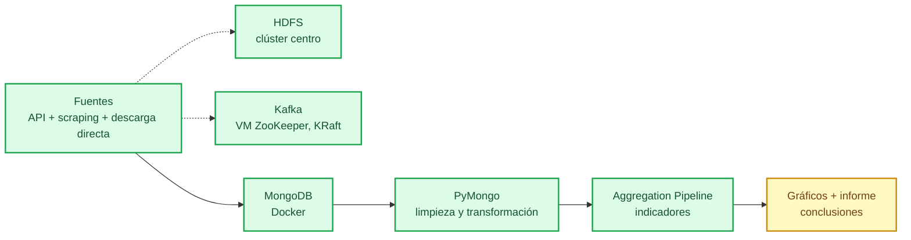
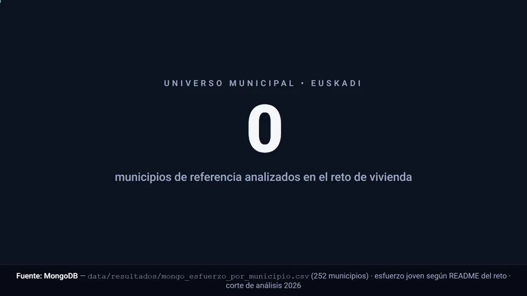
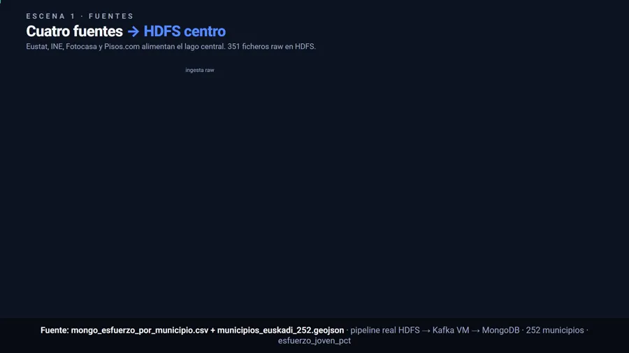

# bigdata-vivienda-euskadi — ¿Dónde pueden vivir los jóvenes en Euskadi?

Reto intermodal **SBD + BDA**: pipeline en Python que analiza la accesibilidad
de la vivienda para la población joven en Euskadi con datos reales, verificando
cada criterio contra la rúbrica del reto.

## 🎯 Objetivo

Responder con datos: ¿puede una persona joven independizarse en Euskadi con su
salario? ¿Qué municipios ofrecen mejores posibilidades de emancipación y por qué?
Todo el recorrido (extracción, almacenamiento, análisis, visualización) está en
Python y se verifica contra la rúbrica del reto.

## 🏗️ Arquitectura del pipeline



> 🟢 Extracción, Silver, MongoDB, HDFS centro y Kafka VM completados.
> 🟡 Pendiente solo el gate extremo a extremo y el informe/demo final.

### Modelo de datos (relaciones por `codigo_ine`)


## 📊 Estado del proyecto

| Fase | Entrega | Estado |
|---|---|---|
| 0 | Entorno + contrato + tests | ✅ Hecha |
| 1 | Extracción (scripts 01–06 + auxiliares) | ✅ Hecha |
| 1b | Salarios INE EPA (script 07) | ✅ Hecha |
| 1c | Pisos.com (script 08) | ✅ Hecha |
| 1d | Idealista/RealtyAPI (script 09) | ✅ Opcional, 84 anuncios |
| 2 | Descargas directas Open Data Euskadi (EMAL, Etxebide, GTFS) | ✅ Hecha |
| 3 | Transformaciones (entity resolution, dim_municipios, distancias, filtrado, enriquecimiento, geojson, metadata) | ✅ Hecha (parcial) |
| 3b | Cuarentena Silver + vistas de mercado + profiling + mapa esquema | ✅ Hecha |
| 4 | Docker Compose HDFS + MongoDB | ✅ Hecha (HDFS centro + Mongo local) |
| 5 | Subida HDFS + recuperación | ✅ Hecha (351 ficheros raw en /user/iabd-user15/bigdata_reto/vivienda_euskadi/data/raw, sin legacy) |
| 6 | Modelado + operaciones PyMongo | ✅ Hecha (13 colecciones, PyMongo) |
| 7 | Aggregation Pipeline | ✅ Hecha (8 pipelines) |
| 8 | Kafka productor/consumidor | ✅ Hecha (broker 4.3.1 KRaft en 9094, topic 3 particiones, productor JSON y consumidor con upsert) |
| 9 | Gráficos desde PyMongo | ✅ Hecha (CSV desde Mongo) |
| 10 | Informe, arquitectura y demo | 🟡 Parcial (arquitectura actualizada) |

Tests del contrato: `129 passed, 1 failed, 2 skipped` (132 collected, ver `pytest tests/ -q`; WP-19 incluido). El único fallo es el test P-08 preexistente por texto de contrato Operaciones PyMongo sin transcribir, ajeno a Kafka y HDFS.

## 📁 Estructura

```
bigdata-vivienda-euskadi/
├── tests/             Verificación del contrato
├── config/
│   └── fuentes.yaml   URLs, IDs, cobertura y notas de cada fuente
├── extract/           Extracción API, scraping y descargas directas
├── transform/         Limpieza y enriquecimiento (33 scripts)
├── storage/           PyMongo + HDFS central + Kafka VM (listos)
├── analysis/          Aggregation Pipeline (hecho, 8 pipelines)
├── visualization/     Gráficos (hecho, CSV desde Mongo)
├── notebooks/         Informe de resultados (pendiente)
├── data/raw/          Datos generados (ignorados por git, 355 archivos)
├── data/procesado/    Datos normalizados (ignorados por git, 185 archivos, manifest 182)
├── data/resultados/   Indicadores y gráficos (ignorados por git)
├── docs/              Documentación (índice en docs/README.md)
└── plan/              Planificación y decisiones
```

## 📈 Datos actuales (silver)

| Métrica | Valor |
|---|---:|
| Municipios de referencia | 252 |
| Archivos raw (bronce) | 355 (353 con hash en `docs/raw_manifest_sha256.txt`) |
| Archivos raw por tipo | CSV 128, JSON 61, HTML 101, ZIP 49, XLSX 6, GEOJSON 2, otros 7 |
| Archivos silver | 185 (manifest 182) |
| Anuncios unificados | 759 (491 larga estancia + 268 temporal) en 83 municipios |
| Anuncios residenciales | 491 en 75 municipios |
| Anuncios de habitaciones | 201 en 11 municipios |
| Municipios sin anuncios residenciales | 169 |
| Municipios robustos (n≥30) | 4 (Bilbao 173, Donostia 113, Getxo 40, Vitoria-Gasteiz 39) |
| Alquiler oficial Eustat | 159/252 (93 imputados por comarca) |
| Tests | 129 passed, 1 failed, 2 skipped (132 collected) |

## 🔍 Conclusiones del análisis (O1–O4)

- **O1 — ¿Puede un joven independizarse?** Esfuerzo joven mediano 43,5%; 100% de los 159 municipios con dato supera el 30%. Emancipación municipal no defendible (proxy renta). Puntuación 7/10.
- **O2 — ¿Qué municipios son viables?** Solo 4 robustos (n≥30): Bilbao 48020 n 173, Donostia 20069 n 113, Getxo 48044 n 40, Vitoria-Gasteiz 01059 n 39; resto Nivel2 (41) / Nivel3 (205). Ranking fino solo para los 4. 8/10.
- **O3 — ¿Trabajo + vivienda barata?** r(paro juvenil, alquiler)=+0,385 (no hay trade-off simple); r(densidad, alquiler)=+0,456; r(distancia mín. a capital, alquiler)=-0,603. 8/10.
- **O4 — ¿Limitaciones?** Proxy renta (falacia ecológica), 93 sin alquiler directo, solo 4 robustos, emancipación solo CAE, mezcla de años, ECVI solo territorial. 9/10.
- **Media global (42 preguntas):** 8,2/10.
- Renta como proxy salarial: Pearson renta–alquiler r≈0,28 (159 municipios).

## 📊 Artefactos visuales (data/resultados/)

- `mapa_esquema_silver.html` — grafo de relaciones entre 33 CSVs (PyVis, hubs: dim_municipios, anuncios_unificados).
- `auditoria_lagunas_silver.csv` — profiling de 33 CSVs (filas, nulos, cobertura/252 muns).
- `dashboard.html` / `dashboard_completo.html` — dashboards estáticos con conclusiones.
- 13 PNGs (g1–g5, A1–A2, B–G) — gráficos por bloques.
- `README.md` — índice de artefactos.

#### Demo KPI (8,5 s)

<p align="center">
  
</p>
<p align="center"><em>Demo KPI (8,5 s) — esfuerzo joven y ranking municipal (Bilbao 173 · Donostia 113 · Getxo 40 · Vitoria 39)</em></p>

#### Demo mapa Euskadi (8,5 s)

<p align="center">
  
</p>
<p align="center"><em>Demo mapa Euskadi (8,5 s) — pipeline HDFS→Kafka→Mongo + choropleth de 252 municipios y top robustos (Bilbao 173 · Donostia 113 · Getxo 40 · Vitoria 39)</em></p>

## 🚀 Puesta en marcha

### 1. Entorno Python

```bash
uv venv --python 3.12 .venv
uv pip install --python .venv/Scripts/python.exe -r requirements.txt
```

Variables de infraestructura (clúster centro y VM ZooKeeper):

```bash
export HDFS_URL=http://10.22.87.215:50070
export HDFS_USER=iabd-user15
export VM_HOST=192.168.201.162
export VM_KAFKA_PORT=9094
```

### 2. Descargar la cartografía municipal

```bash
curl -L -o data/raw/shp_euskadi.zip \
  "https://www.geo.euskadi.eus/cartografia/DatosDescarga/Limites/MUNICIPIOS_5000_ETRS89.zip"
cd data/raw && unzip -o shp_euskadi.zip -d shp_euskadi && cd ../..
```

### 3. Ejecutar la extracción completa

```bash
.venv/Scripts/python.exe extract/main_ingest.py
```

### 4. Verificar contra el contrato

```bash
.venv/Scripts/python.exe -m pytest tests -q
```

### 5. Regenerar artefactos visuales

```bash
.venv/Scripts/python.exe transform/generar_dashboard_visual.py
.venv/Scripts/python.exe transform/generar_dashboard_completo.py
.venv/Scripts/python.exe transform/generar_mapa_esquema.py
.venv/Scripts/python.exe transform/auditar_lagunas_silver.py
```

## 🗂️ Fuentes de datos

Todas verificadas en octubre de 2026. Ver `config/fuentes.yaml` para URLs e IDs
completos.

| Fuente | Tipo | Cobertura |
|---|---|---|
| Eustat bankupx API | API JSON | Población, renta, PIB, tenencia por municipio |
| Eustat ExtractorBlob | CSV/XLSX | Alquiler municipal (€/m², €/mes, m²) |
| INE wstempus API | API JSON | Población, hogares, precios de compraventa |
| INE EPA (salarios) | API JSON | Salarios por edad/decil (INE) |
| INE ECVI | XLSX | Transacciones de vivienda por territorio |
| euskadi.eus | CSV | Emancipación juvenil (16 indicadores) |
| Open Data Euskadi (geo.euskadi.eus) | SHP | Límites municipales + áreas funcionales |
| Open Data Euskadi (opendata.euskadi.eus) | ODS/CSV | EMAL, Etxebide VPO, GTFS, SEPE/Lanbide, certificados energéticos, centros educativos/sanitarios |
| b5m Gipuzkoa (GFA) | API/JSON | Catálogo municipal y distancias por carretera |
| OSRM | API | Tiempos de ruta a capitales |
| SERPAVI/MIVAU | CSV/JSON | Renta municipal basada en datos fiscales |
| LANBIDE / SEPE | Web/CSV | Paro registrado por municipio |
| Fotocasa | Scraping | ~470 anuncios reales de alquiler |
| Pisos.com | Scraping | ~218 anuncios de alquiler |
| RealtyAPI.io (Idealista, no oficial) | API | Opcional, 84 anuncios |
| INE Atlas de la renta | Descarga directa | Rellena municipios faltantes de renta |
| Udalmap (api.euskadi.eus) | API | Actividad, ocupación, paro Lanbide, VPO, renta... |
| HDFS clúster centro | Infraestructura | `HDFS_URL=http://10.22.87.215:50070`, `HDFS_USER=iabd-user15` (351 ficheros raw sin legacy) |
| Kafka VM ZooKeeper | Infraestructura | `VM_HOST=192.168.201.162`, `VM_KAFKA_PORT=9094` (broker 4.3.1 KRaft, topic 3 particiones) |

## ✅ Verificación

- Tests: `.venv/Scripts/python.exe -m pytest tests -q` (129 passed, 1 failed, 2 skipped)
- MongoDB (36 passed en la suite Mongo antes del cierre): `.venv/Scripts/python.exe storage/load_mongo.py` (13 colecciones, PyMongo, índices); `.venv/Scripts/python.exe scripts/run_mongo_pipeline.py` (carga + limpieza + índices + agregación); `.venv/Scripts/python.exe analysis/run_analisis_mongo.py` (8 pipelines a CSV); `.venv/Scripts/python.exe -m pytest tests/test_mongo.py -q` y `.venv/Scripts/python.exe -m pytest tests/test_mongo_geo.py tests/test_mongo_comparativa.py -q`
- CSVs desde Mongo en `data/resultados/`: `mongo_esfuerzo_por_municipio.csv` (252 filas), `mongo_alquiler_por_municipio.csv` (252), `mongo_modalidades.csv` (2), `comparativa_3_municipios_mongo.csv` (3, Bilbao 173, Donostia 113, Getxo 40). Ver `docs/modelo_mongodb.md` y `docs/arquitectura_datos.md`.
- Manifest de extracción: `data/raw/ingestion_manifest.json` (integridad SHA-256)
- Contrato de datos raw: `docs/contrato_datos_raw.md` — `data/raw/` es inmutable **por diseño**:
  solo `extract/` escribe ahí; `transform/` solo puede hacerlo vía `assert_raw_writable(reason)`
  (lista blanca de 2 scripts). Bloqueado por `tests/test_raw_guardrails.py`, no por convención.

## ⚠️ Cosas que faltan

- **HDFS:** listo en clúster centro `http://10.22.87.215:50070` con user `iabd-user15` y ruta `/user/iabd-user15/bigdata_reto/vivienda_euskadi/data/raw`. `storage/hdfs_utils.py` ahora lee `HDFS_URL` y `HDFS_USER` de entorno y sube el bronce sin legacy con estado en `data/_hdfs_state/hdfs_upload_raw.json`.
- **Kafka:** listo en VM ZooKeeper `192.168.201.162:9094` con broker 4.3.1 KRaft, `log.dirs` en `~/kafka-logs` y topic `anuncios_inmobiliarios` de 3 particiones. Productor y consumidor Python en `storage/kafka_producer.py` y `storage/kafka_consumer.py` con upsert idempotente y test `tests/test_kafka.py` buscando `KafkaConsumer` y `KafkaProducer` en modo desde VM.
- **Informe y demo:** pendiente. Aggregation Pipeline, indicadores y CSV desde Mongo hechos (`analysis/run_analisis_mongo.py`); falta informe/demo final.
- **Cobertura de anuncios (83/252, solo 4 con n≥30):** limitación principal del ranking municipal fino. Los municipios sin datos se marcan “sin dato”.
- **Alquiler oficial (159/252 sin dato):** completado parcialmente con alquiler comarcal para los 93 faltantes.
- **Paro: `tasa_paro_aprox_pct` invalidado** → usar `tasa_paro_lanbide_pct` del Udalmap/Lanbide.
- **Distancias completas (252×252):** generadas con Haversine, pero solo Gipuzkoa tiene distancia por carretera.

## 📚 Concepciones clave

- **Renta como proxy de capacidad económica:** no existe salario municipal por edad disponible gratuitamente en Euskadi. Se usa la renta media municipal (Eustat 2024) como proxy. Pearson renta–alquiler r≈0,28 (159 municipios).
- **Alquiler como eje, compraventa como contraste:** el criterio evalúa el alquiler; la compraventa aparece como dato complementario.
- **Correlación renta–alquiler débil:** la renta local explica poco el precio del alquiler. Otras variables explican más: oferta, demanda, turismo, distancia a capitales, tamaño del municipio.
- **Cobertura de anuncios:** n≥30 como umbral de robustez, “sin dato” como valor legítimo para municipios sin anuncios.
- **Temporal vs larga estancia:** no mezclar. Los anuncios de alquiler temporal tienen un precio ~24% mayor.
- **Paro y actividad:** fuente oficial municipal (Udalmap + Lanbide). `tasa_paro_aprox_pct` invalidado → usar `tasa_paro_lanbide_pct`.

## 📖 Documentación

Ver `docs/README.md` para el índice completo de documentos vigentes y `argon/` para la copia de revisión externa.

## 🔁 Flujo extremo a extremo

El flujo actual es: fuente a silver a HDFS centro a Kafka VM a Mongo local a agregación a visualización. HDFS es la memoria de originales con recuperación SHA, Kafka es el grifo con mensajes JSON y Mongo es la base analítica.
El gate de Integración pendiente es subir el bronce, publicar mensajes, consumir a Mongo con upsert y verificar código INE común sin intervención manual en Mongo.

## ⚠️ Puntos débiles (limitaciones defendibles)

- Cobertura de anuncios: solo 83/252 municipios, 4 robustos (n≥30). Ranking municipal fino no defendible para la mayoría.
- Alquiler oficial: solo 159/252; 93 imputados por comarca (no municipal).
- Proxy renta (falacia ecológica): renta municipal aplicada homogéneamente, no captura precariedad juvenil.
- Emancipación solo a nivel CAE, no municipal.
- Mezcla de años: anuncios 2026 vs alquiler/renta 2024.
- VPO 83.73% ceros: sin stock real.
- ECVI solo territorial/área funcional, no municipal.
- Correlaciones laborales débiles/espurias: paro-alquiler r≈0,385 (conteos) / 0,146 (tasas); afiliación SS vs alquiler ≈-0,011.
- Infraestructura: MongoDB hecho (13 colecciones, 8 pipelines), HDFS centro y Kafka VM listos y documentados, falta solo el gate extremo a extremo y la demo final.
- Distancias por carretera solo Gipuzkoa; Álava/Bizkaia por Haversine.
