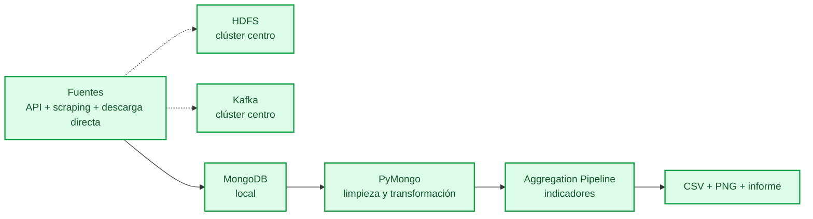
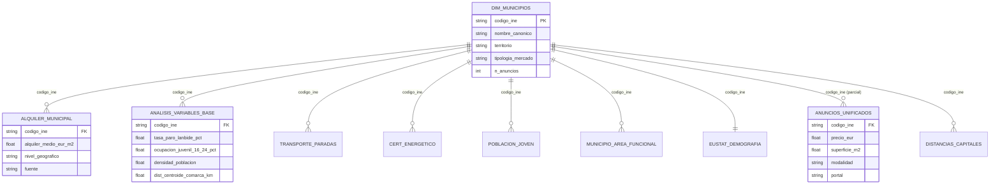

# bigdata-vivienda-euskadi — ¿Dónde pueden vivir los jóvenes en Euskadi?

Pipeline en Python para el reto intermodal **SBD + BDA**: extrae datos reales, publica
los originales en HDFS vía Kafka, los modela en MongoDB y responde con indicadores
verificables contra el contrato del reto.

> **Respuesta corta.** El esfuerzo mediano de un joven de 18–34 años es **26,61 %** de
> su salario en los 159 municipios con alquiler oficial; **40 de 159** superan el
> umbral del 30 %. El ranking municipal fino solo es defendible en **4 municipios**
> con n≥30 anuncios.
>
> **Estado.** Pipeline completo (extracción → silver → MongoDB → gold) e informe y
> demo entregados. Última revisión de este README: **2026-11-13**.

## Índice

1. [Qué responde](#1-qué-responde)
2. [Puesta en marcha](#2-puesta-en-marcha)
3. [Arquitectura](#3-arquitectura)
4. [Estado del proyecto](#4-estado-del-proyecto)
5. [Datos y cifras](#5-datos-y-cifras)
6. [Verificación](#6-verificación)
7. [Límites y criterios](#7-límites-y-criterios)
8. [Documentación](#8-documentación)
9. [Problemas frecuentes](#9-problemas-frecuentes)
10. [Contexto](#10-contexto)

## 1. Qué responde

| Pregunta | Respuesta | Límite |
|---|---|---|
| **O1 — ¿Puede un joven independizarse?** | No de forma general: mediana **26,61 %** del salario; **40/159** municipios oficiales por encima del 30 %. Sensibilidad IDW-252: **25,37 %** (47/252). | La renta municipal es un proxy; no hay salario individual por edad. |
| **O2 — ¿Qué municipios son viables?** | Solo **4** con n≥30 anuncios: Bilbao (204), Donostia (126), Getxo (50) y Vitoria-Gasteiz (39). | El resto es indicativo (Nivel 2/3); no se rankea. |
| **O3 — ¿Trabajo y vivienda barata?** | No hay trade-off simple: paro y precio suben juntos donde hay demanda, y la correlación más fuerte es con la distancia a la capital (negativa). | Correlación, no causalidad; se usan conteos de paro, no tasas. |
| **O4 — ¿Qué límites tiene?** | 93 municipios sin alquiler directo, mezcla de años, emancipación solo a nivel CAE y falacia ecológica. | Detalle en [§7](#7-límites-y-criterios). |

## 2. Puesta en marcha

Requisitos: **Python 3.12**, [uv](https://docs.astral.sh/uv/), **MongoDB local** en
`localhost:27017` y red para la extracción viva y el clúster del centro.

> En Linux/macOS sustituye `.venv/Scripts/python.exe` por `.venv/bin/python`.

```bash
uv venv --python 3.12 .venv
uv pip install --python .venv/Scripts/python.exe -r requirements.txt
cp .env.example .env          # ajusta MONGO_*, HDFS_*, KAFKA_* y GATE_LIVE
```

Descarga la cartografía municipal:

```bash
curl -L -o data/raw/shp_euskadi.zip \
  "https://www.geo.euskadi.eus/cartografia/DatosDescarga/Limites/MUNICIPIOS_5000_ETRS89.zip"
cd data/raw && unzip -o shp_euskadi.zip -d shp_euskadi && cd ../..
```

Extrae los originales. `--mode replay-raw` valida los SHA sin red:

```bash
.venv/Scripts/python.exe extract/main_ingest.py
.venv/Scripts/python.exe extract/main_ingest.py --mode replay-raw
```

Reconstruye por capas. La fase `mongo` es **destructiva** (recarga la base) y exige
`--allow-mongo-write`; el resto no toca `data/raw`:

```bash
.venv/Scripts/python.exe scripts/run_pipeline.py --fase silver,quality
.venv/Scripts/python.exe scripts/run_pipeline.py --fase mongo --allow-mongo-write
.venv/Scripts/python.exe scripts/run_pipeline.py --fase gold
```

`--fase all` equivale a `silver,quality,gold` y **nunca** incluye `mongo`.
`--dry-run` lista el plan y `--check` valida los hashes de raw y silver.

## 3. Arquitectura



Flujo en una línea:
`Fuentes → extract/ → data/raw [inmutable] → transform/ → data/procesado [silver] → storage/load_mongo.py → MongoDB → analysis/run_analisis_mongo.py → data/resultados [gold]`.

**Dos ramas sobre los mismos originales.** La rama analítica va de raw a MongoDB y de
ahí a gold. La rama de archivo publica `data/raw` en HDFS: `storage/kafka_raw_producer.py`
emite un manifiesto `{rel, size, sha256}` y `storage/kafka_hdfs_uploader.py` consume y
sube, descartando por SHA lo que ya coincide. **Kafka no escribe en Mongo**: la carga
analítica es batch.

**BDA y MongoDB.** Servidor 9.0.2 standalone local, sin replica set: atomicidad de
documento único e idempotencia por lotes, sin transacciones multidocumento. La unidad
de integración es `codigo_ine` de 5 dígitos. Hay **11 pipelines** en `PIPELINE_ORDER`
más `pipeline_esfuerzo_mercado_2026` fuera de orden; **10 índices** definidos en
`analysis/mongo_indexes.py`, de los que **8** están materializados. Los índices ESR
`{ubicacion.codigo_ine: 1, modalidad: 1, precio_eur: 1}` convierten la consulta
canónica de `COLLSCAN` (594 examinados) a `IXSCAN` (1 examinado);
`explain_before_after()` lo demuestra en solo lectura.

### Modelo de datos (relaciones por `codigo_ine`)



> **HDFS: solo `raw` (excepción acordada con la profesora).** Se publican los 353
> ficheros canónicos de `data/raw`; `data/procesado` **no** se sube. El criterio se
> cubre con la organización de originales, la recuperación verificada con
> `scripts/hdfs_recuperacion_un_fichero.py` (cotejo de tamaño y SHA, solo lectura) y
> el `GETCONTENTSUMMARY /data/raw` en vivo (353 ficheros, 895.597.901 B).
>
> `data/raw/` es inmutable **por diseño**: solo `extract/` escribe ahí; `transform/`
> necesita `assert_raw_writable(reason)` y está bloqueado por
> `tests/test_raw_guardrails.py`, no por convención.

## 4. Estado del proyecto

| Fase | Entrega | Estado |
|---|---|---|
| 0 | Entorno + contrato + tests | ✅ |
| 1 | Extracción (scripts 01–26 + auxiliares) | ✅ |
| 2 | Descargas directas Open Data Euskadi (EMAL, Etxebide, GTFS, VPO) | ✅ |
| 3 | Transformaciones, cuarentena Silver, vistas de mercado y profiling | ✅ |
| 4 | HDFS centro + MongoDB local | ✅ |
| 5 | Subida a HDFS + recuperación SHA | ✅ |
| 6 | Modelado + operaciones PyMongo | ✅ |
| 7 | Aggregation Pipeline (11 pipelines) | ✅ |
| 8 | Kafka productor/consumidor | ✅ |
| 9 | Gráficos e indicadores desde PyMongo | ✅ |
| 10 | Informe, arquitectura y demo | ✅ |

La entrega incluye `openspec/archive/2026-11-10-docs/informe_final.md`, el deck de
defensa (`docs/presentacion/`) y el deck v2 con guion y PDF
(`docs/presentacion_v2/`).

## 5. Datos y cifras

Cada cifra tiene una única fuente; el resto del documento no las repite.

| Métrica | Valor | Fuente |
|---|---:|---|
| Municipios de referencia | 252 | `data/procesado/dim_municipios.csv` |
| Raw en disco | 357 (355 sin `.FROZEN`/`.gitkeep`) | `find data/raw -type f` |
| Raw canónico en HDFS | 353 | `GETCONTENTSUMMARY /data/raw` |
| Manifest raw | 355 SHA | `docs/raw_manifest_sha256.txt` |
| Silver | 183 entradas de manifest (187 ficheros en disco, 65 en `_meta`) | `data/procesado/manifest_sha256.txt` |
| Anuncios unificados | 594: 326 larga estancia (53 muns) + 268 temporal (38 muns); 64 muns con anuncio | Mongo `anuncios`, `data/resultados/mongo_modalidades.csv` |
| Habitaciones | 201 en 9 municipios | Mongo `anuncios_habitaciones_unificados` |
| Municipios sin anuncio | 188 | `data/resultados/mongo_tier_confianza.csv` |
| Precio observable | 60/252 | `data/resultados/mongo_esfuerzo_por_municipio.csv` (`precio_medio_eur`) |
| Alquiler oficial | 159/252; 93 imputados por comarca | `data/resultados/mongo_esfuerzo_por_municipio.csv`, `data/resultados/mongo_alquiler_por_municipio.csv` |
| Tier A/B/C/D | 4 / 3 / 57 / 188 | `data/resultados/mongo_tier_confianza.csv` |
| Tipología de mercado | Nivel 1: 4 / Nivel 2: 54 / Nivel 3: 194 | `data/procesado/dim_municipios.csv` |
| VPO | 406 promociones; `NumViviendas` vacío en 406/406 | Mongo `etxebide_promociones` |
| MongoDB | 17 colecciones vivas + 15 `__backup` = 32; 8/10 índices | PyMongo `list_collection_names()`, `list_indexes()` |
| Pipelines / export | 11 en `PIPELINE_ORDER` + 1 fuera de orden; 8 CSV `mongo_*` | `analysis/run_analisis_mongo.py` |
| Gold | 53 artefactos (24 CSV + 29 PNG) + 8 PNG en `anexo/` | `data/resultados/` |
| Tests | 285 passed, 2 skipped (287 collected) | `pytest tests` |

> **353 vs 355 vs 357.** El manifest tiene 355 entradas (351 canónicas + 4 de
> `legacy_obsoleto_no_usar/`); el canónico publicado en HDFS es 353 porque incluye
> `.FROZEN` y `.gitkeep`, que el manifest excluye; en disco hay 357 ficheros contando
> los dos ocultos. **183 vs 187.** El manifest cuenta 183 entradas (incluye 65 sidecars
> `_meta`); `find` ve además `data/procesado/manifest_sha256.txt`,
> `data/procesado/run_manifest.json`, `data/procesado/log_filtrado.txt` y `.gitkeep`.
>
> `viviendas = 0` en VPO significa **«sin dato»**: `NumViviendas` viene vacío en todas
> las promociones; no es stock cero. Los municipios sin anuncios se marcan «sin dato»,
> no se imputan.

## 6. Verificación

```bash
.venv/Scripts/python.exe -m pytest tests
.venv/Scripts/python.exe scripts/verificar_gobernanza.py
.venv/Scripts/python.exe scripts/gate_extremo_a_extremo.py --offline
.venv/Scripts/python.exe scripts/run_pipeline.py --check
.venv/Scripts/python.exe scripts/verificar_fase_datos.py
.venv/Scripts/python.exe scripts/verificar_cifras_deck.py
.venv/Scripts/python.exe transform/run_all.py --check
```

Resultados esperados a 2026-11-13:

| Comando | Salida |
|---|---|
| `pytest tests` | `285 passed, 2 skipped` |
| `verificar_gobernanza.py` | `TODO OK`: 53 cabeceras / 49 con ID, 47 scripts / 40 nodos DAG, 183 silver, 0 env sin declarar, 11 pipelines |
| `gate_extremo_a_extremo.py --offline` | `RESULTADO gate: OK` (355 SHA, 183 silver, 15 colecciones, 0 duplicados, lag 0) |
| `run_pipeline.py --check` | 355 y 183 entradas, 0 errores |
| `verificar_fase_datos.py` | 21 PASS y **1 FAIL 07 conocido**: paro-cero en Aramaio 0,28 / Gaintza 1,45 / Usansolo 3,26, documentado sin imputar |
| `verificar_cifras_deck.py` | `44/44 comprobaciones pasan` |
| `transform/run_all.py --check` | Todo `[OK]` salvo `auditoria_lagunas_silver.csv`; sale con **rc 1** por esa salida (ver huecos) |

**Huecos declarados, no enmascarados:**

- `auditoria_lagunas_silver.csv` es salida del DAG pero **no está materializada** en
  este checkout; por eso `run_all.py --check` devuelve rc 1. Regenerarla mueve el gold
  de 53 a 54 y obliga a rehacer el deck, así que se deja como pendiente explícita.
- Los 2 índices de `esfuerzo_mercado_2026` no están creados; los otros 8 sí.
- El `OPEN` de WebHDFS depende del DNS de los datanodes. Hoy
  `scripts/hdfs_recuperacion_un_fichero.py` devuelve `HDFS_REC OK SHA_TAMANO_IGUALES`; si el
  DNS falla, devuelve `HDFS_NO_ALCANZABLE` y el `ContentSummary` sigue funcionando.
- El topic antiguo `anuncios_inmobiliarios` **sigue existiendo** en el broker (1
  partición, RF 1, 1.420 mensajes; los leídos llevan `key=test_key` y un payload de
  prueba como `{"precio":850,"municipio":"Bilbao"}`). No se usa en la cadena vigente.

## 7. Límites y criterios

### Criterios metodológicos

- El **alquiler** es el eje del análisis; la compraventa (ECVI) solo contrasta.
- **Temporal y larga estancia** se reportan por separado; no se mezclan.
- **n≥30 anuncios** es el umbral de robustez; «sin dato» es un valor legítimo, no un cero.
- La **renta municipal** es un proxy de capacidad económica, no un salario individual.

### Límites

- **Cobertura de anuncios:** 64/252 municipios con anuncio y 60/252 con precio
  observable. Solo 4 permiten ranking fino; el resto es «sin dato».
- **Alquiler oficial:** 159/252. Los 93 restantes se imputan por comarca, no a nivel
  municipal.
- **Proxy de renta (falacia ecológica):** la renta municipal se aplica homogéneamente
  y no captura la precariedad juvenil.
- **Emancipación:** solo hay dato a nivel CAE, no municipal.
- **Mezcla de años:** anuncios 2026 frente a renta y alquiler 2024.
- **VPO:** el flujo oficial municipal se integra aparte; `NumViviendas` no es stock.
- **ECVI:** solo territorial o por área funcional, no municipal.
- **Distancias:** por carretera solo en Gipuzkoa; Álava y Bizkaia usan Haversine.
- **Paro:** `tasa_paro_aprox_pct` está invalidado; se usa `tasa_paro_lanbide_pct`.

## 8. Documentación

| Ruta | Qué contiene |
|---|---|
| `docs/README.md` | Índice de lo que queda en `docs/` |
| `docs/raw_manifest_sha256.txt` | SHA-256 canónico de los raw (355) |
| `docs/presentacion/` | Deck de defensa v1 (13 diapositivas + PDF) |
| `docs/presentacion_v2/` | Deck v2 (22 + 8 backups), guion y PDF |
| `data/resultados/README.md` | Índice del gold y de los 8 CSV `mongo_*` |
| `openspec/specs/contrato-reto/spec.md` | Contrato: 19 criterios C1–C19 y 21 requisitos |
| `openspec/archive/2026-11-10-docs/` | `modelo_mongodb.md`, `arquitectura_datos.md`, `contrato_datos_raw.md`, `informe_final.md` |
| `openspec/audit/` | Auditorías y evidencia viva (HDFS, Kafka, MongoDB) |
| `scripts/` | Orquestadores y gates (`run_pipeline`, `gate_extremo_a_extremo`, `verificar_gobernanza`) |

`vaultVivienda/` es una copia local de estudio **no versionada** (`.gitignore`): no
forma parte del repositorio y no se cita como fuente. La documentación versionada por
colección está en `openspec/archive/2026-11-10-docs/modelo_mongodb.md`.

## 9. Problemas frecuentes

| Síntoma | Causa | Acción |
|---|---|---|
| `ping=False` o timeout de Mongo | MongoDB no está arrancado | Arranca `mongod` y comprueba `MONGO_HOST`/`MONGO_PORT`; `run_mongo_pipeline.py --dry-run` |
| `NameResolutionError hadoop-worker*` | DNS de los datanodes | Añade los hosts o usa la IP; el `ContentSummary` no depende del `OPEN` |
| `NodeNotReadyError` en Kafka | Broker sin metadata | Reintenta y recrea el topic con `scripts/ensure_topic.py` |
| `.env` no se aplica | Ejecución fuera de la raíz | Lanza los scripts desde la raíz del repositorio |
| `pytest` no imprime el resumen | Doble `-q` (`pyproject` ya añade uno) | Usa `pytest tests` sin `-q` |
| `--fase mongo` aborta | Fase destructiva sin permiso | Añade `--allow-mongo-write` solo si quieres recargar la base |

## 10. Contexto

Proyecto académico del reto intermodal **SBD + BDA** (Euskadi, 2026). Todas las fuentes
son públicas y están documentadas en `config/fuentes.yaml`. El repositorio no incluye
fichero `LICENSE`; el uso previsto es académico.
