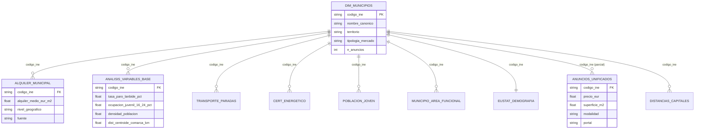

# bigdata-vivienda-euskadi — ¿Dónde pueden vivir los jóvenes en Euskadi?

Reto intermodal **SBD + BDA**: pipeline en Python que analiza la accesibilidad
de la vivienda para la población joven en Euskadi con datos reales, midiendo cada
criterio contra el contrato OpenSpec de `openspec/specs/contrato-reto/spec.md`.

## 🎯 Objetivo

Responder con datos: ¿puede una persona joven independizarse en Euskadi con su
salario? ¿Qué municipios ofrecen mejores posibilidades de emancipación y por qué?
Todo el recorrido (extracción, almacenamiento, análisis, visualización) está en
Python y se verifica contra la rúbrica del reto.

## 🏗️ Arquitectura del pipeline

```mermaid
flowchart LR
    accTitle: Pipeline de datos vivienda Euskadi
    accDescr: Flujo de fuentes a resultados: extraccion, HDFS, Kafka, MongoDB, limpieza, agregacion, visualizacion.

    src["Fuentes<br/>API + scraping + descarga directa"]
    hdfs["HDFS<br/>originales y procesados"]
    kafka["Kafka<br/>VM Ubuntu, KRaft"]
    mongo["MongoDB<br/>Docker"]
    clean["PyMongo<br/>limpieza y transformación"]
    agg["Aggregation Pipeline<br/>indicadores"]
    viz["Gráficos + informe<br/>conclusiones"]

    src --> hdfs --> kafka --> mongo --> clean --> agg --> viz

    classDef done fill:#dcfce7,stroke:#16a34a,stroke-width:2px,color:#14532d
    classDef partial fill:#fef9c3,stroke:#ca8a04,stroke-width:2px,color:#713f12
    classDef todo fill:#fee2e2,stroke:#dc2626,stroke-width:2px,color:#7f1d1d
    class src done
    class hdfs,kafka,mongo,clean,agg,viz todo
```



> 🟢 Extracción y Silver completados. 🟡 Infraestructura y análisis pendientes.

### Modelo de datos (relaciones por `codigo_ine`)



## 📊 Estado del proyecto

| Fase | Entrega | Estado |
|---|---|---|
| 0 | Entorno + contrato + tests | ✅ Hecha |
| 1 | Extracción (scripts 01–06 + auxiliares) | ✅ Hecha |
| 1b | Salarios INE EPA (script 07) | ✅ Hecha |
| 1c | Pisos.com (script 08) | ✅ Hecha |
| 1d | Idealista/RealtyAPI (script 09) | ✅ Opcional, 139 anuncios |
| 2 | Descargas directas Open Data Euskadi (EMAL, Etxebide, GTFS) | ✅ Hecha |
| 3 | Transformaciones (entity resolution, dim_municipios, distancias, filtrado, enriquecimiento, geojson, metadata) | ✅ Hecha (parcial) |
| 3b | Cuarentena Silver + vistas de mercado + profiling + mapa esquema | ✅ Hecha |
| 4 | Docker Compose HDFS + MongoDB | ⬜ Pendiente |
| 5 | Subida HDFS + recuperación | ⬜ Pendiente |
| 6 | Modelado + operaciones PyMongo | ⬜ Pendiente |
| 7 | Aggregation Pipeline | ⬜ Pendiente |
| 8 | Kafka productor/consumidor | ⬜ Pendiente |
| 9 | Gráficos desde PyMongo | ⬜ Pendiente |
| 10 | Informe, arquitectura y demo | ⬜ Pendiente |

Tests del contrato: `59 passed, 0 xfail`.

## 📁 Estructura

```
bigdata-vivienda-euskadi/
├── openspec/          Contrato y specs (la verdad)
├── tests/             Verificación del contrato
├── config/
│   └── fuentes.yaml   URLs, IDs, cobertura y notas de cada fuente
├── extract/           Extracción API, scraping y descargas directas
├── transform/         Limpieza y enriquecimiento (33 scripts)
├── storage/           HDFS, Kafka, MongoDB (pendiente)
├── analysis/          Aggregation Pipeline (pendiente)
├── visualization/     Gráficos (pendiente)
├── notebooks/         Informe de resultados (pendiente)
├── data/raw/          Datos generados (ignorados por git, 317 archivos)
├── data/procesado/    Datos normalizados (ignorados por git, 101 archivos)
├── data/resultados/   Indicadores y gráficos (ignorados por git)
├── docs/              Documentación (índice en docs/README.md)
└── plan/              Planificación y decisiones
```

## 📈 Datos actuales (silver)

| Métrica | Valor |
|---|---:|
| Municipios de referencia | 252 |
| Archivos raw (bronce) | 317 |
| Archivos silver | 101 |
| Anuncios unificados | 873 (570 residencial + 303 temporal) en 84 municipios |
| Anuncios residenciales | 570 en 76 municipios |
| Anuncios de habitaciones | 201 en 11 municipios |
| Municipios sin anuncios residenciales | 176 |
| Municipios robustos (n≥30) | 6 (Bilbao, Donostia, Vitoria-Gasteiz, Getxo, Abanto, Ayala) |
| Alquiler oficial Eustat | 159/252 (93 imputados por comarca) |
| Tests | 59 passed |

## 🔍 Conclusiones del análisis (O1–O4)

- **O1 — ¿Puede un joven independizarse?** Esfuerzo joven mediano 43,5%; 100% de los 159 municipios con dato supera el 30%. Emancipación municipal no defendible (proxy renta). Puntuación 7/10.
- **O2 — ¿Qué municipios son viables?** Solo 6 robustos (n≥30); resto Nivel2 (41) / Nivel3 (205). Ranking fino solo para los 6. 8/10.
- **O3 — ¿Trabajo + vivienda barata?** r(paro juvenil, alquiler)=+0,385 (no hay trade-off simple); r(densidad, alquiler)=+0,456; r(distancia mín. a capital, alquiler)=-0,603. 8/10.
- **O4 — ¿Limitaciones?** Proxy renta (falacia ecológica), 93 sin alquiler directo, solo 6 robustos, emancipación solo CAE, mezcla de años, ECVI solo territorial. 9/10.
- **Media global (42 preguntas):** 8,2/10.
- Renta como proxy salarial: Pearson renta–alquiler r≈0,28 (159 municipios).

## 📊 Artefactos visuales (data/resultados/)

- `mapa_esquema_silver.html` — grafo de relaciones entre 33 CSVs (PyVis, hubs: dim_municipios, anuncios_unificados).
- `auditoria_lagunas_silver.csv` — profiling de 33 CSVs (filas, nulos, cobertura/252 muns).
- `dashboard.html` / `dashboard_completo.html` — dashboards estáticos con conclusiones.
- 18 PNGs (g1–g5, A1–A2, B–G) — gráficos por bloques.
- `README.md` — índice de artefactos.

## 🚀 Puesta en marcha

### 1. Entorno Python

```bash
uv venv --python 3.12 .venv
uv pip install --python .venv/Scripts/python.exe -r requirements.txt
```

### 2. Descargar la cartografía municipal

```bash
curl -L -o data/raw/shp_euskadi.zip \
  "https://www.geo.euskadi.eus/cartografia/DatosDescarga/Limites/MUNICIPIOS_5000_ETRS89.zip"
cd data/raw && unzip -o shp_euskadi.zip -d shp_euskadi && cd ../..
```

### 3. Ejecutar la extracción completa

```bash
.venv/Scripts/python.exe extract/main_ingest.py
```

### 4. Verificar contra el contrato

```bash
.venv/Scripts/python.exe -m pytest tests -q
```

### 5. Regenerar artefactos visuales

```bash
.venv/Scripts/python.exe transform/generar_dashboard_visual.py
.venv/Scripts/python.exe transform/generar_dashboard_completo.py
.venv/Scripts/python.exe transform/generar_mapa_esquema.py
.venv/Scripts/python.exe transform/auditar_lagunas_silver.py
```

## 📜 Contrato de requisitos (OpenSpec)

La implementación está atada a la rúbrica del reto. El contrato vive en
`openspec/` y **manda sobre el código**:

| Fichero | Contenido |
|---|---|
| `openspec/specs/contrato-reto/spec.md` | **La verdad.** Rúbrica literal + 18 requisitos + prohibiciones |
| `openspec/specs/extraccion-datos/spec.md` | Extracción API y scraping |
| `openspec/specs/almacenamiento-y-streaming/spec.md` | HDFS, Kafka, integración |
| `openspec/specs/mongodb-y-analisis/spec.md` | Modelado, PyMongo, consultas, agregación |
| `openspec/specs/presentacion-de-resultados/spec.md` | Gráficos, datos, presentación |

**Regla de oro:** antes de escribir código se lee `openspec/specs/contrato-reto/spec.md`.

## 🗂️ Fuentes de datos

Todas verificadas en octubre de 2026. Ver `config/fuentes.yaml` para URLs e IDs
completos.

| Fuente | Tipo | Cobertura |
|---|---|---|
| Eustat bankupx API | API JSON | Población, renta, PIB, tenencia por municipio |
| Eustat ExtractorBlob | CSV/XLSX | Alquiler municipal (€/m², €/mes, m²) |
| INE wstempus API | API JSON | Población, hogares, precios de compraventa |
| euskadi.eus | CSV | Emancipación juvenil (16 indicadores) |
| Open Data Euskadi (geo.euskadi.eus) | SHP | Límites municipales Euskadi completo (251) |
| Open Data Euskadi (opendata.euskadi.eus) | ODS/CSV | EMAL, Etxebide VPO, GTFS, SEPE/Lanbide, certificados energéticos |
| LANBIDE | Web/CSV | Paro registrado por municipio |
| Fotocasa | Scraping | ~470 anuncios reales de alquiler |
| Pisos.com | Scraping | ~218 anuncios de alquiler |
| Idealista (RealtyAPI) | API | Opcional, 139 anuncios |
| INE Atlas de la renta | Descarga directa | Rellena 51 municipios faltantes |
| Udalmap (api.euskadi.eus) | API | Actividad, ocupación, paro Lanbide, VPO, renta... |

## ✅ Verificación

- Contrato: `openspec/specs/contrato-reto/spec.md`
- Tests: `.venv/Scripts/python.exe -m pytest tests -q`
- Manifest de extracción: `data/raw/ingestion_manifest.json` (integridad SHA-256)

## ⚠️ Cosas que faltan

- **Infraestructura (HDFS + MongoDB + Kafka):** pendiente. Docker Desktop arrancado, `docker-compose.yml` por escribir. Kafka en VM Ubuntu Server.
- **Análisis (Aggregation Pipeline + indicadores + gráficos + informe):** pendiente. Depende de MongoDB levantado.
- **Cobertura de anuncios (76/252, solo 6 con n≥30):** limitación principal del ranking municipal fino. Los municipios sin datos se marcan “sin dato”.
- **Alquiler oficial (159/252 sin dato):** completado parcialmente con alquiler comarcal para los 93 faltantes.
- **Paro: `tasa_paro_aprox_pct` invalidado** → usar `tasa_paro_lanbide_pct` del Udalmap/Lanbide.
- **Distancias completas (252×252):** generadas con Haversine, pero solo Gipuzkoa tiene distancia por carretera.

## 📚 Concepciones clave

- **Renta como proxy de capacidad económica:** no existe salario municipal por edad disponible gratuitamente en Euskadi. Se usa la renta media municipal (Eustat 2024) como proxy. Pearson renta–alquiler r≈0,28 (159 municipios).
- **Alquiler como eje, compraventa como contraste:** el criterio evalúa el alquiler; la compraventa aparece como dato complementario.
- **Correlación renta–alquiler débil:** la renta local explica poco el precio del alquiler. Otras variables explican más: oferta, demanda, turismo, distancia a capitales, tamaño del municipio.
- **Cobertura de anuncios:** n≥30 como umbral de robustez, “sin dato” como valor legítimo para municipios sin anuncios.
- **Temporal vs larga estancia:** no mezclar. Los anuncios de alquiler temporal tienen un precio ~24% mayor.
- **Paro y actividad:** fuente oficial municipal (Udalmap + Lanbide). `tasa_paro_aprox_pct` invalidado → usar `tasa_paro_lanbide_pct`.

## 📖 Documentación

Ver `docs/README.md` para el índice completo de documentos vigentes y `argon/` para la copia de revisión externa.

## ⚠️ Puntos débiles (limitaciones defendibles)

- Cobertura de anuncios: solo 76/252 municipios, 6 robustos (n≥30). Ranking municipal fino no defendible para la mayoría.
- Alquiler oficial: solo 159/252; 93 imputados por comarca (no municipal).
- Proxy renta (falacia ecológica): renta municipal aplicada homogéneamente, no captura precariedad juvenil.
- Emancipación solo a nivel CAE, no municipal.
- Mezcla de años: anuncios 2026 vs alquiler/renta 2024.
- VPO 93,6% ceros: sin stock real.
- ECVI solo territorial/área funcional, no municipal.
- Correlaciones laborales débiles/espurias: paro-alquiler r≈0,385 (conteos) / 0,146 (tasas); afiliación SS vs alquiler ≈-0,011.
- Infraestructura pendiente: HDFS, MongoDB, Kafka no implementados.
- Distancias por carretera solo Gipuzkoa; Álava/Bizkaia por Haversine.
