# ¿Dónde puede vivir un joven en Euskadi?

**252 municipios. 159 con alquiler oficial. 93 con un hueco declarado. 4 donde el ranking aguanta.**

`bigdata-vivienda-euskadi` es un pipeline de datos de principio a fin: extrae 1.828 anuncios y
series públicas, los congela con hash, los modela en MongoDB y produce las cifras de un informe,
un deck de 26 diapositivas y este README. Ninguna cifra está escrita a mano; un verificador compara
159 comprobaciones contra los CSV del gold y falla si algo deja de cuadrar.

[English version](README.en.md) · Última revisión: 2026-11-16

[](https://github.com/mikelrh-dev/bigdata-vivienda-euskadi/actions/workflows/quality-gate.yml)

| | |
|---|---|
| Stack | Python 3.12, MongoDB 9.0.2, Kafka, HDFS/WebHDFS, pandas, matplotlib |
| Escala | 355 ficheros raw (895 MB en HDFS), 183 entradas silver, 17 colecciones, 55 artefactos gold |
| Calidad | 298 tests, 159/159 comprobaciones de cifras, 56 figuras selladas por vintage |
| Entregables | Memoria en 4 formatos, deck de 26 diapositivas + 12 backups, auditoría v13 (2026-11-15): 184/190 (96,8 %), SBD 100 %, Tema 8 9,40/10 |

## 1. El problema, en una cifra

Para saber si un joven puede emanciparse hay que dividir dos cosas que nadie publica juntas: lo que
cuesta un alquiler y lo que ingresa alguien de 18 a 34 años. En Euskadi hay 252 municipios y la
respuesta adopta cuatro formas según lo que exista en cada uno.

En **159** hay alquiler registrado por Eustat y se puede calcular. En **93** no lo hay: se rellenan
por interpolación desde los vecinos, se pintan rayados y se usan solo como sensibilidad. En **188**
no hay ni un anuncio, y se escribe «sin dato» en lugar de cero. En **4** hay anuncios suficientes
para ordenar municipios sin que el orden sea ruido.

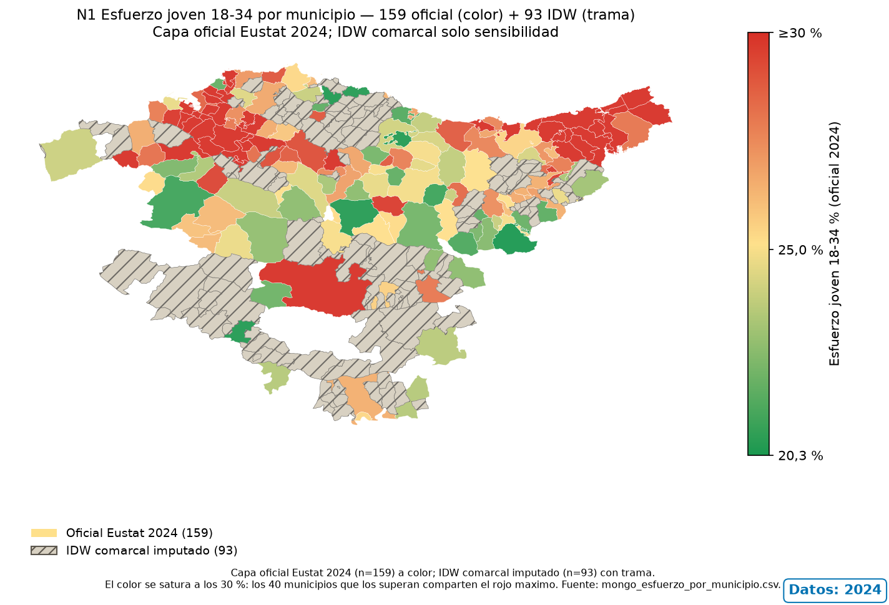

*Esfuerzo 18–34 en 2024 (n=159). La escala va del 20,3 % al 30 % o más, con el color saturado a
partir del umbral. La trama son los 93 municipios imputados por IDW.*

La mediana es **26,61 %** de la renta anual sobre los 159 municipios con alquiler oficial; sobre los 252 da 25,37 %. Cuarenta municipios superan el 30 % y catorce el 35 %.
El indicador mide esfuerzo y no precio, y eso reordena el mapa: Barakaldo encabeza con 746 € de
alquiler frente a los 995 € de Donostia, porque su renta es bastante más baja.

## 2. Quién no puede pagar

El ranking completo con umbral dibujado deja ver dos cosas que un promedio esconde: la brecha entre
el primero y el decimocuarto es de 3 puntos, y los catorce están en Bizkaia o Gipuzkoa.

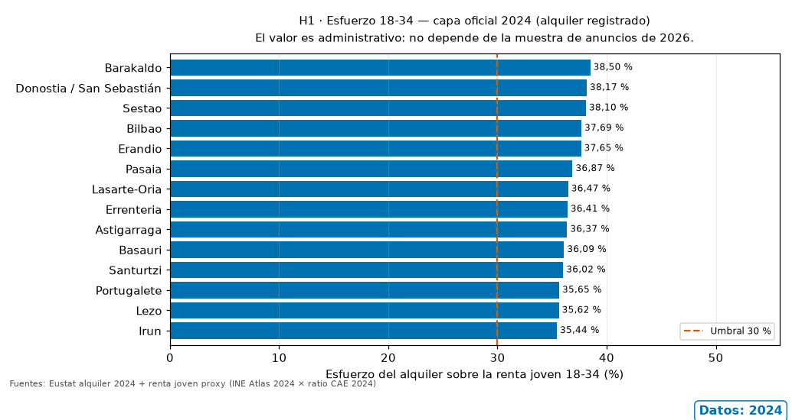

*Capa oficial 2024. El valor administrativo no depende de la muestra de anuncios de 2026: por eso
se puede defender municipio a municipio.*

Barakaldo (38,50 %), Donostia (38,17 %) y Sestao (38,10 %) están a tres décimas. Bilbao queda
cuarto con 37,69 %. En el otro extremo, 119 municipios no pasan del 30 %.

## 3. Qué se pide en 2026

La segunda capa cambia de fuente: precios de anuncio de Fotocasa, Pisos y RealtyAPI, con el salario
joven del Observatorio Vasco de la Juventud llevado de 2024 a 2026 por el IPC. La mediana municipal
sube a **78,6 %** en 50 municipios y el **98,3 %** de los 287 anuncios válidos supera el 30 %. Esas
dos cifras conviven y no son la misma: el 78,6 % es la mediana de las 50 medianas municipales, con
cada municipio pesando igual; el **87,3 %** es la mediana de los 287 anuncios, donde pesa cada
anuncio. Cada una responde a una pregunta distinta.

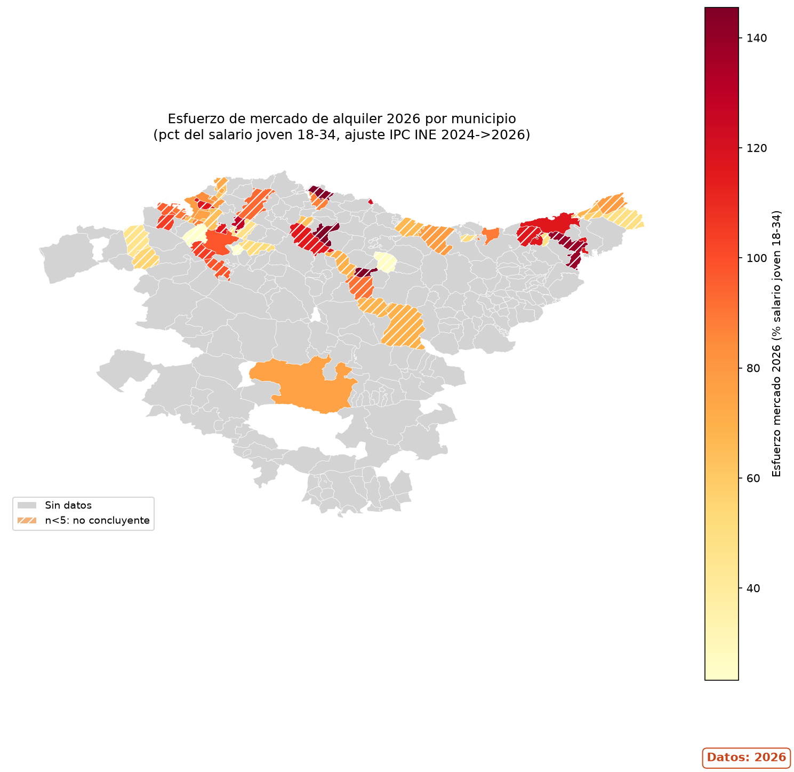

*2026 (n=287 anuncios en 50 municipios). La escala llega a 140 % del salario joven. Gris significa
sin datos y la trama marca municipios con menos de 5 anuncios, que no son concluyentes.*

Dentro de la misma capa hay decisiones que cambian el resultado y se reportan por separado. El
mismo portal mezcla piso entero y habitación: se detectaron **201** anuncios de habitación; **140**
son plausibles (precio por debajo del alquiler mediano del municipio), **60** se descartan por precio
y **1** no tiene precio. Una habitación cuesta 545 € de mediana, el 31,7 % del salario joven, y en
Bilbao (580 €) y Donostia (600 €) compite con el alquiler completo del municipio.

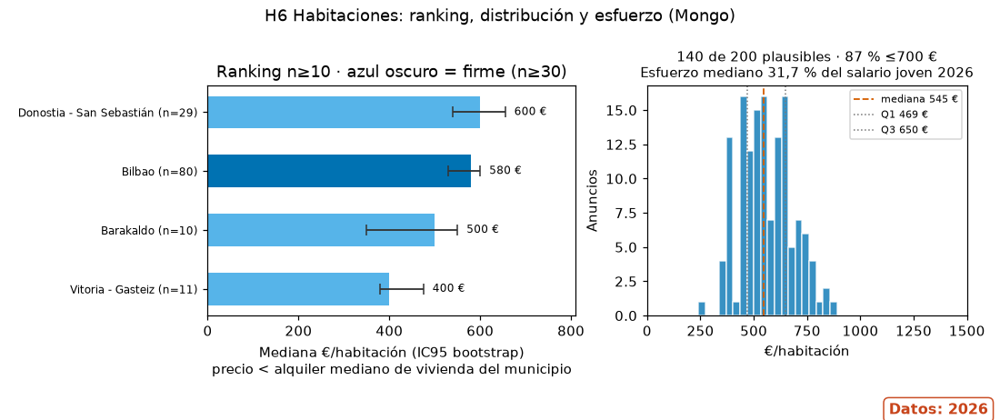

*Habitaciones con n≥10. La mediana es 545 €, con cuartiles 469 y 650 €. El 87 % de las plausibles
cuesta 700 € o menos.*

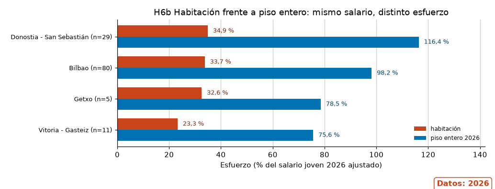

*Esfuerzo de una habitación frente al piso entero del mismo año, con el mismo salario joven de
2026 ajustado. Solo municipios con al menos 5 anuncios de habitación y 30 de piso; la muestra es
firme en Bilbao e indicativa en Getxo y Vitoria-Gasteiz.*

La modalidad también importa, y no por el precio de la mediana: temporal y larga estancia cuestan
1.500 € al mes, pero la temporal paga 18,95 €/m² frente a 16,67 €/m² de la larga. Mismo recibo, 13,7 %
menos de vivienda.

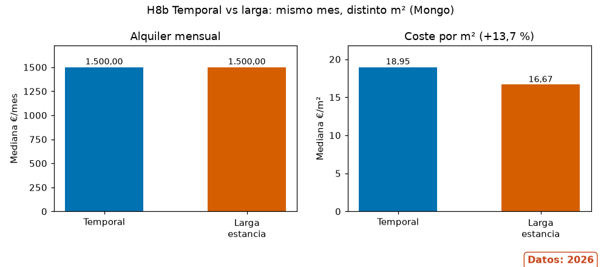

*Temporal frente a larga estancia en 2026. El recibo es idéntico y el precio por m² no.*

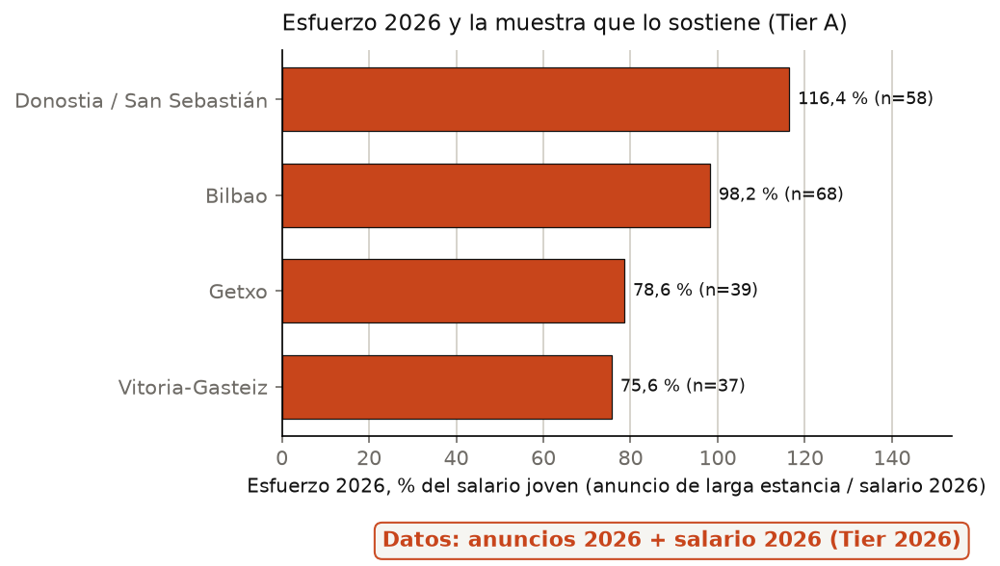

*Esfuerzo 2026 con la muestra que lo sostiene, solo Tier A. Cada barra usa solo los anuncios de larga
estancia con precio válido: el `n` es menor que el del Tier (Bilbao, 68 frente a 204; Donostia, 58
frente a 126). Sin línea de umbral: aquí cambian numerador y denominador.*

## 4. La brecha que no es una serie

Entre 2024 y 2026 cambian dos cosas a la vez: la fuente (contrato firmado frente a precio pedido) y
el tamaño de la vivienda (90,0 m² de anuncio frente a 80,7 m² registrado). La diferencia no se puede
repartir entre «subió el alquiler» y «estamos midiendo otra cosa», así que se publica como nivel.

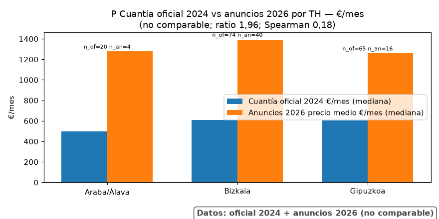

*Las dos barras llevan sello propio: `Datos: oficial 2024 + anuncios 2026 (no comparable)`. No
forman una serie temporal.*

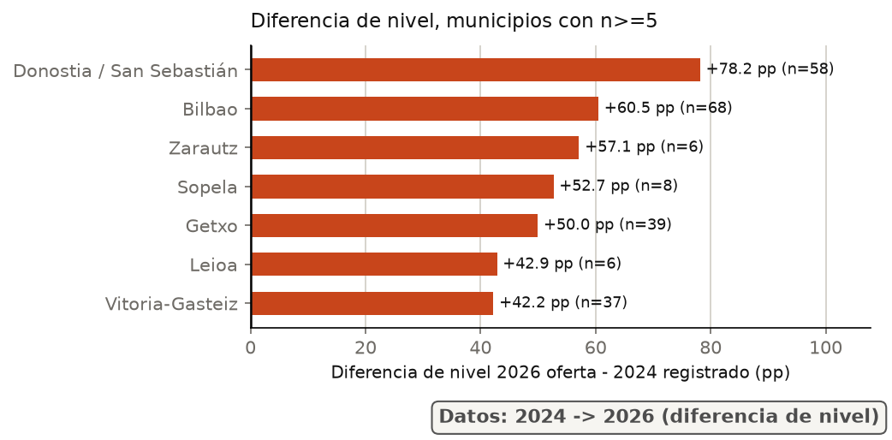

*Siete municipios con al menos 5 anuncios. Todos en el mismo sentido, de +42,2 puntos en
Vitoria-Gasteiz a +78,2 en Donostia. Datos: 2024→2026 (diferencia de nivel); copia aplanada sobre
fondo blanco de la figura sellada `docs/memoria/figuras/fig-brecha-2026.png`, que es un PNG
transparente pensado para el deck.*

Mientras el esfuerzo subía, la vivienda protegida caía. La tasa de VPO terminada por 1.000 habitantes
y quinquenio pasó de **11,5 ‰ en 2007-2011** (1,15 % de la población en cinco años) a **2,7 ‰ en
2020-2024** (0,27 %). Álava llegó a **40,1 ‰** en 2007-2011, un **4,01 %** acumulado, no un 40 %; la
figura usa una escala común y un zoom para que su magnitud no aplaste al resto.

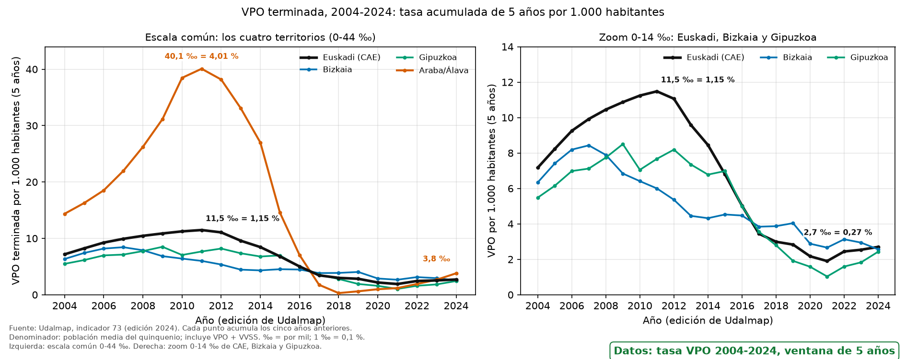

*Cada año resume los cinco anteriores (ventana móvil de Udalmap), así que no es el flujo de un año
suelto. Es oferta protegida terminada (VPO + VVSS), no stock. ‰ = por mil; 1 ‰ = 0,1 %: 11,5 ‰ = 1,15 %,
2,7 ‰ = 0,27 %, 40,1 ‰ = 4,01 %. El panel izquierdo comparte escala 0-44 ‰; el derecho amplía 0-14 ‰
para CAE, Bizkaia y Gipuzkoa. Figura regenerable con `transform/generar_figuras_N.py`.*

## 5. Cuánto vale cada punto del mapa

Un ranking con tres anuncios es una anécdota. Con menos de 30 el intervalo de confianza se abre
tanto que dos municipios no se pueden ordenar, así que el Tier mide solo confianza y el mapa de
confianza es casi todo «sin dato».

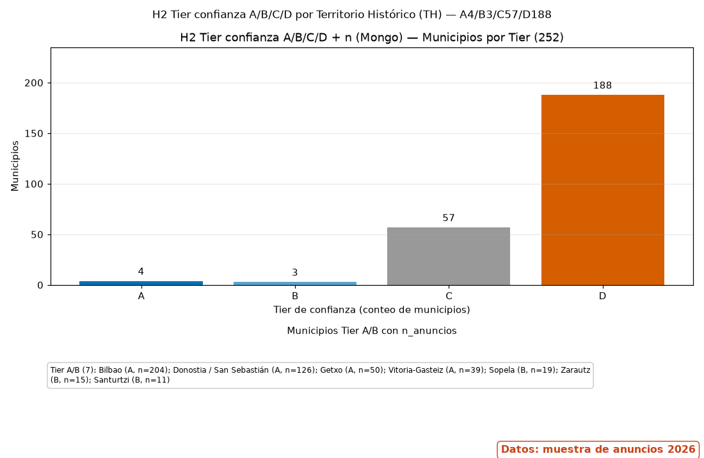

*Tier A: Bilbao (204 anuncios), Donostia (126), Getxo (50) y Vitoria-Gasteiz (39). Tier B llega a
Sopela (19), Zarautz (15) y Santurtzi (11). C y D son 245 municipios sin precio municipal.*

De los 50 municipios con mediana en 2026, **43 no llegan a cinco anuncios** y no se publican. Con
los cuatro Tier A se comparan intervalos, no un podio: Bilbao (33,75–40,95), Getxo (27,54–31,77) y
Donostia (32,4–45,8) se solapan entre sí. Lo defendible es que los tres cruzan el 30 %.

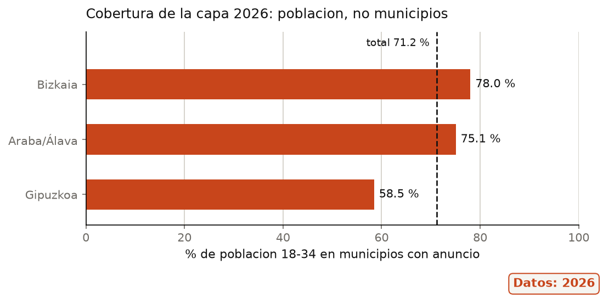

*Cobertura de la capa 2026 por población de 18 a 34 años, no por municipios: los 50 municipios con
dato cubren el **71,2 %** de los jóvenes (334.753 de 470.083).*

## 6. Qué no responde este proyecto

El indicador mide esfuerzo, no calidad de vida. Estos límites condicionan la lectura:

| Límite | Qué significa |
|---|---|
| La renta joven es un proxy | Renta neta media por hogar × 56,9 % (ratio 18-34 de la CAE), no salario individual. El salario 2026 es una constante autonómica (1.719 € al mes), así que el orden municipal lo mueve la renta. |
| El alquiler de los 93 municipios es imputado | Se rellena por IDW desde los vecinos y nunca entra en la conclusión. Con los 252 municipios la mediana del esfuerzo es 25,37 %; con los 159 oficiales, 26,61 %, y esa es la que se defiende. |
| El IPC de 2026 es la media anual del corte | 107,2 en 2024 y 117,8 en 2026. No es el cierre del año. |
| `nivel_geografico` «comarcal» es herencia del nombre | El método real es distancia entre centroides, no una media de comarca. |
| El área funcional se asigna por centroide | Un municipio que cruce dos áreas se queda con la del centro. |
| Los anuncios no son el parque | Miden oferta publicada en tres portales, no el parque completo ni el alquiler regulado. |
| 2024 y 2026 no forman serie | Cambian la fuente y el tamaño de la vivienda; se publican como nivel, no como evolución. |
| La VPO es flujo, no stock | Cuenta viviendas protegidas terminadas en cinco años (VPO + VVSS), no viviendas disponibles. |

Las figuras muestran asociaciones territoriales, no causalidad: un esfuerzo alto depende a la vez de precios, rentas, empleo y oferta. El tier ordena la evidencia disponible; no clasifica municipios por calidad de vida.

## 7. Decisiones y deuda

Cada dificultad conocida tiene una decisión tomada y un coste declarado.

| Dificultad | Decisión | Coste declarado |
|---|---|---|
| No hay salario juvenil municipal | Renta media como proxy, declarada | Posible falacia ecológica |
| Anuncios 2026 contra renta y alquiler 2024 | Dos capas separadas, sin resta | No hay serie temporal |
| Tres inventarios: disco, manifiesto y HDFS | Se conservan con propósitos distintos | Hay que explicar la diferencia |
| HDFS solo guarda raw | Requisito del alcance del reto | Silver y gold no están en HDFS |
| Dos índices 2026 definidos y no materializados | Se declaran y se dejan sin crear hasta tener ventana | El pipeline 2026 no está optimizado |
| Falta `auditoria_lagunas_silver.csv` | No se regenera para no mover el gold de 55 a 56 artefactos | Una comprobación queda en rojo |
| Topic legacy `anuncios_inmobiliarios` | No se borra: el clúster es compartido | 1.420 mensajes de prueba conviven con el topic vigente |

La infraestructura también lleva fecha. El 12-11 el `OPEN` de WebHDFS fallaba por DNS del datanode y Kafka no entregaba metadata; el 13-11 la recuperación por SHA devuelve `HDFS_REC OK SHA_TAMANO_IGUALES` y el topic responde con una partición y factor de replicación 1. Una avería de red no se convierte en una afirmación sobre el código.

Quedan cinco deudas: dos índices 2026 sin crear, dos colecciones de habitaciones duplicadas, el topic legacy, un pipeline fuera del orden principal y una comprobación de silver en rojo. Ninguna impide responder a la pregunta, pero todas acotan lo que se puede afirmar sobre rendimiento y consistencia. Las mejoras previstas son completar los dos índices, unificar las colecciones de habitaciones y sustituir la renta media por una renta juvenil municipal cuando exista.

## 8. Cómo está construido

Un anuncio entra por scraping o API, se congela con su SHA, se normaliza, se carga en Mongo y
termina en los CSV y figuras que alimentan el informe y el deck. El original nunca se sobrescribe.

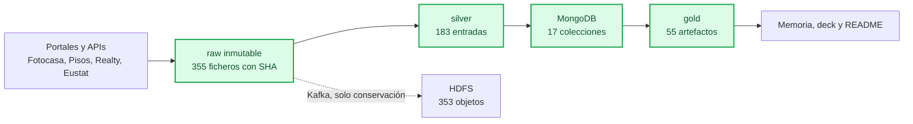

El embudo explica el resto de decisiones: **1.828** registros crudos, **639** únicos tras deduplicar,
**594** vigentes y **287** válidos para el cálculo. Solo **424** de los 594 traen coordenadas, porque
únicamente Fotocasa publica latitud y longitud; los otros 170 quedan fuera del índice geoespacial
antes que inventarlos.

### El modelo de datos

`codigo_ine` de cinco dígitos es la clave natural de `municipios` y la referencia en el resto. Lo que
se lee junto y cambia poco vive embebido (`demografia`, `empleo`, `demanda_social`); lo que crece y
se consulta por municipio vive referenciado (`anuncios`, `alquiler_municipal`, `etxebide_promociones`).

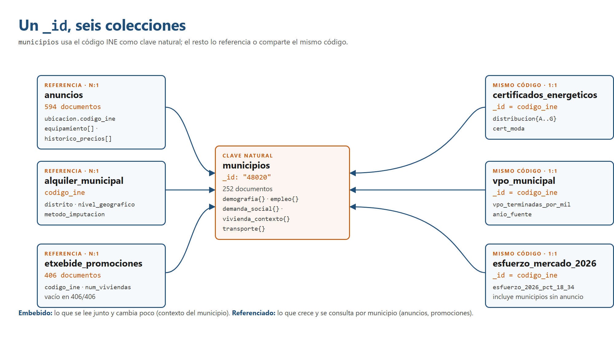

*17 colecciones vivas más 15 de backup. `municipios` tiene 252 documentos; `anuncios`, 594;
`etxebide_promociones`, 406, todas con el número de viviendas vacío.*

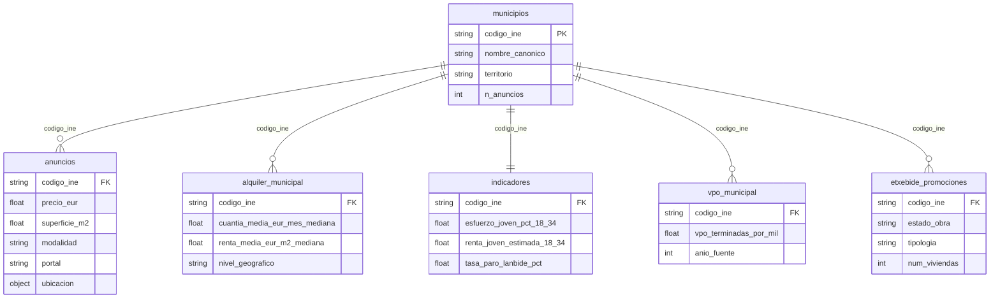

### Las piezas que sostienen la reproducibilidad

`data/raw/` es inmutable por diseño. Solo `extract/` escribe ahí; `transform/` necesita
`assert_raw_writable(reason)` y un test bloquea la excepción. El DAG de silver declara 40 nodos con
entradas y salidas tipadas (`raw:`, `proc:`, `res:`) y calcula el orden con Kahn, con desempate
estable por grupo; 7 scripts quedan fuera con motivo escrito.

En Mongo hay 11 pipelines en `PIPELINE_ORDER` y 10 índices definidos, 8 materializados. El índice ESR
`{ubicacion.codigo_ine: 1, modalidad: 1, precio_eur: 1}` convierte la consulta canónica de un
`COLLSCAN` de 594 documentos en un `IXSCAN` de 1, y `explain_before_after()` lo demuestra en solo
lectura. Las medianas de precio por m² van winsorizadas p1-99 y el precio medio descarta outliers por
IQR, con el n de cada paso expuesto en el CSV.

La rama de archivo publica los originales en HDFS con un manifiesto `{rel, size, sha256}`: Kafka
transporta, HDFS conserva, Mongo sirve consultas. Kafka no escribe en Mongo; la carga analítica es
batch e idempotente por lotes con `replace_collection`.

## 9. Qué demuestra este repositorio

| Competencia | Dónde se ve |
|---|---|
| Ingesta heterogénea | 41 extractores sobre APIs, scraping, XLSX y GeoJSON, con resolución de entidades y cuarentena |
| Ingeniería de datos | DAG declarativo de 40 nodos con orden topológico y `--check` de staleness por SHA |
| Modelado NoSQL | 17 colecciones, embebido frente a referenciado, índices ESR y `explain()` medido |
| Reproducibilidad | 355 SHA de raw, 183 de silver, huella del gold idéntica en dos pasadas |
| Calidad | 298 tests, gate extremo a extremo offline, verificación de gobernanza y de vintage |
| Comunicación técnica | Memoria en Markdown, HTML, DOCX y PDF, deck de 26 diapositivas, auditoría contra criterios |

## 10. Que no te lo creas

```bash
.venv/Scripts/python.exe -m pytest tests
.venv/Scripts/python.exe scripts/verificar_cifras_deck.py
.venv/Scripts/python.exe scripts/verificar_vintage_figuras.py
.venv/Scripts/python.exe scripts/verificar_gobernanza.py
.venv/Scripts/python.exe scripts/gate_extremo_a_extremo.py --offline
.venv/Scripts/python.exe scripts/verificar_reproducibilidad.py
.venv/Scripts/python.exe scripts/run_pipeline.py --check
.venv/Scripts/python.exe transform/run_all.py --check
.venv/Scripts/python.exe scripts/verificar_fase_datos.py
```

| Comando | Salida a 2026-11-15 |
|---|---|
| `pytest tests` | `298 passed, 2 skipped` |
| `verificar_cifras_deck.py` | **159/159** comprobaciones contra CSV gold, fórmula del ratio, GeoJSON y conteos de Mongo |
| `verificar_vintage_figuras.py` | `56 figuras declaradas · gold, deck y memoria sellados y coherentes` |
| `verificar_gobernanza.py` | `TODO OK`: 53 cabeceras / 49 con ID, 47 scripts, 183 silver, 11 pipelines |
| `gate_extremo_a_extremo.py --offline` | `RESULTADO gate: OK` (355 SHA, 183 silver, 17 colecciones, 0 duplicados) |
| `verificar_reproducibilidad.py` | `RESULTADO: OK`, huella `983fa53f…` idéntica en dos pasadas |
| `run_pipeline.py --check` | 355 y 183 entradas, 0 errores |
| `transform/run_all.py --check` | Todo `[OK]` salvo `auditoria_lagunas_silver.csv`, que sale con rc 1 |
| `verificar_fase_datos.py` | 21 PASS y **1 FAIL 07 conocido**: paro-cero en Aramaio 0,28 / Gaintza 1,45 / Usansolo 3,26 |

Las fuentes de `docs/` y `openspec/` no se versionan: viven en el checkout local, que es el que
requieren estos verificadores.

El fallo conocido está documentado sin imputar, y los huecos también: faltan 2 de los 10 índices de
`esfuerzo_mercado_2026`, el `OPEN` de WebHDFS depende del DNS de los datanodes (el gate coteja
tamaño y SHA en lugar de restaurar) y el topic antiguo `anuncios_inmobiliarios` conserva 1.420
mensajes de prueba que no usa la cadena vigente.

## 11. Ejecutarlo

Requisitos: Python 3.12, [uv](https://docs.astral.sh/uv/), MongoDB en `localhost:27017` y red para
la extracción viva. En Linux o macOS cambia `.venv/Scripts/python.exe` por `.venv/bin/python`.

```bash
uv venv --python 3.12 .venv
uv pip install --python .venv/Scripts/python.exe -r requirements.txt
cp .env.example .env

curl -L -o data/raw/shp_euskadi.zip \
  "https://www.geo.euskadi.eus/cartografia/DatosDescarga/Limites/MUNICIPIOS_5000_ETRS89.zip"
cd data/raw && unzip -o shp_euskadi.zip -d shp_euskadi && cd ../..

.venv/Scripts/python.exe extract/main_ingest.py
.venv/Scripts/python.exe extract/main_ingest.py --mode replay-raw

.venv/Scripts/python.exe scripts/run_pipeline.py --fase silver,quality
.venv/Scripts/python.exe scripts/run_pipeline.py --fase mongo --allow-mongo-write
.venv/Scripts/python.exe scripts/run_pipeline.py --fase gold
```

`--fase all` equivale a `silver,quality,gold` y nunca incluye `mongo`, que es destructiva y exige
`--allow-mongo-write`. `--dry-run` lista el plan sin escribir.

| Síntoma | Causa | Acción |
|---|---|---|
| `ping=False` o timeout | Mongo apagado | Arranca `mongod`, revisa `MONGO_HOST` y `MONGO_PORT` |
| `NameResolutionError hadoop-worker*` | DNS de datanodes | Añade los hosts; el `ContentSummary` no depende del `OPEN` |
| `NodeNotReadyError` | Broker sin metadata | Reintenta y recrea el topic con `scripts/ensure_topic.py` |
| `.env` no se aplica | Ejecución fuera de la raíz | Lanza todo desde la raíz del repo |

## 12. Estructura y documentación

| Ruta | Contenido |
|---|---|
| `extract/` | 41 scripts de captura; única capa que escribe en raw |
| `transform/` | 47 scripts y el DAG silver (`run_all.py`) |
| `storage/` | Carga en Mongo, productor Kafka, subida a HDFS |
| `analysis/` | 11 pipelines, consultas, índices y análisis de sensibilidad |
| `scripts/` | Orquestador por fases y gates de verificación |
| `docs/memoria/` | Memoria técnica en PDF con figuras selladas |
| `docs/presentacion_v2/` | Deck de defensa en PDF: 26 diapositivas y 12 backups |
| `data/resultados/README.md` | Índice del gold y de los 8 CSV `mongo_*` |

### Documentación viva

| Documento | Qué contiene |
|---|---|
| [Memoria técnica (PDF)](docs/memoria/memoria.pdf) | Capítulos 1-8 y anexos |
| [Deck de defensa (PDF)](docs/presentacion_v2/presentacion_v2.pdf) | 26 diapositivas más 12 backups |
| [Manifiesto de raw](docs/raw_manifest_sha256.txt) | SHA-256 de los 355 ficheros de origen |
| [Baseline del gold](docs/baseline_gold_sha256.json) | Huella con la que se comprueba la reproducibilidad |
| [Matriz de comparabilidad](docs/matriz-comparabilidad.md) | Qué métrica es comparable con qué y por qué |
| [Índice de docs](docs/README.md) | Qué queda versionado en `docs/` |
| [Índice del gold](data/resultados/README.md) | CSV y figuras que componen el gold |
| [AGENT.md](AGENT.md) | Punteros para agentes |

## 13. Glosario

| Término | Significado en este proyecto |
|---|---|
| Esfuerzo joven | Porcentaje de la renta joven que consume el alquiler. Es el indicador principal. |
| IDW | Interpolación inversamente proporcional a la distancia al cuadrado. Usa los 5 municipios oficiales más cercanos y distancia haversine entre centroides. |
| Winsorizar | Recortar los extremos de una distribución a un percentil (aquí p1-p99) antes de calcular la mediana. |
| Tier A/B/C/D | Nivel de confianza según cuántos anuncios sostienen el dato municipal. Ordena evidencia, no calidad de vida. |
| Índice ESR | Índice de MongoDB con orden Equi-Sort-Range. Aquí `{ubicacion.codigo_ine, modalidad, precio_eur}`: filtra, ordena y acota por rango sin recorrer la colección entera. |
| `COLLSCAN` / `IXSCAN` | Resultados de `explain()`: recorrer toda la colección o entrar por el índice. |
| Proxy | Variable que se usa porque la deseada no existe. Aquí la renta joven y el salario 2026 actualizado por IPC. |
| Vintage | Corte de datos que sostiene una cifra. Las figuras selladas llevan el suyo en los metadatos PNG. |
| VPO | Vivienda protegida (oficial y social). El indicador 73 cuenta viviendas terminadas en cinco años por 1.000 habitantes; es flujo, no stock. 1 ‰ = 0,1 %. |

## 14. Contexto y cita

Proyecto académico del reto intermodal **SBD + BDA** (Euskadi, 2026). Todas las fuentes son públicas
y están en `config/fuentes.yaml`. No hay fichero `LICENSE`; el uso previsto es académico.

Cita sugerida: Equipo bigdata-vivienda-euskadi (2026), «¿Dónde puede vivir un joven en Euskadi?»,
pipeline de datos del reto intermodal SBD+BDA, repositorio académico.

---
