# bigdata-vivienda-euskadi — ¿Dónde pueden vivir los jóvenes en Euskadi?

Reto intermodal **SBD + BDA**: pipeline en Python que analiza la accesibilidad
de la vivienda para la población joven en Euskadi con datos reales, midiendo cada
criterio contra el contrato OpenSpec de `openspec/specs/contrato-reto/spec.md`.

## 🎯 Objetivo

Responder con datos: ¿puede una persona joven independizarse en Euskadi con su
salario? ¿Qué municipios ofrecen mejores posibilidades de emancipación y por qué?
Todo el recorrido (extracción, almacenamiento, análisis, visualización) está en
Python y se verifica contra la rúbrica del reto.

## 📜 Lectura obligatoria antes de tocar código

Antes de escribir o modificar cualquier fichero, leer
`openspec/specs/contrato-reto/spec.md`. Ese fichero es **la verdad**: transcribe la
rúbrica del PDF `RETO 1Evaluacion SBD-BDA.pdf` y asigna un requisito y un
escenario verificable a cada criterio. Si el código y el contrato discrepan,
manda el contrato, o se cambia el contrato antes de cambiar el código.

## 🏗️ Arquitectura del pipeline

```mermaid
flowchart LR
    accTitle: Pipeline de datos vivienda Euskadi
    accDescr: Flujo de fuentes a resultados: extraccion, HDFS, Kafka, MongoDB, limpieza, agregacion, visualizacion.

    src["Fuentes<br/>API + scraping + descarga directa"]
    hdfs["HDFS<br/>originales y procesados"]
    kafka["Kafka<br/>VM Ubuntu, KRaft"]
    mongo["MongoDB<br/>Docker"]
    clean["PyMongo<br/>limpieza y transformación"]
    agg["Aggregation Pipeline<br/>indicadores"]
    viz["Gráficos + informe<br/>conclusiones"]

    src --> hdfs --> kafka --> mongo --> clean --> agg --> viz

    classDef done fill:#dcfce7,stroke:#16a34a,stroke-width:2px,color:#14532d
    classDef partial fill:#fef9c3,stroke:#ca8a04,stroke-width:2px,color:#713f12
    classDef todo fill:#fee2e2,stroke:#dc2626,stroke-width:2px,color:#7f1d1d
    class src done
    class hdfs,kafka,mongo,clean,agg,viz todo
```



> 🟢 Extracción completada. 🟡 Infraestructura y análisis pendientes.

## 📊 Estado del proyecto

| Fase | Entrega | Estado |
|---|---|---|
| 0 | Entorno + contrato + tests | ✅ Hecha |
| 1 | Extracción (scripts 01–06 + auxiliares) | ✅ Hecha |
| 1b | Salarios INE EPA (script 07) | ✅ Hecha |
| 1c | Pisos.com (script 08) | ✅ Hecha |
| 1d | Idealista/RealtyAPI (script 09) | ✅ Opcional, 139 anuncios |
| 2 | Descargas directas Open Data Euskadi (EMAL, Etxebide, GTFS) | ✅ Hecha |
| 3 | Transformaciones (entity resolution, dim_municipios, distancias, filtrado, enriquecimiento, geojson, metadata) | ✅ Hecha (parcial) |
| 4 | Docker Compose HDFS + MongoDB | ⬜ Pendiente |
| 5 | Subida HDFS + recuperación | ⬜ Pendiente |
| 6 | Modelado + operaciones PyMongo | ⬜ Pendiente |
| 7 | Aggregation Pipeline | ⬜ Pendiente |
| 8 | Kafka productor/consumidor | ⬜ Pendiente |
| 9 | Gráficos desde PyMongo | ⬜ Pendiente |
| 10 | Informe, arquitectura y demo | ⬜ Pendiente |

Tests del contrato: `59 passed, 0 xfail` (54 originales + 5 nuevos de inmutabilidad raw).

## 📁 Estructura

```
bigdata-vivienda-euskadi/
├── openspec/          Contrato y specs (la verdad)
├── tests/             Verificación del contrato
├── config/
│   └── fuentes.yaml   URLs, IDs, cobertura y notas de cada fuente
├── extract/           Extracción API, scraping y descargas directas
│   ├── 01_eustat_api.py          Población, renta por edad, renta municipal, PIB, tenencia
│   ├── 02_eustat_alquiler.py     Alquiler municipal (ExtractorBlob, 3 territorios)
│   ├── 03_euskadi_emancipacion.py Emancipación juvenil (16 indicadores)
│   ├── 04_b5m_geo.py             Geojson + distancias Gipuzkoa (solo Gipuzkoa)
│   ├── 05_fotocasa_scraper.py    Scraping alquiler Fotocasa (3 provincias)
│   ├── 06_ine_api.py             INE wstempus (población, hogares, urbanos)
│   ├── 07_ine_salarios.py        INE EPA (salarios, nacional)
│   ├── 08_pisos_scraper.py       Scraping Pisos.com
│   ├── 10_ovj_salario.py        OVJ salario joven (scraping Irekia, 1564€/1381€)
│   ├── 22_geo_areas_funcionales.py GeoEuskadi shapefile → 15 áreas funcionales
│   ├── 23_certificados_energeticos.py Open Data Euskadi certificados energéticos (6 CSVs)
│   ├── 16_serpavi_renta.py       SERPAVI/MIVAU renta fiscal municipal (descarga)
│   ├── 17_osrm_tiempos.py        OSRM minutos de conducción a capitales (API)
│   ├── 18_lanbide_paro_juvenil.py Lanbide paro juvenil municipal (descarga)
│   ├── _common.py                Helpers compartidos (RAW_DIR, logging, guardar_json...)
│   ├── main_ingest.py            Orquestador de la extracción completa (live/replay-raw)
│   ├── entity_resolution.py      Mapeo nombre canónico → código INE
│   ├── fotocasa_detalle.py       Enriquece anuncios Fotocasa (planta, certificado, etc.)
│   ├── ine_atlas_renta.py        INE Atlas de la renta → 51 municipios faltantes
│   ├── euskadi_geo.py            Cartografía Euskadi completa → GeoJSON + distancias a capitales
│   ├── udalmap_empleo.py         Udalmap: actividad, ocupación, paro Lanbide, VPO, renta, etc.
│   ├── educacion_centros.py      Dependencias de centros educativos (contextual)
│   └── salud_centros.py          Dependencias de centros de salud (contextual)
├── storage/           HDFS, Kafka, MongoDB (pendiente)
├── transform/         Limpieza y enriquecimiento
│   ├── dim_municipios.py         Tabla de verdad de los 252 municipios
│   ├── entity_resolution.py      Mapeo nombre→codigo_ine (uso compartido)
│   ├── generar_distancias.py    Haversine 252×252 (63.504 pares)
│   ├── filtrar_outliers.py      Marca outliers de €/m²
│   ├── f4_pisos_dirigido.py     Scraping dirigido a municipios con n bajo
│   ├── enriquecer_codigo_ine.py Corrección código INE Araba (4 dígitos)
│   ├── completar_alquiler_comarca.py Agrega alquiler comarcal a los 93 municipios sin dato
│   ├── enriquecer_json_anidado.py  Enriquece anuncios con ubicacion/equipamiento
│   ├── add_metadata_fingerprint.py _metadata + property_fingerprint
│   ├── add_geojson.py           location 2dsphere para MongoDB (Fotocasa 471/471)
│   ├── calcular_renta_joven.py   Proxy renta joven (ratio 0,3534 + OVJ) → dim_municipios_enriquecido.csv
│   ├── generar_cert_energetico_municipal.py Open Data Euskadi cert. energético → 252 mun
│   ├── generar_dashboard_visual.py 4 gráficos PNG + HTML
│   ├── generar_dashboard_completo.py 8 gráficos PNG + HTML (7 bloques A-G)
│   ├── auditoria_duckdb.py       Auditoría DuckDB (27 archivos)
├── analysis/          Aggregation Pipeline (pendiente)
├── visualization/     Gráficos (pendiente)
├── notebooks/         Informe de resultados (pendiente)
├── data/raw/          Datos generados (ignorados por git)
├── data/procesado/    Datos normalizados (ignorados por git)
├── data/resultados/   Indicadores y gráficos (ignorados por git)
└── plan/              Planificación y decisiones
```

## 🚀 Puesta en marcha

### 1. Entorno Python

```bash
uv venv --python 3.12 .venv
uv pip install --python .venv/Scripts/python.exe -r requirements.txt
```

### 2. Descargar la cartografía municipal (si no está en `data/raw/`)

El convertidor de SHP a GeoJSON necesita el shapefile descargado primero:

```bash
curl -L -o data/raw/shp_euskadi.zip \
  "https://www.geo.euskadi.eus/cartografia/DatosDescarga/Limites/MUNICIPIOS_5000_ETRS89.zip"
cd data/raw && unzip -o shp_euskadi.zip -d shp_euskadi && cd ../..
```

> El shapefile viene de Open Data Euskadi (actualizado 07/05/2025, EPSG:25830,
> UTM 30N, ETRS89). Cubre los 251 municipios de la CAPV (Álava 51 + Bizkaia 112 +
> Gipuzkoa 88).

### 3. Ejecutar la extracción completa

```bash
.venv/Scripts/python.exe extract/main_ingest.py
```

Ejecuta en orden todos los extractores numerados (01–16) y los auxiliares
(`entity_resolution`, `fotocasa_detalle`, `ine_atlas_renta`, `euskadi_geo`,
`udalmap_empleo`, `educacion_centros`, `salud_centros`). Si uno falla, los demás
siguen. Al final genera `data/raw/ingestion_manifest.json` con un registro por
cada fichero tocado (nombre, timestamp UTC, SHA-256, n_registros, estado).

También hay modo verificación de consistencia de los archivos ya generados:

```bash
.venv/Scripts/python.exe extract/main_ingest.py --mode replay-raw
```

Compara los hashes SHA-256 del manifest con los ficheros actuales y reporta
incidencias (archivo ausente o hash cambiado).

### 4. Verificar contra el contrato

```bash
.venv/Scripts/python.exe -m pytest tests -q
```

### 5. Infraestructura y análisis (pendiente)

```bash
.venv/Scripts/python.exe storage/hdfs_utils.py
.venv/Scripts/python.exe storage/kafka_producer.py
.venv/Scripts/python.exe storage/kafka_consumer.py
.venv/Scripts/python.exe analysis/pipeline_agregaciones.py
```

## Concepciones

Estas son las decisiones y convicciones que sustentan el análisis. Van más allá
de los datos en bruto: marcan cómo se interpreta el problema y por qué se elige
una variable sobre otra. Se revisan cuando cambia el contexto o se incorpora nueva
fuente.

### Renta como proxy de capacidad económica (doc/decision_salario_proxy.md)

No existe salario municipal por edad disponible gratuitamente en Euskadi:
- `ine_salarios_edad.csv` (INE EPA) es **nacional** (1.372,8 € para 16-24 años).
- Eustat no publica salario municipal por edad.
- El Observatorio Vasco de la Juventud no ofrece dato municipal.

**Decisión:** usar la **renta media municipal (Eustat, 2024)** como proxy de
capacidad económica para calcular la tasa de esfuerzo (alquiler / ingresos).

**Justificación:**
1. La renta municipal captura el nivel de ingresos del hogar, que es el
   determinante principal de la capacidad de pago del alquiler.
2. Es el único indicador económico disponible a nivel municipal para los 252
   municipios.
3. La correlación Pearson renta vs alquiler es débil (r ≈ 0.28), lo que indica
   que el precio del alquiler no se explica únicamente por la renta local. Esto
   se documenta en el informe final (ver `docs/correlacion_renta_alquiler.md`).

**Limitaciones:**
- La renta es un proxy, no un salario. No refleja la distribución por edad ni la
  precariedad juvenil.
- Mezclar renta (2024) con alquiler (2024) es coherente temporalmente.
- La tasa de esfuerzo calculada es orientativa, no exacta; se advertirá en la
  defensa.

**Alternativas descartadas:**
- Salario nacional (INE EPA): no es municipal, inútil para ranking.
- Simular salario municipal: prohibido (los datos deben ser reales, P-02).
- Observatorio Vasco de la Juventud: sin dato municipal.

### Alquiler como eje, compraventa como contraste (contrato P-01)

El criterio evalúa el **alquiler**; usar la compraventa como eje principal está
 prohibido. La compraventa puede aparecer como dato complementario, pero el eje del
 análisis es el precio del alquiler.

### Correlación renta–alquiler débil (docs/correlacion_renta_alquiler.md)

Pearson r ≈ 0.28 (159 municipios con alquiler oficial). La renta local explica
poco el precio del alquiler. Otras variables explican más: oferta, demanda,
turismo, distancia a capitales, tamaño del municipio, tasa de ocupación, etc.
El informe final debe mencionar este hecho y explorar esas variables adicionales.

### Distancias: Haversine como aproximación, distancia por carretera como objetivo

- `b5m_gipuzkoa` da distancias **por carretera** (OSRM) para Gipuzkoa, pero no
  para Álava ni Bizkaia.
- `euskadi_geo.py` calcula Haversine desde centroides municipales a las 3 capitales
  y entre centroides, para todos los municipios (EPSG:25830 → 4326).
- `generar_distancias.py` completa la matriz 252×252 con Haversine cuando no hay
  dato de carretera.
- La distancia por carretera es más precisa; el Haversine es una aproximación
  reproducible y suficiente para indicadores de accesibilidad básica.

### Cobertura de anuncios: n≥30 como umbral de robustez, “sin dato” como valor legítimo

- Solo 4 municipios tienen n≥30 anuncios combinados (Bilbao, Donostia, Vitoria,
  Getxo). El ranking fino de 252 municipios no es robusto con la muestra actual.
- Para los municipios sin anuncios o con n<5, el valor legítimo es **“sin dato”**,
  no imputar ni usar proxy. Eso se documenta como limitación del análisis, no como
  fallo del pipeline.
- El plan de mejora prioriza ampliar el scraping a municipios objetivo hasta n≥30
  (ver `openspec/plan/plan_mejora_2026-10-27.md`).

### Temporal vs larga estancia: no mezclar

Los anuncios de alquiler temporal (tourists, temporadas) tienen un precio ~24%
mayor que los de larga estancia. Se separan con la columna `tipo_alquiler` y se
evita mezclarlos en los cálculos de €/m².

### Paro y actividad: fuente oficial municipal (Udalmap + Lanbide)

- El indicador `tasa_paro_aprox_pct` (derivado de actividad/ocupación) fue
  invalidado porque el cociente usaba bases distintas y daba 248/252 municipios
  con paro negativo.
- Se sustituye por `tasa_paro_lanbide_pct` (indicador 13 de Udalmap, paro
  registrado real) y `tasa_ocupacion_juvenil_16_24_pct` (indicador 50). Ambos
  son oficiales a nivel municipal.
- `udalmap_empleo.py` descarga además indicadores de VPO (etxebide, adjudicadas,
  terminadas), licencias de nueva construcción, afiliación SS 16-24, renta
  familiar y personal, superficie media, antigüedad, certificado energético y
  suelo urbanizable, todos a nivel municipal (2024).

### Fuentes complementarias ya integradas

| Fuente | Tipo | Gap que cubre | Estado |
|---|---|---|---|
| EMAL fianzas de alquiler | Descarga directa (Open Data Euskadi) | Alquiler por municipio (730 reg, 2016-2025) | ✅ |
| Etxebide VPO promociones | Descarga directa (Open Data Euskadi) | Demanda vivienda protegida (5040 reg) | ✅ |
| Transporte GTFS (paradas) | Descarga directa (Open Data Euskadi) | Conectividad transporte (252 mun, 2635 paradas) | ✅ |
| Habitaciones (Fotocasa + Pisos) | Scraping | Piso compartido (155 + 46 anuncios) | ✅ |
| INE Atlas renta | Descarga directa (streaming) | Rellena 51 municipios faltantes (252 total) | ✅ |
| Udalmap (actividad, ocupación, paro Lanbide, VPO, renta...) | API | 252 municipios con indicadores múltiples | ✅ |
| cartografía Euskadi completa (SHP → GeoJSON) | Descarga directa (Open Data Euskadi) | Límites de los 251 municipios de la CAPV | ✅ |
| distancias a capitales (haversine sobre centroides) | Transformación | 252 municipios con distancia a Bilbao, Donostia, Vitoria | ✅ |

### Próximas fuentes a valorar (planificación, no implementadas)

Fuentes que han sido evaluadas para cerrar gaps persistentes. Ninguna es obligatoria
para el contrato; se priorizan cuando el dato base es ya suficiente.

| Fuente | Tipo | Qué aporta | Esfuerzo | Prioridad |
|---|---|---|---|---|
| SEPE/Lanbide paro juvenil | Descarga directa (XLSX, Open Data Euskadi) | Paro juvenil real por municipio | Bajo (2-3 h) | Alta |
| Observatorio Vasco Vivienda (EMAL/ECVI) | Descarga directa (XLSX/PDF) | Contexto comarcal (precios contratos vs oferta) | Bajo-medio (3-4 h) | Media |
| Udalmap indicadores adicionales | Descarga directa (Open Data Euskadi) | Más indicadores municipales (vivienda, empleo) | Bajo (2 h) | Media |
| Idealista RapidAPI | API (key del usuario, 200 req/mes) | Anuncios + lat/lng en municipios pequeños | Bajo (si hay key) | Baja (depende de key) |
| OSM Overpass | API (sin registro, 406 en este entorno) | Servicios a 500m (contexto interpretación) | Bajo | Baja (bloqueado ahora) |
| Etxebide web scraping | Scraping | Vivienda protegida (VPO) para jóvenes | Medio | Baja (descarga directa ya disponible) |

Ver `openspec/audit/inventario_fuentes_2026-10-28.md` y
`openspec/plan/fuentes_automatizables_gaps_2026-10-28.md` para el inventario
completo y las fuentes descartadas.

## 📜 Contrato de requisitos (OpenSpec)

La implementación está atada a la rúbrica del reto. El contrato vive en
`openspec/` y **manda sobre el código**:

| Fichero | Contenido |
|---|---|
| `openspec/specs/contrato-reto/spec.md` | **La verdad.** Rúbrica literal + 18 requisitos + prohibiciones |
| `openspec/specs/extraccion-datos/spec.md` | Extracción API y scraping, formato, salarios |
| `openspec/specs/almacenamiento-y-streaming/spec.md` | HDFS, Kafka, integración |
| `openspec/specs/mongodb-y-analisis/spec.md` | Modelado, PyMongo, consultas, agregación, limpieza |
| `openspec/specs/presentacion-de-resultados/spec.md` | Gráficos, datos, presentación, interpretación |
| `openspec/config.yaml` | Contexto, reglas y `contract_first` |
| `openspec/project.md` | Objetivo, stack, layout y fuentes |
| `openspec/plan/fases.md` | Plan de implementación por fases |
| `openspec/plan/plan_mejora_2026-10-27.md` | Correcciones críticas, cobertura, calidad estadística |
| `openspec/audit/reauditoria_2026-10-28.md` | Metrícula de datos reales y veredicto de suficiencia |
| `openspec/audit/inventario_fuentes_2026-10-28.md` | Inventario de fuentes automatizadas y no automatizadas |
| `openspec/plan/fuentes_automatizables_gaps_2026-10-28.md` | Fuentes automatizables para cerrar gaps |
| `openspec/plan/plan_api_scraping_2026-10-28.md` | Plan API/scraping vs gaps de auditoría |
| `openspec/plan/plan_recopilacion_fuentes_2026-10-28.md` | Plan de recopilación de fuentes adicionales |
| `docs/fuentes_salario_joven.md` | Investigación de fuentes de salario/renta joven |
| `docs/correlacion_renta_alquiler.md` | Correlación renta municipal vs alquiler municipal |
| `docs/decision_salario_proxy.md` | Decisión de usar renta como proxy de salario |
| `docs/fuentes_cartografia_empleo.md` | Fuentes de cartografía y empleo/actividad juvenil |
| `docs/fuentes_salario_joven.md` | Fuentes oficiales de salario/renta joven |
| `tests/test_contrato.py` | Verificación del contrato (tests) |

**Regla de oro:** antes de escribir código se lee
`openspec/specs/contrato-reto/spec.md`. Un criterio solo se marca como cubierto
cuando se puede verificar.

## 🗂️ Fuentes de datos

Todas verificadas en octubre de 2026. Ver `config/fuentes.yaml` para URLs e IDs
completos.

| Fuente | Tipo | Registro | Cobertura |
|---|---|---|---|
| Eustat bankupx API | API JSON | No | Población, renta, PIB, tenencia por municipio |
| Eustat ExtractorBlob | CSV/XLSX | No | Alquiler municipal (€/m², €/mes, m²) |
| INE wstempus API | API JSON | No | Población, hogares, precios de compraventa |
| euskadi.eus | CSV | No | Emancipación juvenil (16 indicadores) |
| b5m Gipuzkoa | API JSON | No | Límites municipales, distancias (solo Gipuzkoa) |
| Open Data Euskadi (geo.euskadi.eus) | SHP | No | Límites municipales Euskadi completo (251) |
| Open Data Euskadi (opendata.euskadi.eus) | ODS/CSV | No | EMAL, Etxebide VPO, GTFS, SEPE/Lanbide, certificados energéticos (6 CSVs, 283K registros) |
| LANBIDE | Web/CSV | No | Paro registrado por municipio (mensual) |
| Fotocasa | Scraping | No | ~470 anuncios reales de alquiler |
| Pisos.com | Scraping | No | ~218 anuncios de alquiler |
| Idealista (RealtyAPI) | API | Sí (key) | Opcional, 139 anuncios generados |
| INE Atlas de la renta | Descarga directa | No | Rellena 51 municipios faltantes |
| Udalmap (api.euskadi.eus) | API | No | Actividad, ocupación, paro Lanbide, VPO, renta... |
| OSM Overpass | API | No | Servicios a 500m (bloqueado 406 en este entorno) |

> **Nota:** la API del INE no publica el alquiler por municipio en Euskadi
> (régimen foral): el valor viene a `null`. Para el alquiler se usa Eustat.

## 📦 Datos generados (última ejecución)

| Fichero | Contenido |
|---|---|
| `eustat_poblacion_edad.json/csv` | 89.424 filas |
| `eustat_renta_municipal.json/csv` | 98.532 filas |
| `eustat_renta_edad.json/csv` | 6.426 filas |
| `eustat_pib_municipal.json/csv` | 13.248 filas |
| `eustat_tenencia.json/csv` | 4.416 filas |
| `alquiler_municipal.csv` | 253 registros, 159 municipios |
| `alquiler_comarca_completado.csv` | 252 municipios (con alquiler comarcal para los 93 faltantes) |
| `anuncios_fotocasa.json/csv` | 470 anuncios, 57 municipios |
| `anuncios_pisos.json/csv` | 218 anuncios, 29 municipios |
| `anuncios_realtyapi.json/csv` | 139 anuncios (opcional) |
| `anuncios_habitaciones.json/csv` | 201 anuncios (Fotocasa + Pisos) |
| `ine_salarios_edad.json/csv` | 198 series (EPA, nacional) |
| `ine_indicadores_urbanos.json/csv` | Tablas 69301, 69302, 69303, 69323, 69330 |
| `emancipacion_juventud.csv` | 867 filas |
| `municipios_euskadi.geojson` | 251 polígonos municipales (CAPV completo) |
| `distancias_capitales.csv` | 252 municipios con distancia a Bilbao, Donostia, Vitoria |
| `distancias_municipios.json` | 63.504 pares de distancias (Haversine, 252×252) |
| `cert_energetico_municipal_252.csv` | 252 municipios con distribución real A-G (Open Data Euskadi) |
| `dim_municipios_enriquecido.csv` | 252×44 con ratio fiscal/salarial y esfuerzo [40.5%-76.3%] |
| `municipio_area_funcional_ecvi.csv` | 252 municipios → 15 áreas funcionales ECVI |
| `dim_municipios.json/csv` | 252 municipios canónicos (tabla de verdad) |
| `udalmap_empleo.json/csv` | 252 municipios, 24 indicadores (actividad, ocupación, paro Lanbide, VPO, renta...) |
| `emal_fianzas.json/csv` | 730 registros (fianzas de alquiler, 2016-2025) |
| `etxebide_vpo.json/csv` | 5040 registros (promociones VPO) |
| `gtfs_paradas.json/csv` | 2635 paradas asignadas a 252 municipios |
| `ine_atlas_renta.json/csv` | 252 municipios (rellena 51 faltantes) |
| `ingestion_manifest.json` | Registro de cada fichero generado (SHA-256, n_registros, estado) |
| `*/html_fotocasa/*.html` | HTML crudos de Fotocasa (17 archivos) |

## ✅ Verificación

- Contrato: `openspec/specs/contrato-reto/spec.md` (rúbrica transcrita + 18 requisitos)
- Tests: `.venv/Scripts/python.exe -m pytest tests -q`
- Manifest de extracción: `data/raw/ingestion_manifest.json` (integridad SHA-256)
- Prohibiciones verificadas: todo en Python, sin credenciales rastreadas, criterios transcritos

## ⚠️ Cosas que faltan

- **Infraestructura (HDFS + MongoDB + Kafka):** pendiente. Docker Desktop arrancado,
  `docker-compose.yml` por escribir. Kafka en VM Ubuntu Server (IP fija, puerto 9092,
  KRaft). Ver `openspec/plan/PLAN.md` y `openspec/plan/fases.md` para el plan de
  implementación.
- **Análisis (Aggregation Pipeline + indicadores + gráficos + informe):** pendiente.
  Depende de MongoDB levantado y de los datos limpios.
- **Cobertura de anuncios (71/252, solo 4 con n≥30):** es la limitación principal del
  ranking municipal fino. Los municipios sin datos se marcan “sin dato”, no se imputan.
  Mejorado con certificados energéticos (252/252) y áreas funcionales ECVI (252/252).
- **Alquiler oficial (159/252 sin dato):** completado parcialmente con alquiler comarcal
  para los 93 faltantes (`alquiler_comarca_completado.csv`). El valor es comarcal, no
  municipal; se documenta el `nivel_geografico`.
- **Paro: `tasa_paro_aprox_pct` invalidado** → usar `tasa_paro_lanbide_pct` del
  Udalmap/Lanbide. Ver `extract/udalmap_empleo.py`.
- **Distancias completas (252×252):** generadas con Haversine (`distancias_municipios.json`),
  pero solo Gipuzkoa tiene distancia por carretera (b5m). Álava y Bizkaia usan
  aproximación por centroides.
- **Certificado energético (252/252):** RESUELTO con Open Data Euskadi (registro oficial).
  Distribución real A-G por municipio en `cert_energetico_municipal_252.csv`.
- **Código INE de Araba en distancias (4 dígitos):** corregido en
  `transform/enriquecer_codigo_ine.py`, pero queda verificar que el join funciona en
  todos los módulos.
- **EPSG sin prueba explícita:** el convertidor de SHP a GeoJSON usa `pyproj` con
  `EPSG:25830 → EPSG:4326`; convención aceptada, pero puede añadirse una prueba
  explícita del rango de coordenadas resultantes.
- **Demo end-to-end:** pendiente. Preparar guion: levantar compose → arrancar Kafka en
  la VM → correr productor → ver el consumidor insertar en MongoDB → lanzar una
  agregación → mostrar un gráfico.
