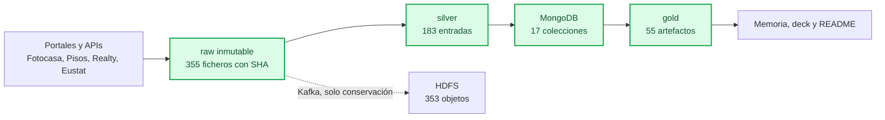
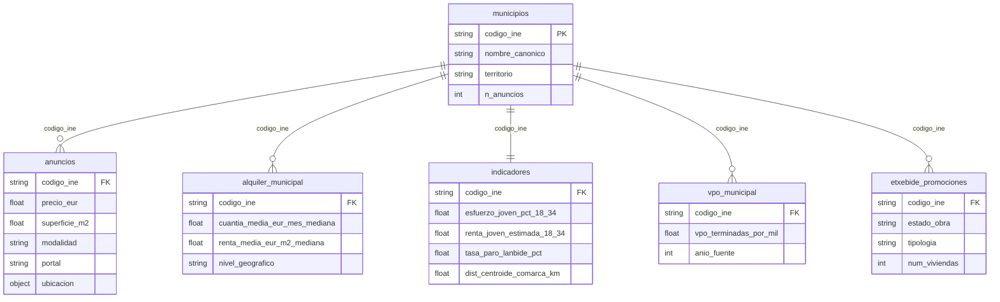

# ¿Dónde puede vivir un joven en Euskadi?

**252 municipios. 159 con alquiler oficial. 93 con un hueco que se declara. 4 donde el ranking aguanta.**

Eso es `bigdata-vivienda-euskadi`, el pipeline que responde esa pregunta con datos públicos y deja
escrito dónde se rompe la respuesta. Nada está tecleado: cada cifra sale de un CSV del gold y un
verificador falla si deja de coincidir.

> Si vienes con prisa: el alquiler mediano se come **26,61 %** de la renta de un joven de 18–34
> años en los 159 municipios con dato oficial, y **40 de 159** pasan del umbral del 30 %. Con
> anuncios de 2026, la mediana municipal sube a **78,6 %**, que no es una subida sino otra
> fotografía. Solo **4 municipios** tienen anuncios suficientes para ordenarlos.

| Si eres… | Empieza por | Tiempo |
|---|---|---|
| Tribunal o evaluador | [La pregunta](#1-la-pregunta) → [los cuatro](#4-los-cuatro-municipios-que-aguantan) → [límites](#6-lo-que-no-podemos-decir) | 10 min |
| Auditor técnico | [Comprobar](#8-comprobar-que-no-te-miento) → [cómo se construye](#5-cómo-se-construye) → `openspec/audit/v13_2026-11-15/` | 20 min |
| Quien va a ejecutarlo | [Ejecutarlo](#7-ejecutarlo) → [cómo se construye](#5-cómo-se-construye) | 30 min |

## 1. La pregunta

La pregunta parece de economía y al abrirla se vuelve de datos. Para saber si un joven puede
emanciparse hay que dividir dos cosas que nadie publica juntas: lo que cuesta un alquiler y lo que
ingresa alguien de 18 a 34 años. En Euskadi hay 252 municipios y la respuesta tiene cuatro formas
distintas según lo que exista en cada uno.

En **159** hay alquiler registrado por Eustat, y ahí se puede calcular. En **93** no lo hay: se
rellenan por interpolación desde los vecinos, se pintan rayados en el mapa y se usan solo para
decir cuánto se mueve el resultado. En **188** no hay ni un anuncio, y eso se escribe «sin dato»
en lugar de cero. En **4** hay anuncios bastantes para ordenar municipios sin que el orden sea
ruido.

El resto del documento cuenta qué sale de ahí, cómo se construyó y qué no se puede afirmar.

## 2. Lo que se firma en 2024

La capa sólida es el alquiler registrado de 2024 cruzado con la renta municipal del INE, ajustada
al reparto por edad de la CAE. El resultado es un porcentaje por municipio, y el mapa lo enseña
entero: la escala va del 20,3 % al 30 % o más, con el color saturado a partir del umbral.


*Esfuerzo 18–34 en 2024 (n=159). Los 40 municipios que pasan del 30 % comparten el rojo máximo.
La trama son los 93 imputados por IDW, que no son dato oficial.*

La mediana es **26,61 %**. Cuarenta municipios superan el 30 % y catorce el 35 %. El máximo no está
donde uno espera: Barakaldo encabeza el ranking con 746 € de alquiler, por encima de Donostia con
995 €, porque su renta es bastante más baja. El indicador ordena esfuerzo, no precio, y esa
diferencia es la primera cosa que un lector tiene que aceptar.

## 3. Lo que se pide en 2026

La segunda capa es otra cosa: precios de anuncio recogidos en 2026 en Fotocasa, Pisos y RealtyAPI,
con el salario joven del Observatorio Vasco de la Juventud llevado de 2024 a 2026 por el IPC. Con
esos datos, la mediana municipal es **78,6 %** en 50 municipios, y el **98,3 %** de los 287 anuncios
válidos supera el 30 %.

Aquí conviene frenar antes de decir «subió». Entre las dos capas cambian dos cosas a la vez: la
fuente (contrato firmado frente a precio pedido) y el tamaño de la vivienda (90,0 m² de anuncio
frente a 80,7 m² registrado). No hay forma de repartir la diferencia entre «el alquiler subió» y
«estamos midiendo otra cosa».


*La figura lleva su propio sello: `Datos: oficial 2024 + anuncios 2026 (no comparable)`. Las dos
barras no forman una serie.*

Lo que sí se sostiene es la diferencia de nivel en los siete municipios con al menos cinco
anuncios: todos van en el mismo sentido, de +42,2 puntos en Vitoria-Gasteiz a +78,2 en Donostia.


*Siete municipios con n≥5. Se llama brecha de nivel, nunca evolución.*

Dentro de 2026 conviven dos cifras que no son la misma: **78,6 %** es la mediana de las 50 medianas
municipales, donde cada municipio pesa igual; **87,3 %** es la mediana de los 287 anuncios, donde
pesa cada anuncio. Y una trampa de mercado que hubo que separar: el mismo portal mezcla pisos
enteros con habitaciones. Se detectaron **201** habitaciones, quedaron **140** usables y el resto
de la muestra son **60** pisos enteros, con una mediana de habitación de **545 €**.

## 4. Los cuatro municipios que aguantan

Un ranking con tres anuncios no es un ranking, es una anécdota. Con menos de 30 anuncios el
intervalo de confianza se abre tanto que dos municipios no se pueden ordenar. Por eso el Tier mide
solo confianza, y el mapa de confianza es casi todo naranja de «sin dato»:


*Tier A: Bilbao (204), Donostia (126), Getxo (50) y Vitoria-Gasteiz (39). Tier B llega a Sopela
(19), Zarautz (15) y Santurtzi (11).*

Fuera de esos siete, 188 municipios no tienen ni un anuncio. «Sin dato» no es «asequible», y por
eso el mapa los deja en gris en vez de pintarlos de verde. De los 50 municipios con alguna mediana
en 2026, 43 no llegan a cinco anuncios y no se publican.

Con cuatro municipios sí se puede comparar, y aun así se dice lo justo: los intervalos al 95 % de
Bilbao (33,75–40,95), Getxo (27,54–31,77) y Donostia (32,4–45,8) se solapan entre sí. Lo defendible
es que los tres cruzan el 30 %, no un podio.

## 5. Cómo se construye

Todo empieza en portales y APIs públicas. Un anuncio entra, se congela con su hash, se normaliza,
se carga en Mongo y termina en los CSV y figuras que alimentan la memoria, el deck y este README.



El embudo real de los anuncios explica muchas decisiones posteriores: **1.828** registros crudos,
**639** únicos tras deduplicar, **594** vigentes y **287** válidos para el cálculo. Solo **424** de
los 594 traen coordenadas, porque únicamente Fotocasa publica latitud y longitud; los otros 170
quedan fuera del índice geoespacial sin que nadie los invente.

`data/raw/` es inmutable por diseño: solo `extract/` escribe ahí, y `transform/` necesita
`assert_raw_writable(reason)` para tocar nada, con un test que lo bloquea. La rama de archivo
publica esos originales en HDFS con un manifiesto SHA: Kafka transporta, HDFS conserva y Mongo
sirve las consultas. Kafka no escribe en Mongo.

En la base hay 17 colecciones vivas más 15 de backup, **11 pipelines** en `PIPELINE_ORDER` y 10
índices definidos de los que 8 están materializados. El índice ESR
`{ubicacion.codigo_ine: 1, modalidad: 1, precio_eur: 1}` convierte la consulta canónica de un
`COLLSCAN` de 594 documentos en un `IXSCAN` de 1, y `explain_before_after()` lo enseña sin mutar la
base.

### El modelo, en una imagen



La unidad que une todo es `codigo_ine` de cinco dígitos, y las distancias se calculan con
haversine entre centroides. Los nombres del diagrama son las colecciones y campos reales de
`storage/load_mongo.py`.

## 6. Lo que no podemos decir

Un trabajo con datos se defiende mejor por lo que descarta que por lo que afirma. Estas son las
grietas, con la decisión que se tomó en cada una:

| Grieta | Decisión |
|---|---|
| No hay renta joven por municipio | Se imputa el reparto por edad de la CAE sobre la renta municipal: 56,9 % del nivel de renta, ponderado 2/5/5/5 sobre 17 años |
| 93 municipios sin alquiler oficial | Se rellenan por IDW con los cinco vecinos más cercanos, solo como sensibilidad: la mediana pasa de 26,61 a 25,37 % y los que superan el 30 % de 40 a 47 |
| 188 municipios sin anuncios | No se imputan. «Sin dato» es un valor, no un cero |
| Menos de 30 anuncios | No se rankea. De ahí 4 Tier A y 43 municipios de 2026 sin mediana publicada |
| Pisos y habitaciones en el mismo portal | Se separan por el alquiler mediano del municipio, no por palabra clave: 201 detectadas, 140 usables, 60 pisos enteros |
| 2024 y 2026 miden cosas distintas | Se publica diferencia de nivel con n≥5, nunca variación temporal |

Y lo que queda fuera del alcance, dicho sin adornos: la renta municipal aplicada a todos es una
falacia ecológica; la emancipación solo existe como dato autonómico; la compraventa (ECVI) solo
llega a nivel territorial; las distancias por carretera solo existen en Gipuzkoa; el paro usa
Lanbide porque `tasa_paro_aprox_pct` está invalidado; y de las 406 promociones de VPO, todas
vienen con el número de viviendas vacío, así que se mide flujo, nunca stock.

Cada figura declara su año con un sello visible y con metadatos en el PNG. La autoridad única es
`config/vintage_figuras.yaml`, y el verificador exige además que el sello no tape ningún texto del
eje.

## 7. Ejecutarlo

Requisitos: Python 3.12, [uv](https://docs.astral.sh/uv/), MongoDB local en `localhost:27017` y red
para la extracción viva y el clúster del centro. En Linux o macOS cambia `.venv/Scripts/python.exe`
por `.venv/bin/python`.

```bash
uv venv --python 3.12 .venv
uv pip install --python .venv/Scripts/python.exe -r requirements.txt
cp .env.example .env          # MONGO_*, HDFS_*, KAFKA_* y GATE_LIVE
```

Descarga la cartografía municipal antes de extraer:

```bash
curl -L -o data/raw/shp_euskadi.zip \
  "https://www.geo.euskadi.eus/cartografia/DatosDescarga/Limites/MUNICIPIOS_5000_ETRS89.zip"
cd data/raw && unzip -o shp_euskadi.zip -d shp_euskadi && cd ../..
.venv/Scripts/python.exe extract/main_ingest.py
.venv/Scripts/python.exe extract/main_ingest.py --mode replay-raw   # valida SHA sin red
```

Reconstruye por capas. La fase `mongo` recarga la base y exige permiso explícito; el resto no toca
`data/raw`:

```bash
.venv/Scripts/python.exe scripts/run_pipeline.py --fase silver,quality
.venv/Scripts/python.exe scripts/run_pipeline.py --fase mongo --allow-mongo-write
.venv/Scripts/python.exe scripts/run_pipeline.py --fase gold
```

`--fase all` equivale a `silver,quality,gold` y nunca incluye `mongo`. `--fase full` añade `mongo`
y por eso pide `--allow-mongo-write`. `--dry-run` lista el plan y `--check` valida los hashes.

Para saber si la cadena sigue siendo reproducible sin reconstruir nada:

```bash
.venv/Scripts/python.exe scripts/verificar_reproducibilidad.py
```

Si algo se rompe, esta tabla ahorra media hora:

| Síntoma | Causa | Acción |
|---|---|---|
| `ping=False` o timeout de Mongo | MongoDB no está arrancado | Arranca `mongod`, revisa `MONGO_HOST`/`MONGO_PORT` |
| `NameResolutionError hadoop-worker*` | DNS de los datanodes | Añade los hosts o usa la IP; el `ContentSummary` no depende del `OPEN` |
| `NodeNotReadyError` en Kafka | Broker sin metadata | Reintenta y recrea el topic con `scripts/ensure_topic.py` |
| `.env` no se aplica | Ejecución fuera de la raíz | Lanza los scripts desde la raíz |
| `pytest` no imprime resumen | Doble `-q` (`pyproject` ya añade uno) | `pytest tests` sin `-q` |
| `--fase mongo` aborta | Fase destructiva sin permiso | Añade `--allow-mongo-write` solo si quieres recargar |

## 8. Comprobar que no te miento

Ocho comandos, todos en verde salvo un fallo conocido que está documentado a propósito.

```bash
.venv/Scripts/python.exe -m pytest tests
.venv/Scripts/python.exe scripts/verificar_gobernanza.py
.venv/Scripts/python.exe scripts/gate_extremo_a_extremo.py --offline
.venv/Scripts/python.exe scripts/run_pipeline.py --check
.venv/Scripts/python.exe scripts/verificar_fase_datos.py
.venv/Scripts/python.exe scripts/verificar_cifras_deck.py
.venv/Scripts/python.exe scripts/verificar_vintage_figuras.py
.venv/Scripts/python.exe transform/run_all.py --check
```

| Comando | Salida a 2026-11-15 |
|---|---|
| `pytest tests` | `298 passed, 2 skipped` |
| `verificar_gobernanza.py` | `TODO OK`: 53 cabeceras / 49 con ID, 47 scripts, 183 silver, 0 env sin declarar, 11 pipelines |
| `verificar_reproducibilidad.py` | `RESULTADO: OK`: 355 SHA, DAG cerrado, 17 colecciones y huella `983fa53f…` idéntica en dos pasadas |
| `gate_extremo_a_extremo.py --offline` | `RESULTADO gate: OK` (355 SHA, 183 silver, 17 colecciones, 0 duplicados) |
| `run_pipeline.py --check` | 355 y 183 entradas, 0 errores |
| `verificar_fase_datos.py` | 21 PASS y **1 FAIL 07 conocido**: paro-cero en Aramaio 0,28 / Gaintza 1,45 / Usansolo 3,26 |
| `verificar_cifras_deck.py` | **159/159**: lee los CSV gold, la fórmula del ratio, el GeoJSON y los conteos de Mongo. Usa `.venv/Scripts/python`, el `python` del sistema no tiene `pymongo` |
| `verificar_vintage_figuras.py` | `56 figuras declaradas · gold, deck y memoria sellados y coherentes` |
| `transform/run_all.py --check` | Todo `[OK]` salvo `auditoria_lagunas_silver.csv`; sale con rc 1 por esa salida |

Los huecos están escritos, no escondidos: `auditoria_lagunas_silver.csv` no está materializada en
este checkout; 2 de los 10 índices de `esfuerzo_mercado_2026` no se han creado; el `OPEN` de
WebHDFS depende del DNS de los datanodes y por eso el script de recuperación coteja tamaño y SHA en
lugar de restaurar; y el topic antiguo `anuncios_inmobiliarios` sigue en el broker con 1.420 mensajes
de prueba que no usa la cadena vigente.

Los tres recuentos de raw tampoco coinciden por error: el manifest tiene 355 entradas, HDFS publica
353 objetos porque incluye `.FROZEN` y `.gitkeep`, y en disco hay 357 ficheros contando los dos
ocultos. En silver pasa igual: 183 entradas de manifest frente a 187 ficheros, por los 65 sidecars.
Las cifras y sus fuentes viven todas en `data/resultados/`.

## 9. Mapa del repositorio

| Ruta | Qué hay |
|---|---|
| `extract/` | 41 scripts de captura y descarga; solo esta capa escribe en raw |
| `transform/` | 47 scripts y el DAG silver (`run_all.py`) |
| `storage/` | Carga en Mongo, productor Kafka y subida a HDFS |
| `analysis/` | 11 pipelines, consultas, índices y la comparativa entre municipios |
| `scripts/` | Orquestador por fases y gates de verificación |
| `docs/memoria/` | Memoria en Markdown, HTML, DOCX y PDF, con sus figuras selladas |
| `docs/presentacion_v2/` | Deck de defensa: 26 diapositivas + 12 backups, guion oral y PDF de 38 páginas |
| `docs/presentacion/` | Deck v1, conservado por trazabilidad |
| `openspec/specs/` | Contrato del reto: 19 criterios y 21 requisitos |
| `openspec/audit/v13_2026-11-15/` | Última auditoría contra la rúbrica |
| `data/resultados/README.md` | Índice del gold y de los 8 CSV `mongo_*` |

`vaultVivienda/` queda fuera del repositorio (está en `.gitignore`): es un vault local de estudio con
las notas de defensa slide por slide y las fichas de conceptos, y no se cita como fuente.

## 10. Contexto

Proyecto académico del reto intermodal **SBD + BDA** (Euskadi, 2026). Todas las fuentes son públicas
y están en `config/fuentes.yaml`. No hay fichero `LICENSE`; el uso previsto es académico.
