# bigdata-vivienda-euskadi — ¿Dónde pueden vivir los jóvenes en Euskadi?

Reto intermodal **SBD + BDA**: pipeline en Python que analiza la accesibilidad
de la vivienda para la población joven en Euskadi con datos reales, midiendo cada
criterio contra el contrato OpenSpec de `openspec/specs/contrato-reto/spec.md`.

## 🎯 Objetivo

Responder con datos: ¿puede una persona joven independizarse en Euskadi con su
salario? ¿Qué municipios ofrecen mejores posibilidades de emancipación y por qué?
Todo el recorrido (extracción, almacenamiento, análisis, visualización) está en
Python y se verifica contra la rúbrica del reto.

## 🏗️ Arquitectura del pipeline

```mermaid
flowchart LR
    accTitle: Pipeline de datos vivienda Euskadi
    accDescr: Flujo de fuentes a resultados: extraccion, HDFS, Kafka, MongoDB, limpieza, agregacion, visualizacion.

    src["Fuentes<br/>API + scraping"]
    hdfs["HDFS<br/>originales y procesados"]
    kafka["Kafka<br/>VM Ubuntu, KRaft"]
    mongo["MongoDB<br/>Docker"]
    clean["PyMongo<br/>limpieza"]
    agg["Aggregation Pipeline<br/>indicadores"]
    viz["Graficos + informe"]

    src --> hdfs --> kafka --> mongo --> clean --> agg --> viz

    classDef done fill:#dcfce7,stroke:#16a34a,stroke-width:2px,color:#14532d
    classDef todo fill:#fef9c3,stroke:#ca8a04,stroke-width:2px,color:#713f12
    class src done
    class hdfs,kafka,mongo,clean,agg,viz todo
```



> 🟢 Extracción completada. 🟡 Infraestructura y análisis pendientes.

## 📊 Estado del proyecto

| Fase | Entrega | Estado |
|---|---|---|
| 0 | Entorno + contrato + tests | ✅ Hecha |
| 1 | Extracción (scripts 01–06) | ✅ Hecha |
| 1b | Salarios INE EPA (script 07) | ✅ Cubierto (datos reales) |
| 1c | Pisos.com (script 08) | ⚠️ Script listo, datos no generados |
| 1d | Idealista/RealtyAPI (script 09) | ✅ Opcional, 139 anuncios |
| 2 | Docker Compose HDFS + MongoDB | ⬜ Pendiente |
| 3 | Subida HDFS + recuperación | ⬜ Pendiente |
| 4 | Modelado + operaciones PyMongo | ⬜ Pendiente |
| 5 | Limpieza y transformación | ⬜ Pendiente |
| 6 | Aggregation Pipeline | ⬜ Pendiente |
| 7 | Kafka productor/consumidor | ⬜ Pendiente |
| 8 | Gráficos desde PyMongo | ⬜ Pendiente |
| 9 | Informe, arquitectura y demo | ⬜ Pendiente |

Tests del contrato: `11 passed, 1 xfail` (salarios, ya cubierto por datos reales).

## 📁 Estructura

```
bigdata-vivienda-euskadi/
├── openspec/          Contrato y specs (la verdad)
├── tests/             Verificación del contrato
├── config/            fuentes.yaml (URLs, IDs, cobertura)
├── extract/           Extracción API + scraping (01–09)
├── storage/           HDFS, Kafka, MongoDB (pendiente)
├── transform/         Limpieza y enriquecimiento (pendiente)
├── analysis/          Aggregation Pipeline (pendiente)
├── visualization/     Gráficos (pendiente)
├── notebooks/         Informe de resultados (pendiente)
├── data/raw/          Datos generados (ignorados por git)
└── plan/              Planificación
```

## 🚀 Puesta en marcha

### 1. Entorno Python

```bash
uv venv --python 3.12 .venv
uv pip install --python .venv/Scripts/python.exe -r requirements.txt
```

### 2. Extracción (no necesita Docker ni VM)

```bash
.venv/Scripts/python.exe extract/01_eustat_api.py        # Eustat bankupx
.venv/Scripts/python.exe extract/02_eustat_alquiler.py   # Alquiler municipal
.venv/Scripts/python.exe extract/03_euskadi_emancipacion.py
.venv/Scripts/python.exe extract/04_b5m_geo.py
.venv/Scripts/python.exe extract/05_fotocasa_scraper.py  # Scraping
.venv/Scripts/python.exe extract/06_ine_api.py           # INE wstempus
.venv/Scripts/python.exe extract/07_ine_salarios.py      # Salarios EPA
.venv/Scripts/python.exe extract/08_pisos_scraper.py     # Pisos.com (opcional)
.venv/Scripts/python.exe extract/09_realtyapi.py         # Idealista vía RealtyAPI (opcional)
```

Salida en `data/raw/`.

### 3. Verificar contra el contrato

```bash
.venv/Scripts/python.exe -m pytest tests -q
```

### 4. Infraestructura y análisis (pendiente)

```bash
.venv/Scripts/python.exe storage/hdfs_utils.py
.venv/Scripts/python.exe storage/kafka_producer.py
.venv/Scripts/python.exe storage/kafka_consumer.py
.venv/Scripts/python.exe analysis/pipeline_agregaciones.py
```

## 📜 Contrato de requisitos (OpenSpec)

La implementación está atada a la rúbrica del reto. El contrato vive en
`openspec/` y **manda sobre el código**:

| Fichero | Contenido |
|---|---|
| `openspec/specs/contrato-reto/spec.md` | **La verdad.** Rúbrica literal + 18 requisitos + prohibiciones |
| `openspec/specs/extraccion-datos/spec.md` | Extracción API y scraping, formato, salarios |
| `openspec/specs/almacenamiento-y-streaming/spec.md` | HDFS, Kafka, integración |
| `openspec/specs/mongodb-y-analisis/spec.md` | Modelado, PyMongo, consultas, agregación, limpieza |
| `openspec/specs/presentacion-de-resultados/spec.md` | Gráficos, datos, presentación, interpretación |
| `openspec/config.yaml` | Contexto, reglas y `contract_first` |
| `openspec/project.md` | Objetivo, stack, layout y fuentes |

**Regla de oro:** antes de escribir código se lee
`openspec/specs/contrato-reto/spec.md`. Un criterio solo se marca como cubierto
cuando se puede verificar.

## 🗂️ Fuentes de datos

Todas verificadas en octubre de 2026.

| Fuente | Tipo | Registro | Cobertura |
|---|---|---|---|
| Eustat bankupx API | API JSON | No | Población, renta, PIB, tenencia por municipio |
| Eustat ExtractorBlob | CSV/XLSX | No | Alquiler municipal (€/m², €/mes, m²) |
| INE wstempus API | API JSON | No | Población, hogares, precios de compraventa |
| euskadi.eus | CSV | No | Emancipación juvenil (16 indicadores) |
| b5m Gipuzkoa | API JSON | No | Límites municipales, distancias |
| Open Data Euskadi (geo.euskadi.eus) | SHP | No | Límites municipales Euskadi completo (251 municipios) |
| Catastro INSPIRE | WFS/WMS | No | Parcelas, antigüedad (opcional; PV excepto Gipuzkoa/Bizkaia) |
| LANBIDE | Web | No | Paro registrado por municipio (mensual) |
| Fotocasa | Scraping | No | ~480 anuncios reales de alquiler |
| Pisos.com | Scraping | No | Segunda fuente de anuncios (script 08) |
| Idealista (RealtyAPI) | API | Sí (key) | Opcional, 139 anuncios generados |

> **Nota:** la API del INE no publica el alquiler por municipio en Euskadi
> (régimen foral): el valor viene a `null`. Para el alquiler se usa Eustat.

## 📦 Datos generados (última ejecución)

| Fichero | Contenido |
|---|---|
| `eustat_poblacion_edad.json/csv` | 89.424 filas |
| `eustat_renta_municipal.json/csv` | 98.532 filas |
| `eustat_renta_edad.json/csv` | 6.426 filas |
| `eustat_pib_municipal.json/csv` | 13.248 filas |
| `eustat_tenencia.json/csv` | 4.416 filas |
| `alquiler_municipal.csv` | 253 registros, 159 municipios |
| `anuncios_fotocasa.json/csv` | 480 anuncios únicos, 57 municipios |
| `anuncios_realtyapi.json/csv` | 139 anuncios (opcional) |
| `ine_salarios_edad.json/csv` | 198 series (EPA, nacional) |
| `emancipacion_juventud.csv` | 867 filas |
| `ine_*.json/csv` | 5 tablas (69301, 69302, 69303, 69323, 69330) |
| `municipios_gipuzkoa.geojson` | 126 polígonos municipales |
| `distancias_municipios.json` | 180.488 pares de distancias |

## ✅ Verificación

- Contrato: `openspec/specs/contrato-reto/spec.md` (rúbrica transcrita + 18 requisitos)
- Tests: `.venv/Scripts/python.exe -m pytest tests -q`
- Prohibiciones verificadas: todo en Python, sin credenciales rastreadas, criterios transcritos
