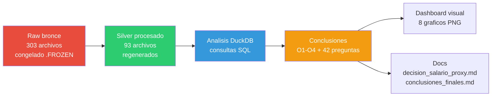
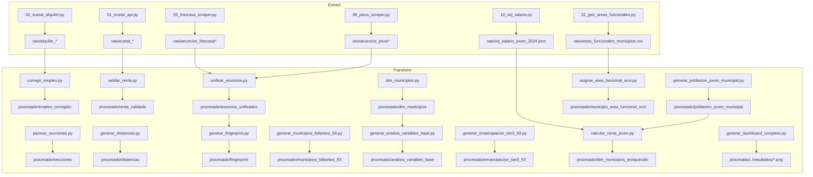
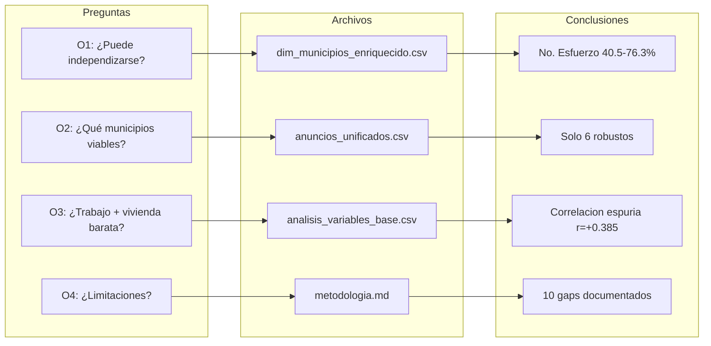
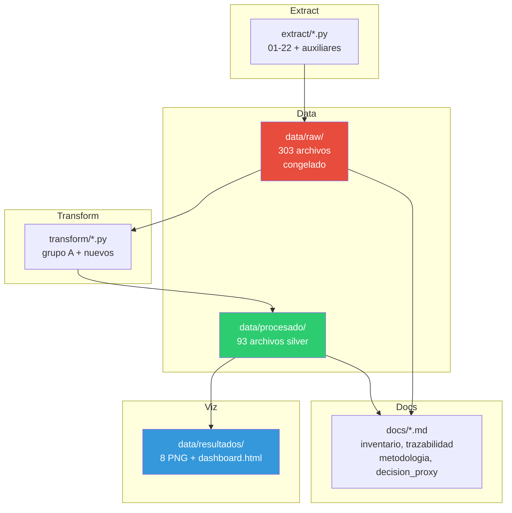

# Mapa de Relaciones — BigData Vivienda Euskadi

> Regenerable: actualizar manualmente cuando cambien transforms, datos o preguntas.
> Renderiza en GitHub, VS Code (extensión Mermaid), Obsidian o https://mermaid.live

---

## 1. Flujo de datos (raw → silver → análisis → conclusiones)

---

## 2. Dependencias entre transforms (qué script genera qué archivo)

---

## 3. Mapa pregunta → archivo → conclusión

### Bloque A — Accesibilidad
| Pregunta | Archivo | Conclusión |
|----------|---------|------------|
| A1 Esfuerzo mediano | dim_municipios_enriquecido.csv | mediana 40.5-76.3% |
| A2 % >30% | dim_municipios_enriquecido.csv | 100% de 159 municipios |
| A3 Fiscal vs salarial | decision_salario_proxy.md | intervalo [40.5-76.3%] |
| A4 Oficial vs anuncios | alquiler_municipal_completo.csv | 159 directo + 93 comarcal |
| A5 Sin dato | alquiler_municipal_completo.csv | 93 imputados por comarca |
| A6 Temporal vs larga | anuncios_unificados.csv | modalidad separada |

### Bloque B — Mercado laboral
| Pregunta | Archivo | Conclusión |
|----------|---------|------------|
| B1 Paro juvenil | analisis_variables_base.csv | tasa_paro_lanbide_pct |
| B2 Ocupación vs precio | analisis_variables_base.csv | correlación espuria |
| B3 Afiliación SS | analisis_variables_base.csv | afiliacion_ss_16_24_pct |
| B4 Trade-off paro/precio | analisis_variables_base.csv | r=+0.385 espuria |
| B5 Paro larga duración | lanbide_paro_juvenil.csv | paro_larga_duracion |
| B6 Tasa desempleo real | — | LIMITACIÓN: falta población activa joven |

### Bloque C — Vivienda stock y calidad
| Pregunta | Archivo | Conclusión |
|----------|---------|------------|
| C1 VPO | udalmap_empleo_corregido.csv | 93.6% ceros |
| C2 Antigüedad | udalmap_empleo_corregido.csv | antiguedad_media_anyos |
| C3 Confort/ascensor | udalmap_empleo_corregido.csv | indice_confort |
| C4 Superficie media | anuncios_unificados.csv | superficie_m2 |
| C5 Cert. energético | anuncios_fotocasa_detalle.json | 467/470 |
| C6 Licencias nueva construcción | udalmap_empleo_corregido.csv | licencias_nueva_por_mil |

### Bloque D — Geografía
| Pregunta | Archivo | Conclusión |
|----------|---------|------------|
| D1 Distancia capital | analisis_variables_base.csv | dist_centroide_comarca_km |
| D2 Conectividad GTFS | transporte_paradas_municipio_enriquecido.csv | expediciones_dia |
| D3 OSRM vs Haversine | municipios_faltantes_93.csv | distancias_capitales.csv |
| D4 Rural vs urbano | analisis_variables_base.csv | tipologia_mercado |
| D5 Densidad población | eustat_demografia_renta_252.csv | poblacion_total |

### Bloque E — Demografía
| Pregunta | Archivo | Conclusión |
|----------|---------|------------|
| E1 Población extranjera | — | LIMITACIÓN: no en silver |
| E2 Variación población | — | LIMITACIÓN: no en silver |
| E3 Envejecimiento | — | LIMITACIÓN: no en silver |
| E4 Renta por sexo | eustat_renta_edad.csv | brecha 1612 vs 1437 (2022) |

### Bloque F — Comparaciones
| Pregunta | Archivo | Conclusión |
|----------|---------|------------|
| F1 Temporal vs larga | anuncios_unificados.csv | modalidad |
| F2 Oficial vs anuncios | alquiler_municipal_completo.csv | 159 + 93 |
| F3 Periféricos vs capital | analisis_variables_base.csv | tipologia_mercado |
| F4 Álava vs Bizkaia vs Gipuzkoa | analisis_variables_base.csv | comparativa TH |
| F5 Compraventa vs alquiler | municipio_area_funcional_ecvi.csv | 15 áreas funcionales |

### Bloque G — Calidad y limitaciones
| Pregunta | Archivo | Conclusión |
|----------|---------|------------|
| G1 Sin dato alquiler | alquiler_municipal_completo.csv | 93 comarcal |
| G2 n<5 anuncios | anuncios_unificados.csv | no usados en ranking |
| G3 Proxy renta | decision_salario_proxy.md | falacia ecológica |
| G4 Emancipación territorial | eustat_renta_edad.csv | solo CAE |
| G5 Mezcla de años | metodologia.md | 2026 vs 2024 |
| G6 Fuentes no automatizadas | inventario_datos.md | SERPAVI, OSM, Idealista |

---

## 4. Arquitectura del proyecto

---

## 5. Leyenda de fuentes

| Abreviatura | Significado |
|-------------|-------------|
| Eustat | Instituto Vasco de Estadística |
| OVJ | Observatorio Vasco de la Juventud (Irekia) |
| Lanbide | Servicio Vasco de Empleo |
| Udalmap | Indicadores municipales Euskadi |
| GTFS | General Transit Feed Specification |
| OSRM | Open Source Routing Machine |
| ECVI | Encuesta de Condiciones de Vida (INE) |
| SERPAVI | Sistema Estatal de Referencia de Precios de Alquiler |

---

## Notas de regeneración

- Este archivo es **texto estático**. Cuando cambien transforms, datos o preguntas, actualizar las tablas y diagramas manualmente.
- Los diagramas Mermaid se renderizan en GitHub, VS Code (extensión), Obsidian o https://mermaid.live
- Para generar PNG estático: `npm install -g @mermaid-js/mermaid-cli` → `mmdc -i docs/mapa_relaciones.md -o mapa_relaciones.png`
PY