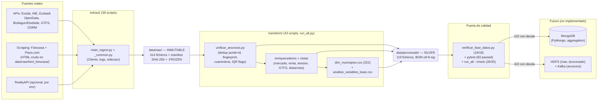

# Arquitectura de datos — recorrido origen → análisis

Entregable §3 del PDF (esquema del recorrido). Fase actual: obtencion + transformacion.
HDFS / Kafka / MongoDB = futuro (readiness en `framework_auditoria_completo2/06_readiness_mongo_infra.md`).

## Tabla de flujos

| # | Origen | Script | Destino | n |
|---|--------|--------|---------|---|
| 1 | APIs + scraping | `extract/main_ingest.py` | `data/raw/` | 314 |
| 2 | `anuncios_*_enriquecido_geo.json` + RealtyAPI | `transform/unificar_anuncios.py` | `anuncios_unificados.json/.csv` | 759, 83 mun |
| 3 | unificados + oficiales + complementarios | `transform/` (vistas) | `dim_municipios.csv`, `analisis_variables_base.csv`, `alquiler_municipal_completo.csv` (252) | 252 |
| 4 | silver | gate + tests | veredicto GO/NO-GO | 18/18, 83 passed |
| 5 | silver (futuro) | PyMongo load | MongoDB | — |
| 6 | raw/silver (futuro) | HDFS + Kafka | `/raw`, `/procesado`, topic anuncios | — |

## Decisiones clave

- Raw append-only con `_raw_guard` + manifest + `.FROZEN` (contrato en `docs/contrato_datos_raw.md`).
- Joins siempre por `codigo_ine` (5 dígitos), nunca por nombre (`muni_resolve.py`).
- Nulos con flag + método (`R1`, `R6`, `R8`, `R9` en `docs/reglas_limpieza.md`); outliers marcados, no borrados.
- Limitaciones declaradas: cobertura anuncios 83/252 (4 robustos), Pisos geo aproximada, equipamiento solo RealtyAPI, renta joven = proxy.
