# Arquitectura de datos — recorrido origen → análisis

Entregable §3 del PDF (esquema del recorrido). Fase actual: obtencion + transformacion + MongoDB implementado.
MongoDB = hecho (PyMongo, 16 colecciones, 9 pipelines, CSV en data/resultados). HDFS centro solo-raw hecho (`http://10.22.87.215:50070`, `/user/iabd-user15/bigdata_reto/vivienda_euskadi/data/raw`); Kafka VM hecho (broker 4.3.1 KRaft pid 1832, topic 3 particiones). Decisión firmada: `procesado/` queda solo en local, no se sube a HDFS.

```mermaid
flowchart LR
    subgraph Fuentes["Fuentes reales"]
        API["APIs: Eustat, INE, Euskadi OpenData, Bizilagun/Etxebide, GTFS, OSRM"]
        SCR["Scraping: Fotocasa + Pisos.com\n(HTML crudo en data/raw/html_fotocasa/)"]
        OPT["RealtyAPI (opcional, por env)"]
    end
    subgraph Extract["extract/ (38 scripts)"]
        ING["main_ingest.py + _common.py\n(Cliente, logs, sidecars)"]
    end
    subgraph RAW["data/raw/ — INMUTABLE\n356 ficheros + manifest SHA-256 + .FROZEN"]
    end
    subgraph Transform["transform/ (43 scripts, run_all.py)"]
        UNI["unificar_anuncios.py\n(dedup portal+id, fingerprint,\ncuarentena, IQR flags)"]
        ENR["enriquecedores + vistas\n(mercado, renta, tension, GTFS, distancias)"]
        DIM["dim_municipios.csv (252)\n+ analisis_variables_base.csv"]
    end
    subgraph Silver["data/procesado/ — SILVER\n188 ficheros, BOM utf-8-sig"]
    end
    subgraph QA["Puerta de calidad"]
        GATE["verificar_fase_datos.py (18/18)\n+ pytest (136 passed)\n+ run_all --check (35/35)"]
    end
    subgraph Mongo["MongoDB hecho (vivienda_euskadi)"]
        MONGO[("MongoDB\n(PyMongo, 16 colecciones)\nstorage/load_mongo.py")]
        AGG["Aggregation\n(9 pipelines)\nanalysis/run_analisis_mongo.py"]
        CSV["CSV visualizacion\ndata/resultados/"]
    end
    subgraph Futuro["Futuro (no implementado)"]
        HK["HDFS (/raw, /procesado)\n+ Kafka (anuncios)"]
    end
    API --> ING
    SCR --> ING
    OPT --> ING
    ING --> RAW
    RAW --> UNI
    UNI --> ENR
    ENR --> DIM
    UNI --> Silver
    ENR --> Silver
    DIM --> Silver
    Silver --> GATE
    Silver --> MONGO
    MONGO --> AGG --> CSV
    GATE -.-> HK
```

## Tabla de flujos

| # | Origen | Script | Destino | n |
|---|--------|--------|---------|---|
| 1 | APIs + scraping | `extract/main_ingest.py` | `data/raw/` | 356 |
| 2 | `anuncios_*_enriquecido_geo.json` + RealtyAPI | `transform/unificar_anuncios.py` | `anuncios_unificados.json/.csv` | 759, 83 mun |
| 3 | unificados + oficiales + complementarios | `transform/` (vistas) | `dim_municipios.csv`, `analisis_variables_base.csv`, `alquiler_municipal_completo.csv` (252) | 252 |
| 4 | silver | gate + tests | veredicto GO/NO-GO | 18/18, 136 passed |
| 5 | silver (hecho) | `storage/load_mongo.py` + `scripts/run_mongo_pipeline.py` | MongoDB `vivienda_euskadi` (16 colecciones) | 252 municipios, 759 anuncios, 252 alquiler, 252 indicadores |
| 6 | MongoDB (hecho) | `analysis/run_analisis_mongo.py` (9 pipelines) | `data/resultados/*.csv` | esfuerzo 252, alquiler 252, modalidades 2, comparativa 3 |
| 7 | raw/silver (futuro) | HDFS + Kafka | `/raw`, `/procesado`, topic anuncios | — |

## Decisiones clave

- Raw append-only con `_raw_guard` + manifest + `.FROZEN` (contrato en `docs/contrato_datos_raw.md`).
- Joins siempre por `codigo_ine` (5 dígitos), nunca por nombre (`muni_resolve.py`).
- Nulos con flag + método (`R1`, `R6`, `R8`, `R9` en `docs/reglas_limpieza.md`); outliers marcados, no borrados.
- MongoDB hecho vía PyMongo (`storage/load_mongo.py`, `analysis/mongo_aggregations.py`, `analysis/mongo_indexes.py`): 16 colecciones, 9 pipelines, índices ESR/2dsphere/multikey y CSV en `data/resultados/`. Ver `docs/modelo_mongodb.md`.
- HDFS solo-raw por decisión firmada 2026-11-05: solo `data/raw/` en HDFS con recuperación SHA byte-idéntica; `data/procesado/` (188 ficheros) queda en local y no se sube. Kafka VM pid 1832 verificado en `docs/trazabilidad_vm.md`.
- Limitaciones declaradas: cobertura anuncios 83/252 (4 robustos: Bilbao 173, Donostia 113, Getxo 40, Vitoria-Gasteiz 39), Pisos geo aproximada, equipamiento solo RealtyAPI, renta joven = proxy.
