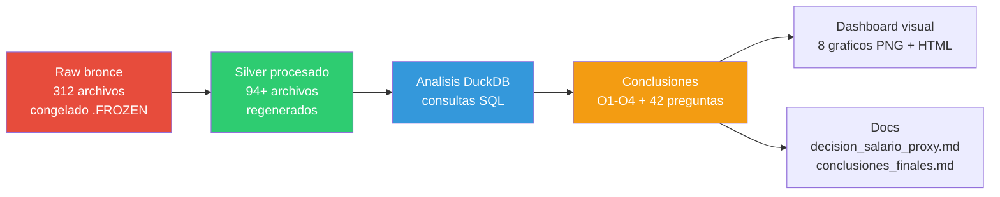
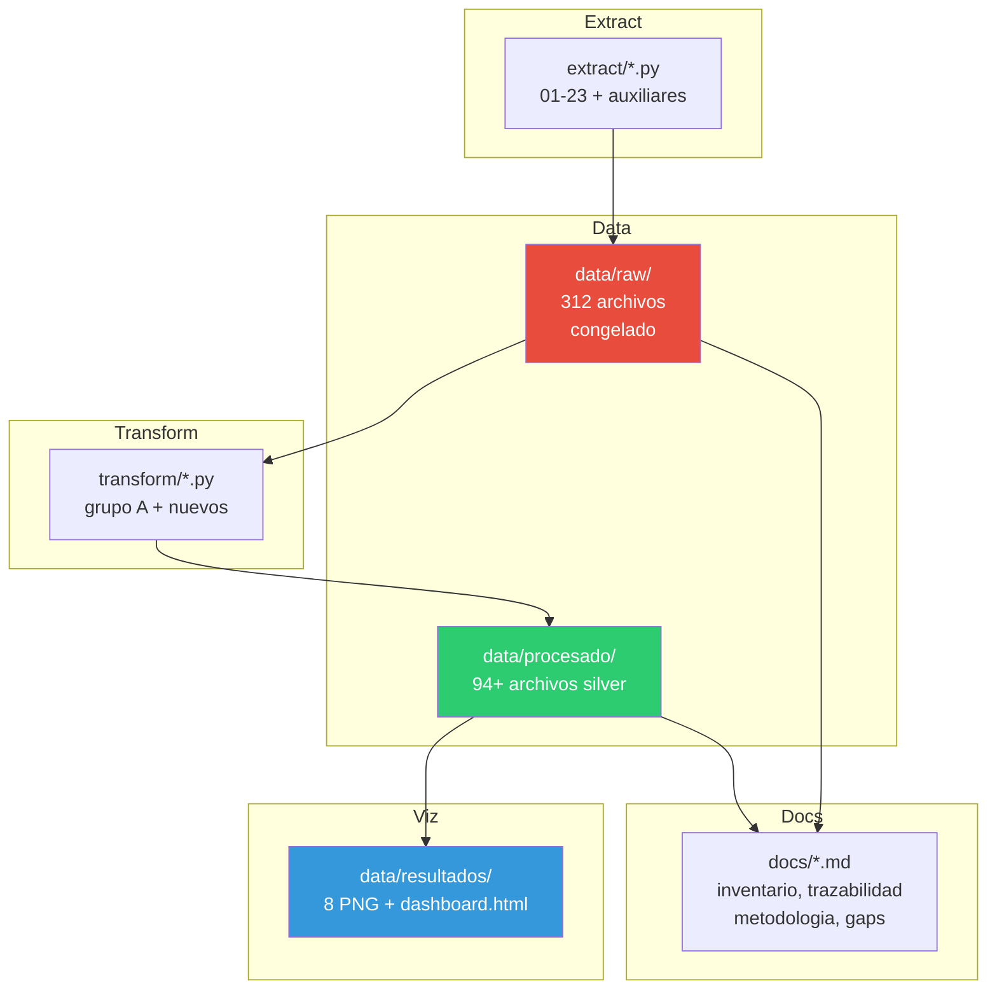

# Mapa de Relaciones v2 — BigData Vivienda Euskadi

> Regenerable: actualizar manualmente cuando cambien transforms, datos o preguntas.
> Renderiza en GitHub, VS Code (extensión Mermaid), Obsidian o https://mermaid.live
> Actualizado: 2026-10-29 (post-certificados energéticos)

---

## 1. Diagrama ER — Tablas principales y relaciones (JOIN por codigo_ine)

```mermaid
erDiagram
    DIM_MUNICIPIOS ||--o{ ALQUILER_MUNICIPAL : "codigo_ine"
    DIM_MUNICIPIOS ||--o{ ANALISIS_VARIABLES_BASE : "codigo_ine"
    DIM_MUNICIPIOS ||--o{ TRANSPORTE_PARADAS : "codigo_ine"
    DIM_MUNICIPIOS ||--o{ CERT_ENERGETICO : "codigo_ine"
    DIM_MUNICIPIOS ||--o{ POBLACION_JOVEN : "codigo_ine"
    DIM_MUNICIPIOS ||--o{ MUNICIPIOS_FALTANTES : "codigo_ine"
    DIM_MUNICIPIOS ||--o{ MUNICIPIO_AREA_FUNCIONAL : "codigo_ine"
    DIM_MUNICIPIOS ||--|| EUSTAT_DEMOGRAFIA : "codigo_ine"
    DIM_MUNICIPIOS ||--o{ ANUNCIOS_UNIFICADOS : "codigo_ine (parcial)"
    DIM_MUNICIPIOS ||--o{ DISTANCIAS_CAPITALES : "codigo_ine"

    DIM_MUNICIPIOS {
        string codigo_ine PK
        string nombre_canonico
        string territorio
        string tipologia_mercado
        int n_anuncios
    }

    ALQUILER_MUNICIPAL {
        string codigo_ine FK
        float alquiler_medio_eur_m2
        string nivel_geografico
        string fuente
    }

    ANALISIS_VARIABLES_BASE {
        string codigo_ine FK
        float tasa_paro_lanbide_pct
        float ocupacion_juvenil_16_24_pct
        float afiliacion_ss_16_24_pct
        float densidad_poblacion
        float dist_centroide_comarca_km
    }

    TRANSPORTE_PARADAS {
        string codigo_ine FK
        int n_paradas
        float paradas_por_1000_hab
        int expediciones_dia
        bool tiene_tren
        bool tiene_metro
    }

    CERT_ENERGETICO {
        string codigo_ine FK
        int n_certificados
        string cert_moda
        int cert_A
        int cert_B
        int cert_C
        int cert_D
        int cert_E
        int cert_F
        int cert_G
    }

    POBLACION_JOVEN {
        string codigo_ine FK
        float poblacion_15_29_est
        float ratio_joven
        string fuente
    }

    MUNICIPIO_AREA_FUNCIONAL {
        string codigo_ine FK
        string area_funcional
        float precio_medio_ecvi
    }

    EUSTAT_DEMOGRAFIA {
        string codigo_ine FK
        float renta_hogar_eur
        float poblacion_total
        float poblacion_extranjera_pct
    }

    ANUNCIOS_UNIFICADOS {
        string codigo_ine FK
        float precio_eur
        float superficie_m2
        string modalidad
        string portal
    }

    DISTANCIAS_CAPITALES {
        string codigo_ine FK
        float dist_bilbao_km
        float dist_donostia_km
        float dist_vitoria_km
        float dist_min_km
    }
```

---

## 2. Flujo de datos (raw → silver → análisis → conclusiones)

---

## 3. Mapa pregunta → archivo → conclusión (resumen)

| Bloque | Pregunta | Archivo principal | Puntuación |
|--------|----------|-------------------|------------|
| O1 | Independizarse con salario | dim_municipios_enriquecido.csv | 7/10 |
| O2 | Mejores municipios | dim_municipios.csv + anuncios_unificados.csv | 8/10 |
| O3 | Trabajo + vivienda barata | analisis_variables_base.csv | 8/10 |
| O4 | Limitaciones | metodologia.md + gaps_misconceptions_errores.md | 9/10 |
| A1-A6 | Accesibilidad | alquiler_municipal_completo.csv + dim_municipios_enriquecido.csv | 8-9/10 |
| B1-B6 | Mercado laboral | analisis_variables_base.csv + lanbide_paro_juvenil.csv | 7-9/10 |
| C1 | VPO | udalmap_empleo.csv (93.6% ceros) | 3/10 |
| C2-C6 | Vivienda stock/calidad | udalmap + anuncios + cert_energetico_municipal_252.csv | 7-9/10 |
| D1-D5 | Geografía | distancias_capitales_252.csv + transporte_paradas_enriquecido.csv | 8-9/10 |
| E1-E4 | Demografía | eustat_demografia_renta_252.csv + udalmap_indicadores_adicionales.csv | 9/10 |
| F1-F5 | Comparaciones | anuncios_unificados.csv + ecvi_compraventa_limpio.csv | 6-9/10 |
| G1-G6 | Calidad/limitaciones | puntos_flacos_dataset.md + gaps_misconceptions_errores.md | 8-9/10 |

**Media: 8,3/10** (42 preguntas)

---

## 4. Arquitectura del proyecto

---

## 5. Leyenda de fuentes

| Abreviatura | Significado |
|-------------|-------------|
| Eustat | Instituto Vasco de Estadística |
| OVJ | Observatorio Vasco de la Juventud (Irekia) |
| Lanbide | Servicio Vasco de Empleo |
| Udalmap | Indicadores municipales Euskadi |
| GTFS | General Transit Feed Specification |
| OSRM | Open Source Routing Machine |
| ECVI | Encuesta de Condiciones de Vida (INE) |
| SERPAVI | Sistema Estatal de Referencia de Precios de Alquiler |
| Open Data Euskadi | Registro de certificados de eficiencia energética |

---

## 6. Relaciones clave (JOINs más usados)

| Tabla A | Tabla B | Clave JOIN | Uso |
|---------|---------|------------|-----|
| dim_municipios | alquiler_municipal_completo | codigo_ine | Esfuerzo = alquiler / renta |
| dim_municipios | analisis_variables_base | codigo_ine | Variables laborales + geográficas |
| dim_municipios | transporte_paradas_enriquecido | codigo_ine | Conectividad vs precio |
| dim_municipios | cert_energetico_municipal_252 | codigo_ine | Cert. energético vs precio |
| dim_municipios | poblacion_joven_municipal | codigo_ine | Población joven vs vivienda |
| dim_municipios | distancias_capitales_252 | codigo_ine | Distancia vs alquiler |
| dim_municipios | municipio_area_funcional_ecvi | codigo_ine | ECVI por área funcional |
| anuncios_unificados | dim_municipios | codigo_ine (parcial) | Anuncios por municipio (6 robustos) |

---

## Notas de regeneración

- Este archivo es **texto estático**. Cuando cambien transforms, datos o preguntas, actualizar las tablas y diagramas manualmente.
- Los diagramas Mermaid se renderizan en GitHub, VS Code (extensión), Obsidian o https://mermaid.live
- Para generar PNG estático: `npm install -g @mermaid-js/mermaid-cli` → `mmdc -i docs/mapa_relaciones.md -o mapa_relaciones.png`
