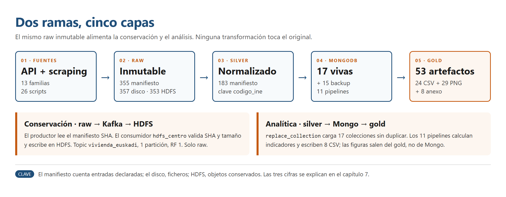

<!-- cap: 2 | titulo: Arquitectura de datos | criterios: C1, C2, C3, C4 | estado: borrador -->
# 2. Arquitectura de datos

> El capítulo sigue el recorrido del dato desde la fuente hasta el análisis y explica por qué hay dos ramas sobre los mismos originales.

## 2.1 Dos ramas sobre los mismos ficheros

El sistema tiene una rama de conservación y una rama analítica. La primera copia los originales a HDFS y simula la llegada de anuncios con Kafka. La segunda limpia, cruza y carga en MongoDB para analizar. Las dos parten del mismo raw inmutable: ningún dato se corrige antes de conservarse.

La separación es deliberada. Si la transformación cambia, el original sigue disponible para reprocesar; si el clúster falla, el análisis puede continuar en local.

## 2.2 Cinco capas

| Capa | Qué contiene | Dónde vive | Tamaño |
|---|---|---|---|
| Fuentes | API, scraping y Open Data | `extract/01…26` | 26 scripts |
| Raw | Original inmutable con SHA-256 y `.FROZEN` | `data/raw/` | {{raw.manifest}} manifiesto · {{raw.disco}} disco ({{raw.visibles}} visibles) · {{infra.hdfs_objetos}} HDFS |
| Silver | CSV normalizados a `codigo_ine` | `data/procesado/` | {{silver.manifest}} manifiesto · {{silver.disco}} disco |
| MongoDB | Colecciones de análisis y pipelines | `vivienda_euskadi` | {{mongo.vivas}} vivas + {{mongo.backup}} backup |
| Gold | CSV y PNG listos para el informe | `data/resultados/` | {{gold.artefactos}} ({{gold.csv}} CSV + {{gold.png}} PNG) + {{gold.anexo_png}} anexo |

Las tres cifras de raw no son intercambiables: el manifiesto cuenta entradas declaradas, el disco cuenta ficheros y HDFS cuenta objetos conservados. La diferencia se explica en el capítulo 7.

## 2.3 La rama de conservación

La extracción cubre 13 familias: Eustat, INE, Fotocasa, Pisos.com, RealtyAPI, Open Data Euskadi (Etxebide, emancipación, certificados, promociones y VPO), Udalmap, Lanbide, OSRM, ECVI, geografía y áreas funcionales, transporte GTFS y equipamientos (educación y salud). Son 26 scripts numerados; el scraping y las descargas no forman parte del orquestador.

El productor lee el manifiesto SHA y publica un mensaje `raw_manifest` con `rel`, `size` y `sha256`. El consumidor del grupo `hdfs_centro` se suscribe al topic `{{infra.kafka_topic}}` en `10.22.87.215:9092`, descarta cualquier mensaje que no sea `raw_manifest` (por eso el topic antiguo de pruebas no contamina), valida SHA y tamaño contra `data/raw` y escribe en `/user/iabd-user15/bigdata_reto/vivienda_euskadi/data/raw`. El topic tiene {{infra.kafka_particiones}} partición y factor de replicación {{infra.kafka_factor_replicacion}}. Los {{infra.hdfs_objetos}} objetos conservados suman {{infra.hdfs_bytes}} bytes.

## 2.4 La rama analítica

Silver se carga en {{mongo.vivas}} colecciones vivas con `replace_collection`. Los pipelines de agregación calculan los indicadores y escriben {{mongo.csv_salidas}} CSV en gold. El resultado final son {{gold.artefactos}} artefactos ({{gold.csv}} CSV y {{gold.png}} PNG), más {{gold.anexo_png}} PNG de anexo.

## 2.5 Una excepción declarada: HDFS solo raw

HDFS conserva los originales, no silver ni gold. Es un requisito del alcance del reto. La reproducibilidad del análisis se apoya en el manifiesto y en los scripts, no en una copia distribuida de los intermedios.

{width=17cm}\
*Figura 2.1. Las dos ramas comparten el raw inmutable. HDFS conserva originales; MongoDB y gold sostienen el análisis. Fuente: `docs/memoria/build.py`, `storage/kafka_hdfs_uploader.py` y `scripts/run_pipeline.py`.*
