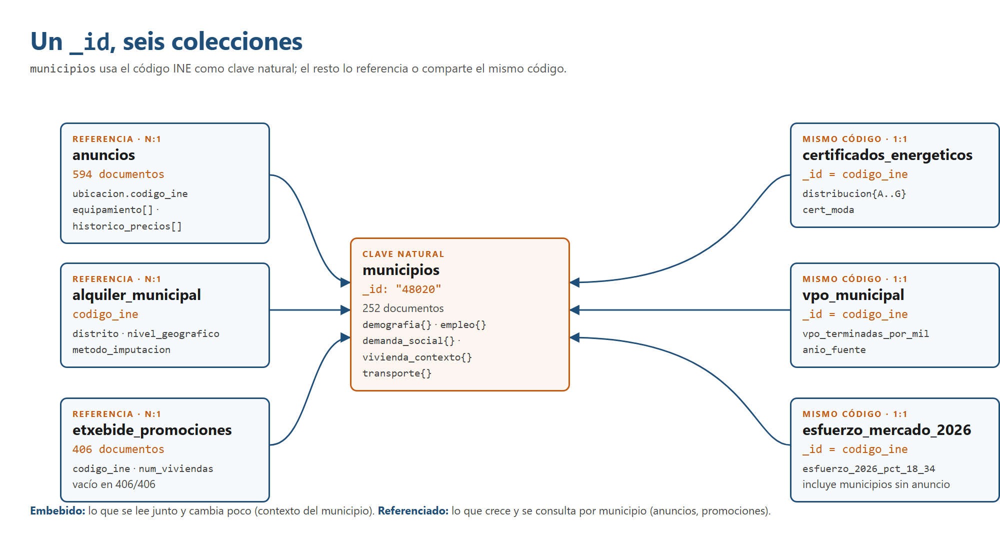

<!-- cap: 4 | titulo: Modelo MongoDB | criterios: C9, C10, C14 | estado: borrador -->
# 4. Modelo MongoDB

> El capítulo justifica el modelo documento a documento y comprueba que las operaciones son correctas e idempotentes.

## 4.1 La regla: lo que se lee junto se embebe, lo que crece se referencia

`municipios` se lee entero para pintar una ficha y cambia poco: demografía, empleo, demanda social, vivienda y transporte van embebidos. `anuncios` crece cada día y se consulta por municipio, modalidad y precio: se referencia con `ubicacion.codigo_ine`. La decisión evita duplicar en cada anuncio un bloque de contexto que no cambia.

| Colección | Documentos | Decisión |
|---|---:|---|
| `municipios` | {{mongo.municipios_docs}} | Contexto embebido; `_id` = código INE |
| `anuncios` | {{mongo.anuncios_docs}} | Referencia a municipio; arrays de equipamiento e histórico |
| `etxebide_promociones` | {{datos.vpo_promociones}} | Documento por promoción; `num_viviendas` puede ser nulo |
| `certificados_energeticos` | {{mongo.certificados_docs}} | Un documento por municipio; distribución A–G embebida |
| `vpo_municipal` | {{mongo.vpo_municipal_docs}} | Indicador terminado por municipio |
| `esfuerzo_mercado_2026` | {{mongo.esfuerzo_2026_docs}} | Capa 2026 separada; incluye municipios sin anuncio |

## 4.2 Colecciones y clave natural

El sistema tiene {{mongo.vivas}} colecciones vivas y {{mongo.backup}} de respaldo, {{mongo.total}} en total. La clave natural es el código INE: el `_id` de `municipios` es `"48020"`, no un ObjectId. No hay un campo `codigo_ine` duplicado dentro de `municipios`; el `_id` ya lo es. En `anuncios`, la referencia es `ubicacion.codigo_ine`.

## 4.3 Tipos y estructuras

Los importes son números, las fechas son fechas y los códigos son cadenas de cinco dígitos. Los arrays (`equipamiento[]`, `historico_precios[]`) se tratan con `$unwind` cuando el análisis lo necesita, sin aplanarlos en la carga. Los documentos anidados conservan la forma de la fuente para no perder información.

## 4.4 Índices

Hay {{mongo.indices_creados}} índices creados de {{mongo.indices_definidos}} definidos. Los ocho activos son: el compuesto ESR de anuncios `(ubicacion.codigo_ine, modalidad, precio_eur)`, el geoespacial `2dsphere`, el único `(portal, id_anuncio)`, el de `equipamiento`, el de `municipios (territorio, nombre_canonico)`, el de alquiler `(codigo_ine, distrito, nivel_geografico)`, el de promociones `(codigo_ine, estado_obra, tipologia)` y el de certificados `cert_moda`. Faltan los dos del pipeline 2026: `idx_esfuerzo_2026_pct_18_34` y `idx_esfuerzo_2026_ter_nombre`.

## 4.5 CRUD, atomicidad y respaldo

El código cubre las cuatro operaciones de PyMongo y comprueba el resultado: `insert_one`/`insert_many`, `find_one`/`find`, `update_one` con `$set`, `$inc`, `$push` y `$addToSet`, y `delete_one`/`delete_many`. `demo_crud_operations` añade `find_one_and_update`, upsert, `$unset`, `$rename`, `$pull` y `bulk_write` sobre una colección temporal que se borra al final.

La carga no usa una transacción multi-documento: cada colección se reemplaza con `replace_collection`, que es atómica a nivel de colección. Para el flag de calidad se usa `find_one_and_update` sobre un único documento de `municipios`, atómico a nivel de documento.

{width=16.5cm}\
*Figura 4.1. `municipios` usa el código INE como `_id`; `anuncios` lo referencia en `ubicacion.codigo_ine`. Fuente: `storage/load_mongo.py` y `analysis/mongo_aggregations.py`.*
