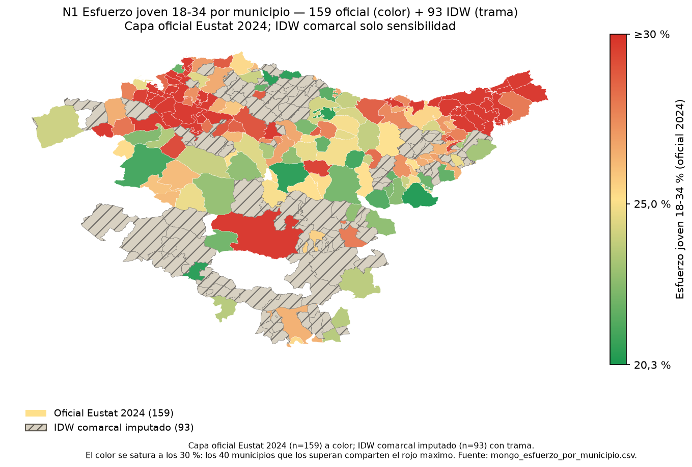
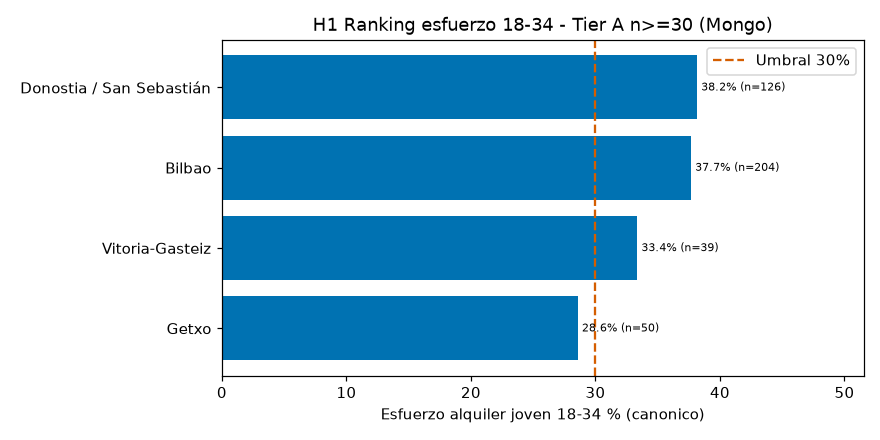
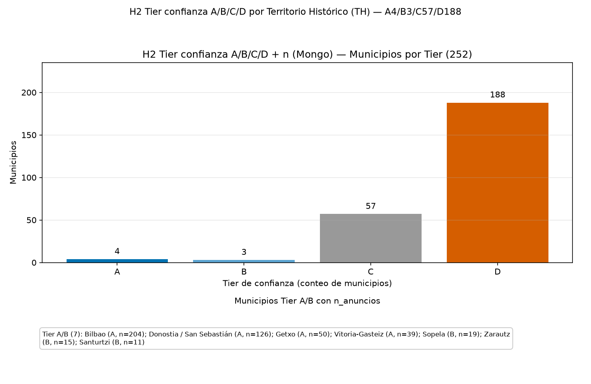
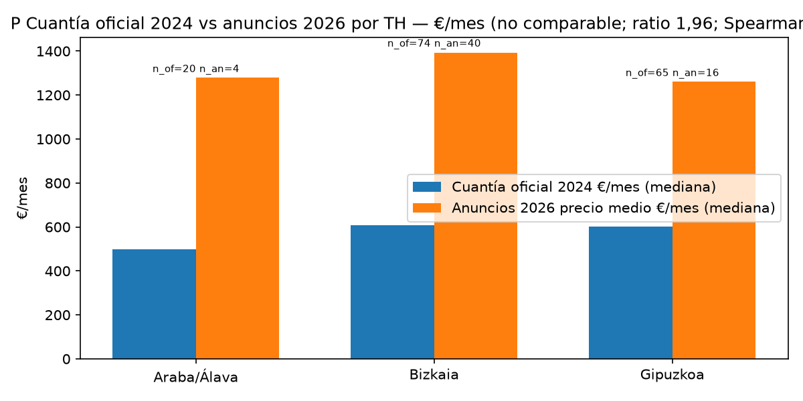
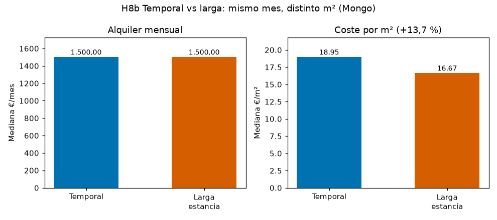
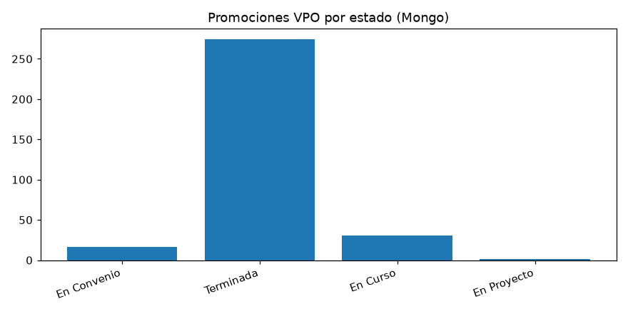
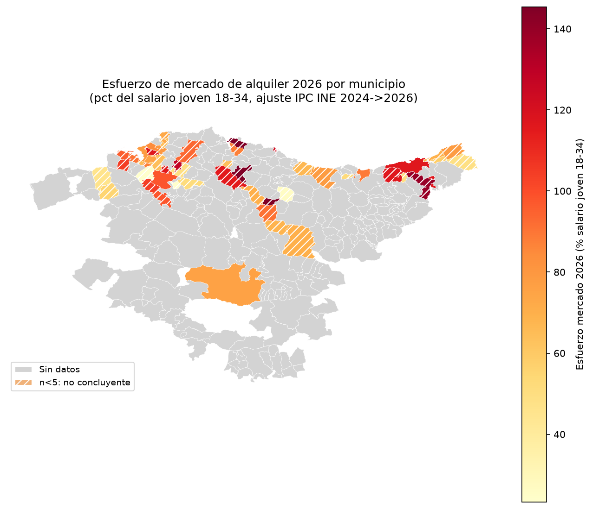
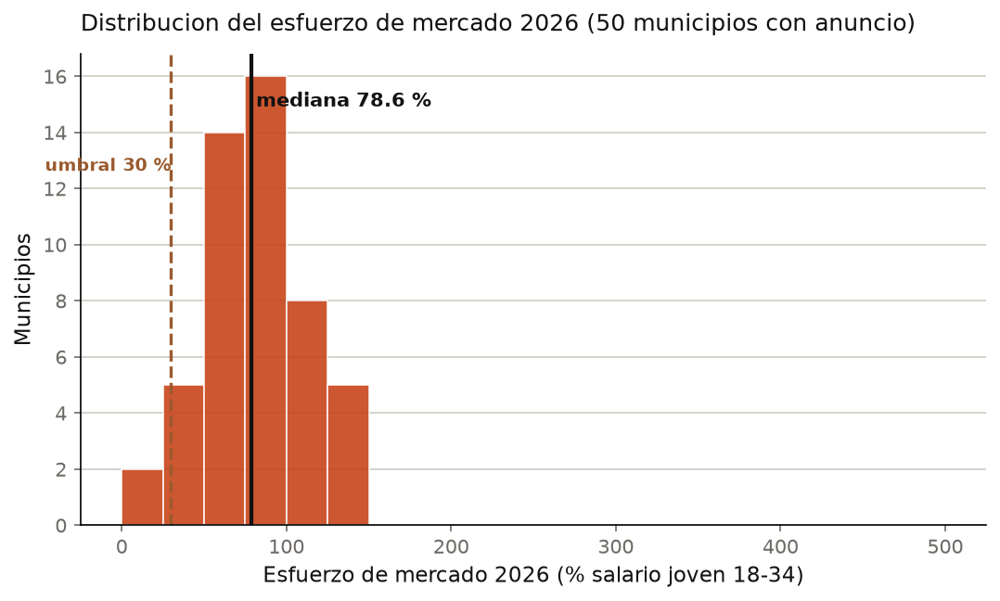

<!-- cap: 6 | titulo: Resultados y conclusiones | criterios: C17, C18, C19 | estado: borrador -->
# 6. Resultados y conclusiones

> **Objetivo.** Responder a la pregunta con indicadores calculados, separar las dos capas y decir qué no se puede afirmar.

## 6.1 O1 · El esfuerzo mediano

| Método | Municipios | Mediana | Por encima del 30 % |
|---|---:|---:|---:|
| Alquiler oficial | {{datos.alquiler_oficial}} | {{datos.esfuerzo_mediana_oficial}} % | {{datos.esfuerzo_oficial_sobre30}} ({{datos.esfuerzo_oficial_sobre30_pct}} %) |
| IDW-252 | {{datos.municipios}} | {{datos.esfuerzo_mediana_idw}} % | {{datos.esfuerzo_idw_sobre30}} ({{datos.esfuerzo_idw_sobre30_pct}} %) |

La mediana oficial es {{datos.esfuerzo_mediana_oficial}} %. La interpolación rebaja la mediana a {{datos.esfuerzo_mediana_idw}} % y reparte los municipios sin dato, pero no crea evidencia donde no la hay. Por eso el ranking principal usa los {{datos.alquiler_oficial}} municipios oficiales.

{width=15cm}

*Figura 6.1. Esfuerzo de la población joven por municipio. El gris indica ausencia de dato, no esfuerzo cero. Fuente: `data/resultados/mapa_coroplastico_esfuerzo_18_34.png`.*

## 6.2 O2 · Dónde está la evidencia

{width=15cm}

*Figura 6.2. Municipios ordenados por esfuerzo con alquiler oficial. Solo se muestran los que tienen muestra suficiente. Fuente: `data/resultados/H1_ranking_esfuerzo_18_34.png`.*

{width=12cm}

*Figura 6.3. Tier A/B/C/D según cobertura y tamaño de muestra. Fuente: `data/resultados/H2_tier_confianza_ABCD.png`.*

El Tier A concentra {{datos.tier_a}} municipios; el B, {{datos.tier_b}}; el C, {{datos.tier_c}}; el D, {{datos.tier_d}}. La conclusión territorial se apoya en el Tier A y se contrasta con el B; el resto se usa para contexto, no para afirmar un ranking.

## 6.3 O3 · Lo que dicen los anuncios

{width=15cm}

*Figura 6.4. Discrepancia entre el alquiler oficial y la oferta observada. Fuente: `data/resultados/P_oficial_vs_anuncios_por_TH.png`.*

De los {{datos.municipios}} municipios, {{datos.anuncios_municipios}} tienen algún anuncio y {{datos.precio_observable}} tienen precio medio. La cobertura es suficiente para describir la oferta, no para sustituir el dato oficial en todos los municipios.

{width=12cm}

*Figura 6.5. Precio por metro cuadrado según modalidad. Fuente: `data/resultados/H8b_modalidad_mediana_eur_m2.png`.*

## 6.4 O4 · Vivienda protegida

{width=12cm}

*Figura 6.6. Promociones de vivienda protegida por estado. Fuente: `data/resultados/C_vpo_por_estado.png`.*

Las {{datos.vpo_promociones}} promociones de Etxebide son flujo de promoción, no stock terminado. El campo `NumViviendas` está vacío en {{datos.vpo_sin_dato}} de {{datos.vpo_promociones}}, así que no se puede leer como un stock de viviendas disponibles.

## 6.5 La capa 2026

{width=15cm}

*Figura 6.7. Esfuerzo con oferta de mercado 2026. Capa separada de 2024; no se resta. Fuente: `docs/presentacion_v2/assets/M26_mapa_coropletico_2026.png`.*

{width=13cm}

*Figura 6.8. Distribución del esfuerzo con anuncios 2026. Fuente: `docs/presentacion_v2/assets/M26_hist_esfuerzo_mercado.png`.*

La capa 2026 responde a “qué se paga hoy en el mercado”, no a “qué alquiler oficial hay”. Se presenta después de la capa 2024 y con su propia escala.

## 6.6 Qué se puede afirmar

Se puede afirmar que el esfuerzo mediano supera el 30 % en una parte relevante de los municipios con dato, que la evidencia se concentra en el Tier A y que la oferta de anuncios no cubre todo el territorio. No se puede afirmar que un municipio sin dato sea asequible, ni que la diferencia entre 2024 y 2026 sea una evolución: son fuentes distintas.
