<!-- cap: 6 | titulo: Resultados y conclusiones | criterios: C17, C18, C19 | estado: borrador -->
# 6. Resultados y conclusiones

> El capítulo cuenta primero la capa registrada de 2024 y después la capa de oferta de 2026, sin mezclarlas, y cierra con lo que se puede y no se puede afirmar.

El capítulo responde a cuatro objetivos. **O1**: ¿qué parte de la renta joven se va en alquiler? **O2**: ¿dónde pesa más? **O3**: ¿qué añade la oferta de 2026? **O4**: ¿qué papel tiene la vivienda protegida? O1, O2 y O4 se responden con datos de 2024; O3, con la capa de oferta. Las secciones 6.1 a 6.3 son de 2024, las secciones 6.4 y 6.5 son de 2026, y solo la 6.6 junta las respuestas, sin restarlas.

## 6.1 O1. La capa 2024: el esfuerzo mediano

| Método | Municipios | Mediana | Por encima del 30 % |
|---|---:|---:|---:|
| Alquiler oficial | {{datos.alquiler_oficial}} | {{datos.esfuerzo_mediana_oficial}} % | {{datos.esfuerzo_oficial_sobre30}} ({{datos.esfuerzo_oficial_sobre30_pct}} %) |
| IDW-252 | {{datos.municipios}} | {{datos.esfuerzo_mediana_idw}} % | {{datos.esfuerzo_idw_sobre30}} ({{datos.esfuerzo_idw_sobre30_pct}} %) |

El esfuerzo es el alquiler mensual multiplicado por doce, dividido entre la renta joven anual y expresado en porcentaje. El indicador canónico usa el tramo de 18 a 34 años. El tramo de 16 a 29 se conserva en los CSV como legado: comparte fórmula pero no denominador, y ninguna conclusión de esta memoria lo usa. El 30 % es el umbral de referencia habitual en los estudios de asequibilidad; aquí se usa como línea de lectura, no como frontera estadística.

La mediana oficial es {{datos.esfuerzo_mediana_oficial}} %. La interpolación asigna un valor a los {{datos.alquiler_imputado}} municipios sin alquiler oficial y baja la mediana a {{datos.esfuerzo_mediana_idw}} %, pero no crea evidencia donde no la hay. El recuento de municipios por encima del 30 % sube de {{datos.esfuerzo_oficial_sobre30}} a {{datos.esfuerzo_idw_sobre30}} solo porque se añaden {{datos.alquiler_imputado}} municipios: en proporción baja del {{datos.esfuerzo_oficial_sobre30_pct}} % al {{datos.esfuerzo_idw_sobre30_pct}} %, así que la imputación no aumenta la tensión, la diluye. Los {{datos.idw_suma_sobre30}} municipios que la imputación empuja por encima del 30 % son Beizama, Navaridas, Kuartango, Galdames, Munitibar, Villabuena de Álava y Añana: núcleos rurales pequeños, no un cambio de patrón. Por eso el ranking principal usa los {{datos.alquiler_oficial}} municipios oficiales.

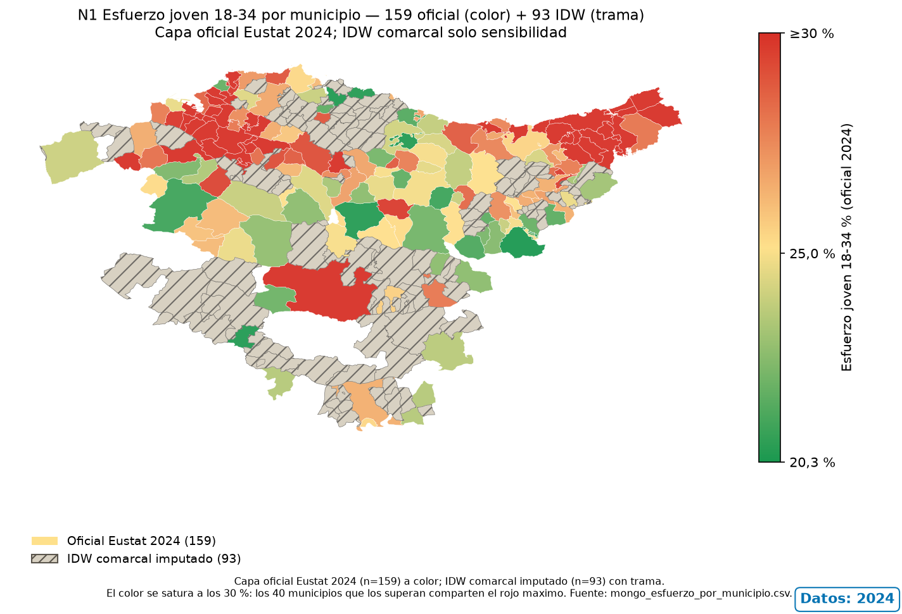{width=15cm}\
*Figura 6.1. Esfuerzo de la población joven por municipio, datos de 2024. El color corresponde a los {{datos.alquiler_oficial}} municipios con alquiler oficial; la trama gris, a los {{datos.alquiler_imputado}} imputados por IDW. Fuente: `data/resultados/mapa_coroplastico_esfuerzo_18_34.png`.*

## 6.2 O2. La capa 2024: dónde pesa más

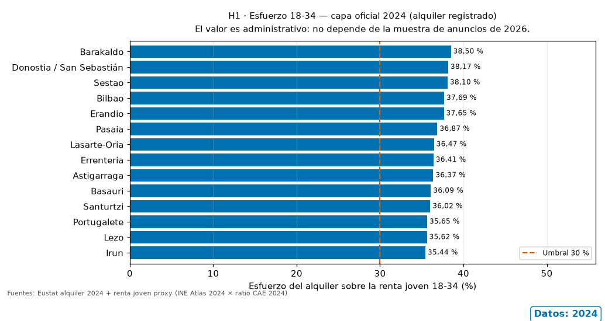{width=15cm}\
*Figura 6.2. Los catorce municipios con alquiler oficial cuyo esfuerzo supera el 35 %, datos de 2024. Sin Tier ni muestra de anuncios: el numerador es administrativo y no depende de la oferta. Fuente: `data/resultados/H1_ranking_esfuerzo_18_34.png`.*

El corte de la tabla no es un top-N elegido a mano: son todos los municipios con alquiler oficial de 2024 que superan el 35 % de esfuerzo, en orden descendente. Por debajo, las posiciones se apelotonan y el orden deja de ser informativo.

| Municipio | Territorio | Alquiler oficial (€/mes) | Esfuerzo 18–34 (2024) |
|---|---|---:|---:|
| Barakaldo | Bizkaia | {{datos.mun_barakaldo_alquiler}} € | {{datos.mun_barakaldo_esfuerzo}} % |
| Donostia / San Sebastián | Gipuzkoa | {{datos.mun_donostia_alquiler}} € | {{datos.mun_donostia_esfuerzo}} % |
| Sestao | Bizkaia | {{datos.mun_sestao_alquiler}} € | {{datos.mun_sestao_esfuerzo}} % |
| Bilbao | Bizkaia | {{datos.mun_bilbao_alquiler}} € | {{datos.mun_bilbao_esfuerzo}} % |
| Erandio | Bizkaia | {{datos.mun_erandio_alquiler}} € | {{datos.mun_erandio_esfuerzo}} % |
| Pasaia | Gipuzkoa | {{datos.mun_pasaia_alquiler}} € | {{datos.mun_pasaia_esfuerzo}} % |
| Lasarte-Oria | Gipuzkoa | {{datos.mun_lasarte_oria_alquiler}} € | {{datos.mun_lasarte_oria_esfuerzo}} % |
| Errenteria | Gipuzkoa | {{datos.mun_errenteria_alquiler}} € | {{datos.mun_errenteria_esfuerzo}} % |
| Astigarraga | Gipuzkoa | {{datos.mun_astigarraga_alquiler}} € | {{datos.mun_astigarraga_esfuerzo}} % |
| Basauri | Bizkaia | {{datos.mun_basauri_alquiler}} € | {{datos.mun_basauri_esfuerzo}} % |
| Santurtzi | Bizkaia | {{datos.mun_santurtzi_alquiler}} € | {{datos.mun_santurtzi_esfuerzo}} % |
| Portugalete | Bizkaia | {{datos.mun_portugalete_alquiler}} € | {{datos.mun_portugalete_esfuerzo}} % |
| Lezo | Gipuzkoa | {{datos.mun_lezo_alquiler}} € | {{datos.mun_lezo_esfuerzo}} % |
| Irun | Gipuzkoa | {{datos.mun_irun_alquiler}} € | {{datos.mun_irun_esfuerzo}} % |

Los catorce tienen alquiler oficial de 2024, ninguno imputado, así que el esfuerzo es dato administrativo y no estimación: alquiler oficial de 2024 sobre renta joven de 2024. El orden es el del esfuerzo, no el del alquiler, y esa diferencia es el resultado: Barakaldo encabeza el ranking con {{datos.mun_barakaldo_esfuerzo}} % y un alquiler de {{datos.mun_barakaldo_alquiler}} €, por debajo del de Donostia ({{datos.mun_donostia_alquiler}} €). Lo que empuja el esfuerzo arriba no es el precio de la vivienda sino la renta joven: Sestao, con {{datos.mun_sestao_alquiler}} €, es el tercero del ranking.

El contraste está en el otro extremo. Getxo, con la renta joven más alta de los siete con muestra, se queda en {{datos.mun_getxo_esfuerzo}} % y no entra en la tabla: un alquiler alto sobre una renta aún más alta pesa menos. El ranking de 2024 mide dónde el alquiler pesa sobre la renta joven, y ahí mandan los municipios industriales de la ría y de la bahía de Pasaia, no los de renta más alta.

Ningún municipio de esta tabla se elige por la muestra de anuncios de 2026. Esa regla pertenece a la capa de oferta y se explica en la sección 6.4.

## 6.3 O4. La capa 2024: la vivienda protegida

Las {{datos.vpo_promociones}} promociones de Etxebide son flujo de promoción, y el reparto por estado lo confirma: 347 terminadas, 39 en curso, 19 en convenio y 1 en proyecto. Es un registro de promociones cerradas, no un flujo vivo. El campo `NumViviendas` está vacío en {{datos.vpo_sin_dato}} de {{datos.vpo_promociones}}, así que no permiten contar viviendas disponibles; y la fecha de sorteo solo existe en parte del registro, entre 2001 y 2014. Por eso este registro sirve para describir el estado de la promoción, no para datar cuánta vivienda protegida se ha terminado.

El dato datado de vivienda protegida es otro: las viviendas protegidas terminadas en el último quinquenio por mil habitantes (Udalmap, indicador 73, edición 2024), cargado para {{mongo.vpo_municipal_docs}} municipios, con Usansolo sin dato. Es un flujo acumulado de cinco años, no un stock, y su reparto es muy desigual: la mayoría de los municipios están en cero y el flujo se concentra en unos pocos. El stock de vivienda protegida no es público, así que no se estima.

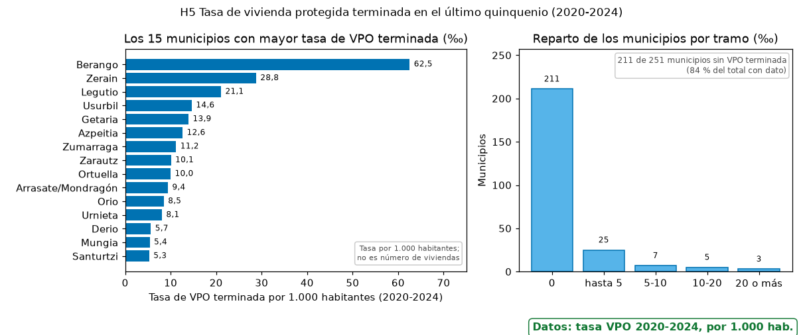{width=12cm}\
*Figura 6.3. Viviendas protegidas terminadas en el último quinquenio por mil habitantes: flujo 2020-2024 (Udalmap, indicador 73, edición 2024), 251 de 252 municipios con dato y 211 en cero. Fuente: `data/resultados/H5_vpo_terminadas_por_mil.png`.*

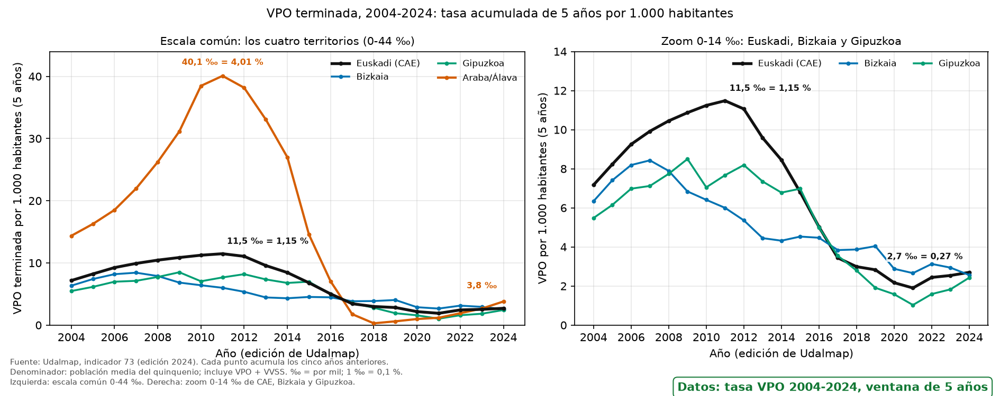{width=15cm}\
*Figura 6.4. VPO terminada por mil habitantes en Euskadi y por territorio histórico, 2004-2024 (Udalmap, indicador 73, edición 2024). Cada punto resume los cinco años anteriores, así que no es el flujo de un año suelto. Euskadi, Bizkaia y Gipuzkoa comparten escala; Araba/Álava va en un panel propio, con su escala, porque su tasa llega a 40,1 ‰ en 2011 y en una escala común aplastaría a las demás series. Fuente: `data/resultados/S_serie_vpo_2004_2024.png`.*

La serie sitúa el dato de 2024: la tasa de Euskadi pasó de un máximo de 11,5 ‰ en 2011 a 2,7 ‰ en 2024. La caída no es un año malo, es una tendencia de más de una década, y se mantiene en los tres territorios históricos. Araba/Álava, con un denominador mucho menor, se comporta igual pero con un perfil mucho más agudo: 40,1 ‰ en 2011 y 3,8 ‰ en 2024, casi sin término medio entre ambos extremos. Esa volatilidad no es un error del dato, es lo que hace una tasa sobre una población pequeña.

## 6.4 O3. La capa 2026: qué hay

La capa 2026 es una fotografía de la oferta publicada, no una segunda medición del alquiler registrado. Se construye porque el dato oficial es de 2024, tarda en publicarse y no cubre a todos los municipios; la oferta dice qué se pide hoy, con la limitación de que un anuncio no es un contrato.

De los {{datos.anuncios_total}} anuncios extraídos en 2026, {{datos.anuncios_larga}} son de larga estancia ({{datos.anuncios_larga_municipios}} municipios) y {{datos.anuncios_temporal}} temporales ({{datos.anuncios_temporal_municipios}}). El temporal se descarta porque no es comparable con un contrato de vivienda habitual. Al filtro de validez —precio y superficie utilizables— le quedan los {{datos.anuncios_2026}} anuncios que sostienen todas las cifras de esta capa, en {{datos.municipios_2026}} municipios. Otros {{datos.anuncios_sin}} municipios no tienen ningún anuncio.

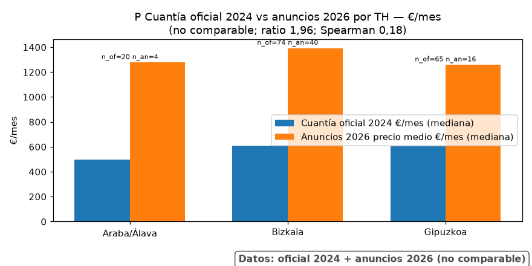{width=15cm}\
*Figura 6.5. Discrepancia entre el alquiler oficial de 2024 y la oferta observada en 2026: mezcla declarada, no comparable. Fuente: `data/resultados/P_oficial_vs_anuncios_por_TH.png`.*

Solo {{datos.n_precio_positivo}} municipios conservan `n_precio > 0`; los {{datos.precio_sin_muestra}} restantes son Tier C/D: tienen precio en la colección, pero no muestra suficiente para publicarlo como estadística municipal. La cobertura describe la oferta; no sustituye el dato oficial en todos los municipios.

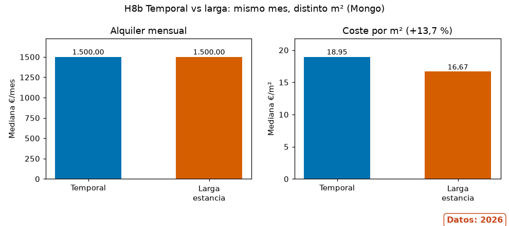{width=12cm}\
*Figura 6.6. Precio por metro cuadrado según modalidad, anuncios de 2026. Fuente: `data/resultados/H8b_modalidad_mediana_eur_m2.png`.*

El alquiler temporal no entra en la capa y conviene decir cuánto pesa. De los {{datos.anuncios_total}} anuncios, {{datos.anuncios_temporal}} son temporales, en {{datos.anuncios_temporal_municipios}} municipios, casi la mitad de la oferta publicada. Se descartan porque un contrato temporal no es vivienda habitual: el precio incluye amueblado y suministros y la estancia no se rige por la ley de arrendamientos urbanos. La diferencia se ve en la figura: por mes cuesta lo mismo que la larga estancia ({{datos.modalidad_mediana_eur_mes}} € de mediana en ambas), pero se pide sobre {{datos.modalidad_temporal_superficie}} m² en vez de {{datos.modalidad_larga_superficie}} m², de modo que el metro cuadrado sale un {{datos.modalidad_temporal_sobrecoste_pct}} % más caro ({{datos.modalidad_temporal_eur_m2}} €/m² frente a {{datos.modalidad_larga_eur_m2}} €/m²). Incluirlo habría subido el precio por metro cuadrado de la capa sin mover la mediana mensual, que es justo el error que se evita al separarlas.

La colección de habitaciones se puede usar, pero no tal cual. Son {{mongo.habitaciones}} anuncios en {{datos.habitaciones_municipios}} municipios, extraídos de la sección de vivienda compartida, y esa sección no solo lista habitaciones: mezcla también pisos completos con el alquiler entero. La prueba está en el extremo alto de la colección bruta, que llega a {{datos.habitaciones_precio_max_bruto}} €/mes, una cifra imposible para una habitación y normal para una vivienda. En vez de descartar la colección entera se aplica una regla de plausibilidad explícita y reproducible: se elimina el anuncio cuyo precio alcanza o supera el alquiler mediano de una vivienda completa en su propio municipio, tomado de la misma fuente oficial de 2024 que el resto de la capa. Una habitación no puede costar más que el piso entero típico del municipio; si lo cuesta, el anuncio no es una habitación.

El corte deja {{datos.habitaciones_utilizables}} anuncios utilizables y descarta {{datos.habitaciones_descartados}} ({{datos.habitaciones_descartados_pct}} %), que son precisamente los pisos enteros colados en la sección. Con ese conjunto, la mediana de una habitación en Euskadi es de {{datos.habitaciones_mediana_global}} €/mes, el {{datos.habitaciones_esfuerzo_global}} % del salario joven de 2026. Por municipios, Bilbao queda en {{datos.habitaciones_bilbao_mediana}} € ({{datos.habitaciones_bilbao_n}} anuncios, {{datos.habitaciones_bilbao_esfuerzo}} %), Donostia en {{datos.habitaciones_donostia_mediana}} € ({{datos.habitaciones_donostia_n}}, {{datos.habitaciones_donostia_esfuerzo}} %), Barakaldo en {{datos.habitaciones_barakaldo_mediana}} €, Vitoria-Gasteiz en {{datos.habitaciones_vitoria_mediana}} € y Getxo en {{datos.habitaciones_getxo_mediana}} €.

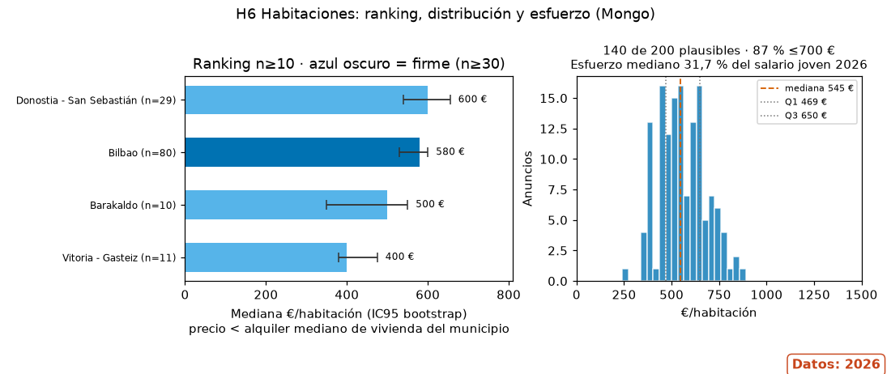{width=15cm}\
*Figura 6.7. Precio de habitación por municipio y distribución de los {{datos.habitaciones_utilizables}} anuncios utilizables, ya sin los pisos enteros que el portal lista en la sección de vivienda compartida. El ranking exige n≥10 y el color separa la muestra firme (n≥30) de la indicativa. Fuente: `data/resultados/H6_habitaciones_mediana_rango.png`.*

La comparación con el piso entero es el resultado que importa: en Bilbao una habitación cuesta {{datos.habitaciones_bilbao_mediana}} € frente a los {{datos.habitaciones_bilbao_tope}} € del alquiler mediano de vivienda, un {{datos.habitaciones_bilbao_ahorro_pct}} % menos; en Donostia, {{datos.habitaciones_donostia_mediana}} € frente a {{datos.habitaciones_donostia_tope}} €, un {{datos.habitaciones_donostia_ahorro_pct}} % menos. Compartir alivia el esfuerzo, pero no lo resuelve: con esos precios el esfuerzo se queda en el {{datos.habitaciones_bilbao_esfuerzo}} % y el {{datos.habitaciones_donostia_esfuerzo}} %, por encima del 30 %. Y la muestra no es un censo: solo Bilbao supera los 30 anuncios utilizables, Donostia se queda en {{datos.habitaciones_donostia_n}} y el resto es indicativo, sin ranking municipal.

Ese esfuerzo de la habitación se puede poner en la misma escala que el del piso entero, porque las dos cifras dividen entre el mismo salario joven de 2026 ajustado que usa la capa de oferta. Es la tasa de esfuerzo por habitaciones:

| Municipio | Anuncios utilizables | Mediana habitación | Esfuerzo habitación | Esfuerzo piso 2026 |
|---|---:|---:|---:|---:|
| Bilbao | {{datos.habitaciones_bilbao_n}} | {{datos.habitaciones_bilbao_mediana}} € | {{datos.habitaciones_bilbao_esfuerzo}} % | {{datos.mun_bilbao_esfuerzo_2026}} % |
| Donostia / San Sebastián | {{datos.habitaciones_donostia_n}} | {{datos.habitaciones_donostia_mediana}} € | {{datos.habitaciones_donostia_esfuerzo}} % | {{datos.mun_donostia_esfuerzo_2026}} % |
| Getxo | {{datos.habitaciones_getxo_n}} | {{datos.habitaciones_getxo_mediana}} € | {{datos.habitaciones_getxo_esfuerzo}} % | {{datos.mun_getxo_esfuerzo_2026}} % |
| Vitoria-Gasteiz | {{datos.habitaciones_vitoria_n}} | {{datos.habitaciones_vitoria_mediana}} € | {{datos.habitaciones_vitoria_esfuerzo}} % | {{datos.mun_vitoria_esfuerzo_2026}} % |

Barakaldo, con {{datos.habitaciones_barakaldo_n}} anuncios, se queda en el {{datos.habitaciones_barakaldo_esfuerzo}} % de esfuerzo de habitación, pero no entra en la tabla porque en 2026 solo tiene dos anuncios comparables de piso. La diferencia entre las dos columnas es el efecto de compartir: la habitación se queda entre el {{datos.habitaciones_vitoria_esfuerzo}} % de Vitoria-Gasteiz y el {{datos.habitaciones_donostia_esfuerzo}} % de Donostia, mientras el piso entero de 2026 va del {{datos.mun_vitoria_esfuerzo_2026}} % al {{datos.mun_donostia_esfuerzo_2026}} %.

El Tier se deriva solo del número de anuncios: A con 30 o más, B de 10 a 29, C de 1 a 9 y D sin anuncios. El Tier A tiene {{datos.tier_a}} municipios, el B {{datos.tier_b}}, el C {{datos.tier_c}} y el D {{datos.tier_d}}. Solo {{datos.tier_ab}} llegan a A o B, y de ellos los {{datos.tier_a}} del Tier A son los que superan el umbral de 30 anuncios que exige la regla del proyecto. Por eso el ranking de la sección 6.5 tiene cuatro barras y no siete.

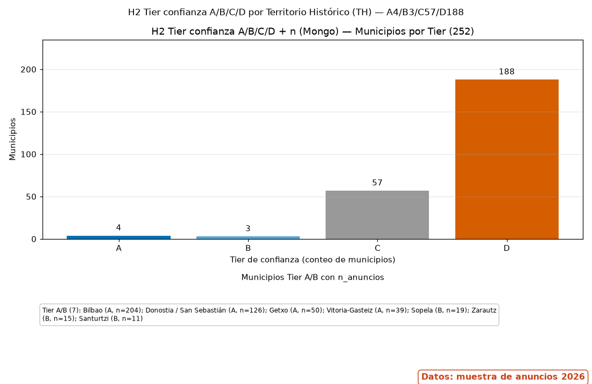{width=12cm}\
*Figura 6.8. Tier A/B/C/D según cobertura y tamaño de muestra, contada sobre los anuncios de 2026. Fuente: `data/resultados/H2_tier_confianza_ABCD.png`.*

La cobertura se mide en población joven, no en municipios: los {{datos.municipios_2026}} municipios con dato son el {{datos.cobertura_municipios_pct}} % del total, pero concentran el {{datos.cobertura_poblacion_pct}} % de la población de 18 a 34 años ({{datos.cobertura_poblacion}} personas). Los {{datos.tier_a}} municipios del Tier A reúnen el {{datos.cobertura_anuncios_n30_pct}} % de los anuncios. La capa no es todo el territorio, pero cubre a la mayoría de la población joven.

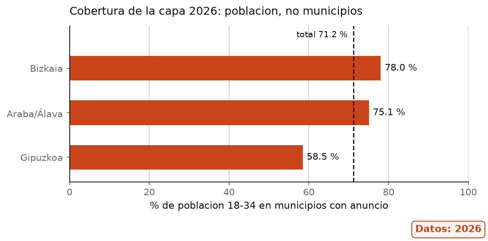{width=13cm}\
*Figura 6.9. Cobertura de la capa 2026 por población de 18 a 34 años, no por número de municipios. Fuente: `docs/presentacion_v2/assets/M26_cobertura.png`.*

## 6.5 O3. La capa 2026: qué dice el esfuerzo

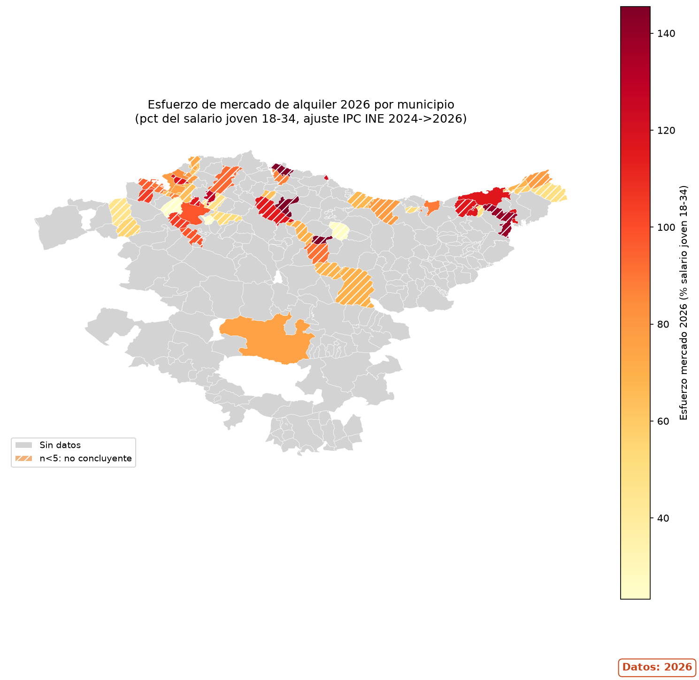{width=15cm}\
*Figura 6.10. Esfuerzo con oferta de mercado de 2026. Capa separada de la de 2024; no se resta. Fuente: `docs/presentacion_v2/assets/M26_mapa_coropletico_2026.png`.*

El esfuerzo de 2026 divide el precio mediano del anuncio entre el salario joven de 2024 ajustado por IPC: el numerador es de 2026 y el denominador se actualiza para no mezclar años. En los cuatro municipios con muestra suficiente el resultado no admite duda de signo:

| Municipio | Anuncios válidos | Esfuerzo 18–34 (2024) | Precio mediano 2026 | Esfuerzo 2026 |
|---|---:|---:|---:|---:|
| Bilbao | {{datos.mun_bilbao_n_2026}} | {{datos.mun_bilbao_esfuerzo}} % | {{datos.mun_bilbao_precio_2026}} € | {{datos.mun_bilbao_esfuerzo_2026}} % |
| Donostia / San Sebastián | {{datos.mun_donostia_n_2026}} | {{datos.mun_donostia_esfuerzo}} % | {{datos.mun_donostia_precio_2026}} € | {{datos.mun_donostia_esfuerzo_2026}} % |
| Getxo | {{datos.mun_getxo_n_2026}} | {{datos.mun_getxo_esfuerzo}} % | {{datos.mun_getxo_precio_2026}} € | {{datos.mun_getxo_esfuerzo_2026}} % |
| Vitoria-Gasteiz | {{datos.mun_vitoria_n_2026}} | {{datos.mun_vitoria_esfuerzo}} % | {{datos.mun_vitoria_precio_2026}} € | {{datos.mun_vitoria_esfuerzo_2026}} % |

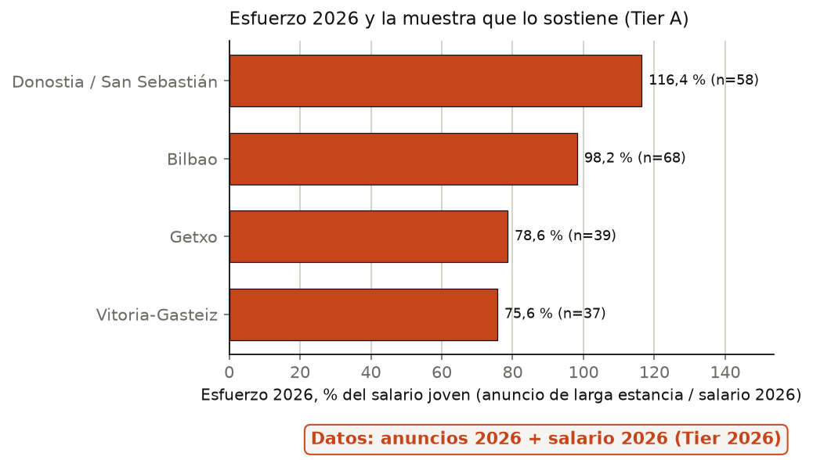{width=15cm}\
*Figura 6.11. Esfuerzo de 2026 con la muestra que lo sostiene, solo Tier A. El Tier se calcula sobre todos los anuncios de 2026, pero la barra usa solo los de larga estancia con precio válido, que son los comparables al contrato oficial: de ahí que cada `n` sea menor que el del Tier (Bilbao, 68 frente a 204; Donostia, 58 frente a 126). El Tier B queda fuera del ranking porque sus 4 a 8 anuncios comparables no llegan al umbral. Sin línea de umbral: el 30 % es del esfuerzo de 2024 y aquí cambian numerador y denominador. Fuente: `docs/presentacion_v2/assets/M26_ranking_esfuerzo_muestra_2026.png`.*

Donostia ({{datos.mun_donostia_esfuerzo_2026}} %) y Bilbao ({{datos.mun_bilbao_esfuerzo_2026}} %) ponen el alquiler de anuncio por encima del salario joven mensual: trabajar no cubre el alquiler. Getxo y Vitoria-Gasteiz se quedan en {{datos.mun_getxo_esfuerzo_2026}} % y {{datos.mun_vitoria_esfuerzo_2026}} %. Santurtzi, Zarautz y Sopela, con 4 a 8 anuncios comparables, no entran en la comparación y se leen como indicativo.

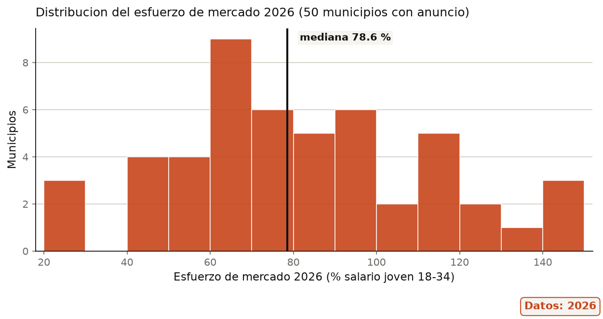{width=13cm}\
*Figura 6.12. Distribución del esfuerzo con anuncios de 2026. Fuente: `docs/presentacion_v2/assets/M26_hist_esfuerzo_mercado.png`.*

La mediana de la capa es {{datos.esfuerzo_2026_salario}} % con el salario ajustado y {{datos.esfuerzo_2026_renta}} % con la renta de 2024 como denominador. En esos mismos {{datos.municipios_2026}} municipios, la mediana oficial de 2024 era {{datos.esfuerzo_2024_canonico}} % y la base salario de 2024, {{datos.esfuerzo_2024_salario}} %. No son comparables: cambia el numerador (anuncio frente a contrato) y, en la primera cifra, también el denominador.

Por tipo, la mediana es {{datos.esfuerzo_2026_tipo_1_2}} % para 1–2 habitaciones ({{datos.anuncios_2026_tipo_1_2}} anuncios), {{datos.esfuerzo_2026_tipo_3}} % para 3 ({{datos.anuncios_2026_tipo_3}}) y {{datos.esfuerzo_2026_tipo_4}} % para 4 o más ({{datos.anuncios_2026_tipo_4}}). El esfuerzo sube con el tamaño. La cifra de 4+ no describe el precio típico de una persona sola.

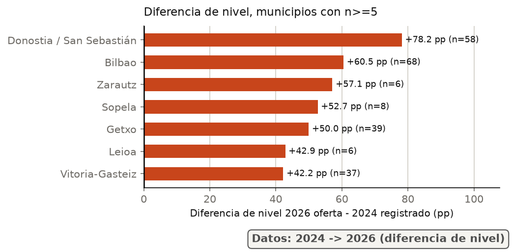{width=15cm}\
*Figura 6.13. Diferencia de nivel entre el esfuerzo registrado de 2024 y el de oferta de 2026, en puntos porcentuales, solo en los municipios con al menos 5 anuncios. No es una variación temporal: cambia la fuente del numerador. Fuente: `docs/presentacion_v2/assets/M26_brecha_n5.png`.*

La distancia entre las dos capas se puede medir sin restarlas como serie: en los {{datos.brecha_municipios_n5}} municipios con al menos 5 anuncios, la diferencia de nivel mediana es de {{datos.brecha_mediana_n5}} puntos porcentuales. Parte de esa distancia es el cambio de fuente y parte es el tipo de vivienda: la superficie mediana del anuncio es de {{datos.sesgo_superficie_anuncios}} m² y la del alquiler registrado, de {{datos.sesgo_superficie_oficial}} m². Un anuncio es una vivienda más grande y más cara que el contrato medio de 2024, y esa diferencia no se corrige restando.

## 6.6 La respuesta y sus límites

En la capa registrada, el esfuerzo mediano en los {{datos.alquiler_oficial}} municipios con alquiler oficial es {{datos.esfuerzo_mediana_oficial}} %, y {{datos.esfuerzo_oficial_sobre30}} municipios ({{datos.esfuerzo_oficial_sobre30_pct}} %) superan el 30 %. El máximo oficial es Barakaldo, con {{datos.mun_barakaldo_esfuerzo}} %, y la tabla de la sección 6.2 lo ordena por renta joven, no por precio: los municipios industriales de la ría y de Pasaia pesan más que los de renta alta, y Getxo, con la renta joven más alta, se queda en {{datos.mun_getxo_esfuerzo}} %.

En la capa de oferta, la mediana sube a {{datos.esfuerzo_2026_salario}} % con el salario ajustado. En los cuatro municipios con muestra suficiente, el esfuerzo va de {{datos.mun_vitoria_esfuerzo_2026}} % en Vitoria-Gasteiz a {{datos.mun_donostia_esfuerzo_2026}} % en Donostia, y en Donostia y Bilbao el alquiler de anuncio supera el salario joven mensual. Esa capa cubre el {{datos.cobertura_poblacion_pct}} % de la población de 18 a 34 años con el {{datos.cobertura_municipios_pct}} % de los municipios.

Las dos respuestas no se suman ni se restan. La diferencia de nivel mediana entre ambas es de {{datos.brecha_mediana_n5}} puntos porcentuales (sección 6.5), y una parte es cambio de fuente: anuncio frente a contrato y vivienda de {{datos.sesgo_superficie_anuncios}} m² frente a {{datos.sesgo_superficie_oficial}} m². Leerla como evolución sería el error que el capítulo 1 advierte.

Lo que no se puede afirmar: un municipio sin dato no es asequible, un esfuerzo alto no prueba causalidad y la vivienda protegida es flujo, nunca stock. Los {{datos.alquiler_imputado}} municipios interpolados y los que tienen anuncio sin muestra no permiten ordenar municipios.
