<!-- GENERADO por docs/memoria/build.py. No editar a mano. -->

> Cifras verificadas el 2026-11-13. Fuente única: `docs/memoria/_cifras.json`.

# Índice

1. Contexto y pregunta
2. Arquitectura de datos
3. Cómo se construyó
4. Modelo MongoDB
5. Análisis e indicadores
6. Resultados y conclusiones
7. Dificultades y decisiones
8. Límites y verificación
9. Anexos

## Resumen

El esfuerzo mediano en los 159 municipios con alquiler oficial es 26,61 %, pero 40 (25,16 %) superan el 30 % de la renta. La evidencia sólida se limita a 4 municipios (Tier A de 2026); el Tier B, con 11 a 19 anuncios, queda como indicativo. Su esfuerzo de 2024 va de 28,60 % en Getxo a 38,17 % en Donostia; el máximo de la capa oficial es Barakaldo, 38,50 %, que en 2026 no tiene muestra suficiente. La capa 2026, con 50 municipios y 287 anuncios, da una mediana de 78,55 % con salario ajustado y 57,77 % con renta 2024; no es comparable con 2024 porque cambia la fuente del numerador. Las dos capas se presentan por separado, los municipios sin dato se declaran y la oferta de anuncios no sustituye al alquiler oficial.

# 1. Contexto y pregunta

> Este capítulo delimita la pregunta, la unidad de análisis y las dos capas de datos que el proyecto mantiene separadas.

## 1.1 El reto

La pregunta de partida es si una persona joven puede independizarse en Euskadi con su salario. El proyecto la traduce a un indicador comparable: el porcentaje de la renta joven que se consume en alquiler. Un municipio es una respuesta mejor cuanto menor es ese esfuerzo, pero solo si el dato existe y es comparable con el de los demás.

El resultado es una lectura territorial del esfuerzo, no un listado de municipios baratos. Hay tres cautelas: la renta es un proxy, el alquiler oficial no cubre todos los municipios y la oferta de anuncios no representa el parque completo.

| Pregunta | Indicador | Fuentes |
|---|---|---|
| ¿Qué parte de la renta joven se va en alquiler? | Esfuerzo joven (%) | Renta, alquiler oficial y anuncios |
| ¿Cuánta evidencia sostiene el dato? | Tier A/B/C/D | Cobertura y muestra de anuncios |
| ¿Qué se paga hoy en el mercado? | Esfuerzo 2026 | Anuncios 2026 y salario ajustado |

## 1.2 La unidad de análisis

Todo el pipeline converge en el código INE de cinco dígitos. Es la clave natural de `municipios`, el nexo con los anuncios y la unidad de los 252 municipios de Euskadi. Usar una sola clave evita el problema clásico de los cruces por nombre: dos municipios con el mismo topónimo en territorios distintos, o un nombre con tilde frente a otro sin ella. En Mongo, el `_id` de `municipios` es el propio código (`"48020"`), no un ObjectId.

## 1.3 Dos capas que no se restan

La capa 2024 mide esfuerzo con alquiler oficial en 159 municipios y se completa por interpolación (IDW) en los 93 restantes. La capa 2026 mide oferta de mercado con 594 anuncios. Son dos fotografías con fuentes distintas y no forman una serie temporal: se presentan por separado y no se restan.

Un anuncio de 2026 y un alquiler registrado de 2024 no miden lo mismo: el primero es oferta publicada y el segundo, contrato registrado. Restarlos produciría una “evolución” que en realidad es un cambio de fuente.

## 1.4 Qué no responde el proyecto

No estima el salario municipal de la población joven, no mide la calidad de la vivienda y no sustituye un trabajo de campo. Cuando falta un dato, se declara; no se rellena con una estimación presentada como observación.


```{=openxml}
<w:p><w:r><w:br w:type="page"/></w:r></w:p>
```

# 2. Arquitectura de datos

> El capítulo sigue el recorrido del dato desde la fuente hasta el análisis y explica por qué hay dos ramas sobre los mismos originales.

## 2.1 Dos ramas sobre los mismos ficheros

El sistema tiene una rama de conservación y una rama analítica. La primera copia los originales a HDFS y simula la llegada de anuncios con Kafka. La segunda limpia, cruza y carga en MongoDB para analizar. Las dos parten del mismo raw inmutable: ningún dato se corrige antes de conservarse.

La separación es deliberada. Si la transformación cambia, el original sigue disponible para reprocesar; si el clúster falla, el análisis puede continuar en local.

## 2.2 Cinco capas

| Capa | Qué contiene | Dónde vive | Tamaño |
|---|---|---|---|
| Fuentes | API, scraping y Open Data | `extract/01…26` | 26 scripts |
| Raw | Original inmutable con SHA-256 y `.FROZEN` | `data/raw/` | 355 manifiesto · 357 disco (355 visibles) · 353 HDFS |
| Silver | CSV normalizados a `codigo_ine` | `data/procesado/` | 183 manifiesto · 187 disco |
| MongoDB | Colecciones de análisis y pipelines | `vivienda_euskadi` | 17 vivas + 15 backup |
| Gold | CSV y PNG listos para el informe | `data/resultados/` | 54 (24 CSV + 30 PNG) + 8 anexo |

Las tres cifras de raw no son intercambiables: el manifiesto cuenta entradas declaradas, el disco cuenta ficheros y HDFS cuenta objetos conservados. La diferencia se explica en el capítulo 7.

## 2.3 La rama de conservación

La extracción cubre 13 familias: Eustat, INE, Fotocasa, Pisos.com, RealtyAPI, Open Data Euskadi (Etxebide, emancipación, certificados, promociones y VPO), Udalmap, Lanbide, OSRM, ECVI, geografía y áreas funcionales, transporte GTFS y equipamientos (educación y salud). Son 26 scripts numerados; el scraping y las descargas no forman parte del orquestador.

El productor lee el manifiesto SHA y publica un mensaje `raw_manifest` con `rel`, `size` y `sha256`. El consumidor del grupo `hdfs_centro` se suscribe al topic `vivienda_euskadi` en `10.22.87.215:9092`, descarta cualquier mensaje que no sea `raw_manifest` (por eso el topic antiguo de pruebas no contamina), valida SHA y tamaño contra `data/raw` y escribe en `/user/iabd-user15/bigdata_reto/vivienda_euskadi/data/raw`. El topic tiene 1 partición y factor de replicación 1. Los 353 objetos conservados suman 895.597.901 bytes.

## 2.4 La rama analítica

Silver se carga en 17 colecciones vivas con `replace_collection`. Los pipelines de agregación calculan los indicadores y escriben 8 CSV en gold. El resultado final son 54 artefactos (24 CSV y 30 PNG), más 8 PNG de anexo.

## 2.5 Una excepción declarada: HDFS solo raw

HDFS conserva los originales, no silver ni gold. Es una decisión expresa de la profesora. La reproducibilidad del análisis se apoya en el manifiesto y en los scripts, no en una copia distribuida de los intermedios.

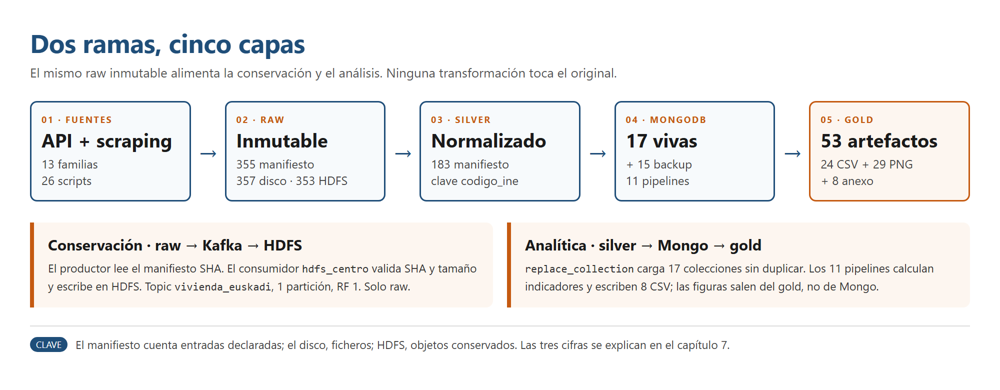{width=17cm}\
*Figura 2.1. Las dos ramas comparten el raw inmutable. HDFS conserva originales; MongoDB y gold sostienen el análisis. Fuente: `docs/memoria/build.py`, `storage/kafka_hdfs_uploader.py` y `scripts/run_pipeline.py`.*


```{=openxml}
<w:p><w:r><w:br w:type="page"/></w:r></w:p>
```

# 3. Cómo se construyó

> El capítulo describe el pipeline que va de la fuente al gold y comprueba que se puede ejecutar sin tocar MongoDB a mano.

## 3.1 Extracción y manifiesto

La extracción combina API, scraping y descargas Open Data. Cada fichero se guarda con su SHA-256 en `docs/raw_manifest_sha256.txt` y se marca con `.FROZEN`; a partir de ahí es inmutable. El manifiesto registra lo que se descargó y permite detectar un fichero alterado sin abrir su contenido. Hoy tiene 355 entradas y `extract/generar_manifest.py --verify` las comprueba con 0 errores.

## 3.2 El orquestador y las fases

`python scripts/run_pipeline.py` encadena cuatro fases: `silver`, `quality`, `mongo` y `gold`. La fase `mongo` es destructiva y exige `--allow-mongo-write`; `--fase all` ejecuta silver, quality y gold, nunca mongo. `--dry-run` lista los pasos y `--strict` convierte los avisos en fallo. Si un paso devuelve un código distinto de 0, la fase se aborta y no se propaga un dato mal formado.

La extracción y el volcado a HDFS quedan fuera de este orquestador: se ejecutan con sus scripts y su propio control. El DAG de 40 nodos vive en `transform/run_all.py` y corresponde a la fase silver; el orquestador lo invoca como un paso, no lo replica.

| Fase | Comando | Salida |
|---|---|---|
| silver | `transform/run_all.py` | 183 CSV en `data/procesado` |
| quality | `normalizar_metadata` + manifiestos | sidecars y manifiesto SHA |
| mongo | `scripts/run_mongo_pipeline.py` (opt-in) | 17 colecciones |
| gold | `capa_2026` + análisis + figuras | 54 artefactos |

## 3.3 Silver: normalizar sin perder el original

Silver convierte 183 ficheros de entrada en CSV con `codigo_ine` como clave. Aquí se tratan nulos, duplicados y tipos: fechas como fecha, importes como número, códigos como cadena de cinco dígitos. El original no se toca; si una regla cambia, se regenera silver desde raw.

## 3.4 Limpieza con PyMongo

La limpieza es una fase con operaciones verificables. `canonicalize_codigo_ine` normaliza el código en `anuncios`, `alquiler`, `indicadores` y el resto de colecciones con `update_many`. `mark_nulls` marca los ausentes y `$unset` retira los centinelas. `resolve_duplicates` agrupa por `(portal, id_anuncio)` y por `property_fingerprint`, y borra todos los documentos del grupo menos uno; en alquiler usa `(codigo_ine, distrito, nivel, metodo)`. `convert_types` convierte precios de texto a `Decimal128`, habitaciones a entero y booleanos a `bool` con `$convert`.

## 3.5 Carga idempotente

La carga usa `replace_collection`: construye la colección en `__staging`, copia la anterior a `__backup` con `$out` y renombra la staging. Una segunda ejecución deja el mismo estado que la primera, sin duplicados ni documentos a medias. Los 15 backup que aparecen en el inventario son la huella de ese mecanismo, no colecciones de trabajo.

## 3.6 Gold y una laguna declarada

Los pipelines de agregación escriben 8 CSV y los scripts de figuras generan 30 PNG. Gold es la única capa que el informe consume; no se dibuja directamente desde Mongo para que una figura se pueda reproducir sin conexión.

Cada figura declara su año con un sello en la esquina inferior derecha, y el mismo texto se repite en el pie de la figura. El sello no se coloca a ojo: antes de escribir el PNG, el generador reserva una franja inferior del lienzo y mide la caja del sello contra la de todos los textos visibles. El recuento de solapes queda en los metadatos del PNG y `scripts/verificar_vintage_figuras.py` falla si alguno no es cero, de modo que una figura nueva no puede publicarse pisando una etiqueta.

Queda una laguna: `transform/run_all.py --check` señala que falta `auditoria_lagunas_silver.csv`. No se regeneró porque añadiría un artefacto más al gold y obligaría a rehacer las cuentas del deck. Se declara aquí y en el capítulo 8.


```{=openxml}
<w:p><w:r><w:br w:type="page"/></w:r></w:p>
```

# 4. Modelo MongoDB

> El capítulo justifica el modelo documento a documento y comprueba que las operaciones son correctas e idempotentes.

## 4.1 La regla: lo que se lee junto se embebe, lo que crece se referencia

`municipios` se lee entero para pintar una ficha y cambia poco: demografía, empleo, demanda social, vivienda y transporte van embebidos. `anuncios` crece cada día y se consulta por municipio, modalidad y precio: se referencia con `ubicacion.codigo_ine`. La decisión evita duplicar en cada anuncio un bloque de contexto que no cambia.

| Colección | Documentos | Decisión |
|---|---:|---|
| `municipios` | 252 | Contexto embebido; `_id` = código INE |
| `anuncios` | 594 | Referencia a municipio; arrays de equipamiento e histórico |
| `etxebide_promociones` | 406 | Documento por promoción; `num_viviendas` puede ser nulo |
| `certificados_energeticos` | 252 | Un documento por municipio; distribución A–G embebida |
| `vpo_municipal` | 252 | Indicador terminado por municipio |
| `esfuerzo_mercado_2026` | 252 | Capa 2026 separada; incluye municipios sin anuncio |

## 4.2 Colecciones y clave natural

El sistema tiene 17 colecciones vivas y 15 de respaldo, 32 en total. La clave natural es el código INE: el `_id` de `municipios` es `"48020"`, no un ObjectId. No hay un campo `codigo_ine` duplicado dentro de `municipios`; el `_id` ya lo es. En `anuncios`, la referencia es `ubicacion.codigo_ine`.

## 4.3 Tipos y estructuras

Los importes son números, las fechas son fechas y los códigos son cadenas de cinco dígitos. Los arrays (`equipamiento[]`, `historico_precios[]`) se tratan con `$unwind` cuando el análisis lo necesita, sin aplanarlos en la carga. Los documentos anidados conservan la forma de la fuente para no perder información.

## 4.4 Índices

Hay 8 índices creados de 10 definidos. Los ocho activos son: el compuesto ESR de anuncios `(ubicacion.codigo_ine, modalidad, precio_eur)`, el geoespacial `2dsphere`, el único `(portal, id_anuncio)`, el de `equipamiento`, el de `municipios (territorio, nombre_canonico)`, el de alquiler `(codigo_ine, distrito, nivel_geografico)`, el de promociones `(codigo_ine, estado_obra, tipologia)` y el de certificados `cert_moda`. Faltan los dos del pipeline 2026: `idx_esfuerzo_2026_pct_18_34` y `idx_esfuerzo_2026_ter_nombre`.

## 4.5 CRUD, atomicidad y respaldo

El código cubre las cuatro operaciones de PyMongo y comprueba el resultado: `insert_one`/`insert_many`, `find_one`/`find`, `update_one` con `$set`, `$inc`, `$push` y `$addToSet`, y `delete_one`/`delete_many`. `demo_crud_operations` añade `find_one_and_update`, upsert, `$unset`, `$rename`, `$pull` y `bulk_write` sobre una colección temporal que se borra al final.

La carga no usa una transacción multi-documento: cada colección se reemplaza con `replace_collection`, que es atómica a nivel de colección. Para el flag de calidad se usa `find_one_and_update` sobre un único documento de `municipios`, atómico a nivel de documento.

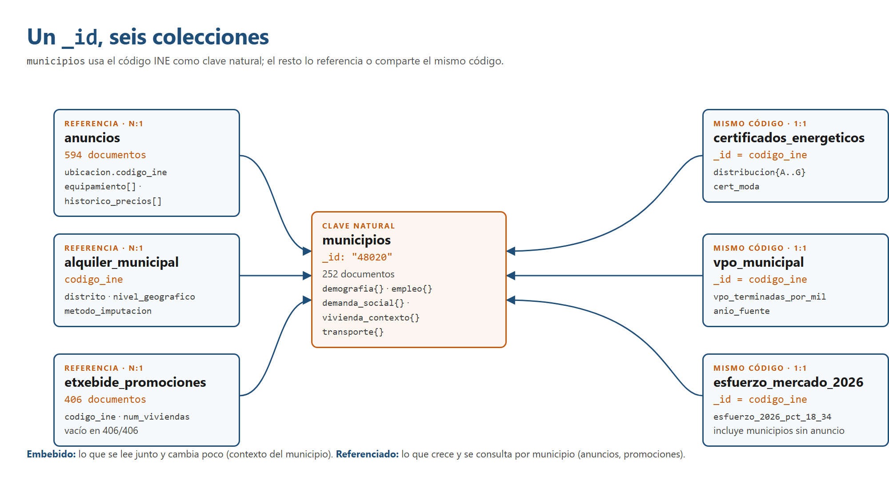{width=16.5cm}\
*Figura 4.1. `municipios` usa el código INE como `_id`; `anuncios` lo referencia en `ubicacion.codigo_ine`. Fuente: `storage/load_mongo.py` y `analysis/mongo_aggregations.py`.*


```{=openxml}
<w:p><w:r><w:br w:type="page"/></w:r></w:p>
```

# 5. Análisis e indicadores

> El capítulo explica qué se calcula, con qué etapas de agregación y cómo se comprueba que el índice se usa.

## 5.1 Los cinco indicadores

| Indicador | Qué mide | Fuentes |
|---|---|---|
| Esfuerzo joven | Porcentaje de renta destinado a alquiler | Renta, alquiler oficial, anuncios |
| Tier de confianza | Cuánta evidencia sostiene el dato municipal | Cobertura y muestra |
| Modalidad | Larga estancia frente a temporal | Anuncios |
| VPO | Promociones protegidas por estado | Etxebide |
| Habitaciones | Oferta de habitaciones y precio | Anuncios |

Cada indicador tiene fórmula, fuente y límite documentados. El esfuerzo es el principal; los demás explican por qué un municipio no se puede rankear con la misma confianza que otro.

## 5.2 Pipelines

Hay 11 pipelines en orden y 1 fuera del orden principal, 12 en total. Los pipelines escriben 8 CSV en gold. El orden importa: un pipeline que depende de otro no puede ejecutarse antes.

Las etapas usadas en el código son `$match` (16), `$lookup` (17), `$unwind` (5), `$group` (4), `$project` (12), `$sort` (12) y `$addFields` (34). `$lookup` cruza anuncios con municipios; `$unwind` abre los arrays de equipamiento e histórico; `$group` resume por municipio. No se usa `$facet`: no hace falta para las preguntas del reto y añadiría una etapa que el código no necesita.

## 5.3 Un pipeline, paso a paso

`pipeline_indicadores_municipio` empieza en `municipios` (252 documentos), hace `$lookup` a `anuncios` por `ubicacion.codigo_ine`, filtra anuncios con `precio_m2` válido y superficie entre 10 y 500 m², ordena los precios por m² y calcula la mediana winsorizada al percentil 1–99. El `precio_medio_eur` excluye los valores fuera de 1,5·IQR por municipio. La mediana cruda no se usa para conclusiones.

`pipeline_tier_por_municipio` deriva el tier solo de `n_anuncios`: A ≥30, B 10–29, C 1–9, D 0. En C y D, `n_precio`, mínimo, máximo y mediana se ponen a cero o nulo por diseño: hay precio, pero no muestra suficiente para publicarlo como estadística municipal.

## 5.4 Índices y `explain`

La comprobación es explícita. El filtro es `ubicacion.codigo_ine = "20069"`, `modalidad = "larga_estancia"` y `precio_eur ≤ 1000`. Antes, forzando `hint={"$natural": 1}`, el plan es `COLLSCAN`: 1 documento devuelto y 594 examinados. Después, con el índice ESR, es `IXSCAN`: 1 documento devuelto, 1 examinado y 1 clave leída. El índice evita examinar 593 documentos que no cumplen el filtro.

El mismo patrón se aplica a `etxebide_promociones` con `explain_promo_before_after("48020")`. El comando es `python analysis/mongo_indexes.py` y es de solo lectura.


```{=openxml}
<w:p><w:r><w:br w:type="page"/></w:r></w:p>
```

# 6. Resultados y conclusiones

> El capítulo cuenta primero la capa registrada de 2024 y después la capa de oferta de 2026, sin mezclarlas, y cierra con lo que se puede y no se puede afirmar.

El capítulo responde a cuatro objetivos. **O1**: ¿qué parte de la renta joven se va en alquiler? **O2**: ¿dónde pesa más? **O3**: ¿qué añade la oferta de 2026? **O4**: ¿qué papel tiene la vivienda protegida? O1, O2 y O4 se responden con datos de 2024; O3, con la capa de oferta. Las secciones 6.1 a 6.3 son de 2024, las secciones 6.4 y 6.5 son de 2026, y solo la 6.6 junta las respuestas, sin restarlas.

## 6.1 O1. La capa 2024: el esfuerzo mediano

| Método | Municipios | Mediana | Por encima del 30 % |
|---|---:|---:|---:|
| Alquiler oficial | 159 | 26,61 % | 40 (25,16 %) |
| IDW-252 | 252 | 25,37 % | 47 (18,65 %) |

El esfuerzo es el alquiler mensual multiplicado por doce, dividido entre la renta joven anual y expresado en porcentaje. El indicador canónico usa el tramo de 18 a 34 años. El tramo de 16 a 29 se conserva en los CSV como legado: comparte fórmula pero no denominador, y ninguna conclusión de esta memoria lo usa. El 30 % es el umbral de referencia habitual en los estudios de asequibilidad; aquí se usa como línea de lectura, no como frontera estadística.

La mediana oficial es 26,61 %. La interpolación asigna un valor a los 93 municipios sin alquiler oficial y baja la mediana a 25,37 %, pero no crea evidencia donde no la hay. El recuento de municipios por encima del 30 % sube de 40 a 47 solo porque se añaden 93 municipios: en proporción baja del 25,16 % al 18,65 %, así que la imputación no aumenta la tensión, la diluye. Los 7 municipios que la imputación empuja por encima del 30 % son Beizama, Navaridas, Kuartango, Galdames, Munitibar, Villabuena de Álava y Añana: núcleos rurales pequeños, no un cambio de patrón. Por eso el ranking principal usa los 159 municipios oficiales.

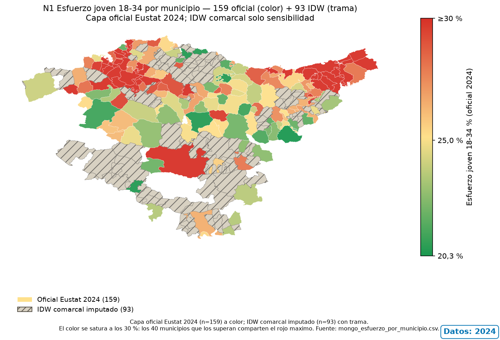{width=15cm}\
*Figura 6.1. Esfuerzo de la población joven por municipio, datos de 2024. El color corresponde a los 159 municipios con alquiler oficial; la trama gris, a los 93 imputados por IDW. Fuente: `data/resultados/mapa_coroplastico_esfuerzo_18_34.png`.*

## 6.2 O2. La capa 2024: dónde pesa más

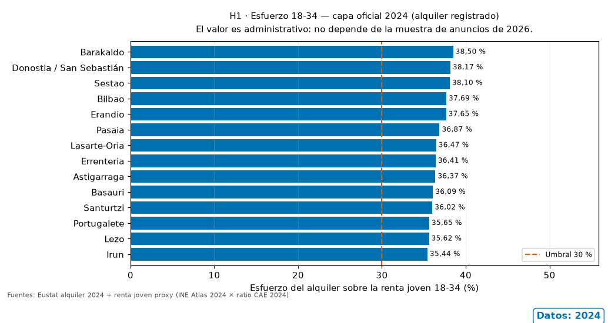{width=15cm}\
*Figura 6.2. Los catorce municipios con alquiler oficial cuyo esfuerzo supera el 35 %, datos de 2024. Sin Tier ni muestra de anuncios: el numerador es administrativo y no depende de la oferta. Fuente: `data/resultados/H1_ranking_esfuerzo_18_34.png`.*

El corte de la tabla no es un top-N elegido a mano: son todos los municipios con alquiler oficial de 2024 que superan el 35 % de esfuerzo, en orden descendente. Por debajo, las posiciones se apelotonan y el orden deja de ser informativo.

| Municipio | Territorio | Alquiler oficial (€/mes) | Esfuerzo 18–34 (2024) |
|---|---|---:|---:|
| Barakaldo | Bizkaia | 746 € | 38,50 % |
| Donostia / San Sebastián | Gipuzkoa | 995 € | 38,17 % |
| Sestao | Bizkaia | 650 € | 38,10 % |
| Bilbao | Bizkaia | 850 € | 37,69 % |
| Erandio | Bizkaia | 720 € | 37,65 % |
| Pasaia | Gipuzkoa | 691 € | 36,87 % |
| Lasarte-Oria | Gipuzkoa | 766 € | 36,47 % |
| Errenteria | Gipuzkoa | 705 € | 36,41 % |
| Astigarraga | Gipuzkoa | 867 € | 36,37 % |
| Basauri | Bizkaia | 672 € | 36,09 % |
| Santurtzi | Bizkaia | 697 € | 36,02 % |
| Portugalete | Bizkaia | 702 € | 35,65 % |
| Lezo | Gipuzkoa | 702 € | 35,62 % |
| Irun | Gipuzkoa | 729 € | 35,44 % |

Los catorce tienen alquiler oficial de 2024, ninguno imputado, así que el esfuerzo es dato administrativo y no estimación: alquiler oficial de 2024 sobre renta joven de 2024. El orden es el del esfuerzo, no el del alquiler, y esa diferencia es el resultado: Barakaldo encabeza el ranking con 38,50 % y un alquiler de 746 €, por debajo del de Donostia (995 €). Lo que empuja el esfuerzo arriba no es el precio de la vivienda sino la renta joven: Sestao, con 650 €, es el tercero del ranking.

El contraste está en el otro extremo. Getxo, con la renta joven más alta de los siete con muestra, se queda en 28,60 % y no entra en la tabla: un alquiler alto sobre una renta aún más alta pesa menos. El ranking de 2024 mide dónde el alquiler pesa sobre la renta joven, y ahí mandan los municipios industriales de la ría y de la bahía de Pasaia, no los de renta más alta.

Ningún municipio de esta tabla se elige por la muestra de anuncios de 2026. Esa regla pertenece a la capa de oferta y se explica en la sección 6.4.

## 6.3 O4. La capa 2024: la vivienda protegida

Las 406 promociones de Etxebide son flujo de promoción, y el reparto por estado lo confirma: 347 terminadas, 39 en curso, 19 en convenio y 1 en proyecto. Es un registro de promociones cerradas, no un flujo vivo. El campo `NumViviendas` está vacío en 406 de 406, así que no permiten contar viviendas disponibles; y la fecha de sorteo solo existe en parte del registro, entre 2001 y 2014. Por eso este registro sirve para describir el estado de la promoción, no para datar cuánta vivienda protegida se ha terminado.

El dato datado de vivienda protegida es otro: las viviendas protegidas terminadas en el último quinquenio por mil habitantes (Udalmap, indicador 73, edición 2024), cargado para 252 municipios, con Usansolo sin dato. Es un flujo acumulado de cinco años, no un stock, y su reparto es muy desigual: la mayoría de los municipios están en cero y el flujo se concentra en unos pocos. El stock de vivienda protegida no es público, así que no se estima.

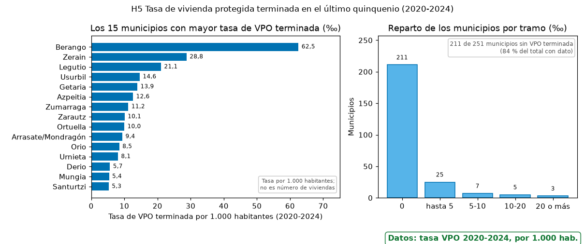{width=12cm}\
*Figura 6.3. Viviendas protegidas terminadas en el último quinquenio por mil habitantes: flujo 2020-2024 (Udalmap, indicador 73, edición 2024), 251 de 252 municipios con dato y 211 en cero. Fuente: `data/resultados/H5_vpo_terminadas_por_mil.png`.*

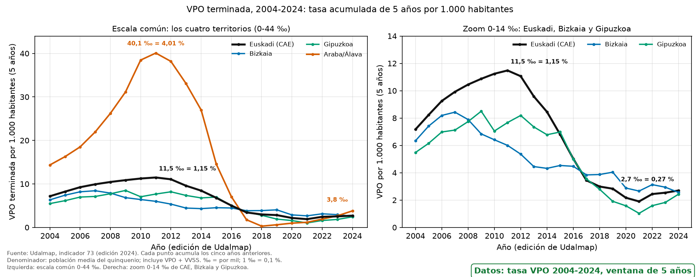{width=15cm}\
*Figura 6.4. VPO terminada por mil habitantes en Euskadi y por territorio histórico, 2004-2024 (Udalmap, indicador 73, edición 2024). Cada punto resume los cinco años anteriores, así que no es el flujo de un año suelto. Euskadi, Bizkaia y Gipuzkoa comparten escala; Araba/Álava va en un panel propio, con su escala, porque su tasa llega a 40,1 ‰ en 2011 y en una escala común aplastaría a las demás series. Fuente: `data/resultados/S_serie_vpo_2004_2024.png`.*

La serie sitúa el dato de 2024: la tasa de Euskadi pasó de un máximo de 11,5 ‰ en 2011 a 2,7 ‰ en 2024. La caída no es un año malo, es una tendencia de más de una década, y se mantiene en los tres territorios históricos. Araba/Álava, con un denominador mucho menor, se comporta igual pero con un perfil mucho más agudo: 40,1 ‰ en 2011 y 3,8 ‰ en 2024, casi sin término medio entre ambos extremos. Esa volatilidad no es un error del dato, es lo que hace una tasa sobre una población pequeña.

## 6.4 O3. La capa 2026: qué hay

La capa 2026 es una fotografía de la oferta publicada, no una segunda medición del alquiler registrado. Se construye porque el dato oficial es de 2024, tarda en publicarse y no cubre a todos los municipios; la oferta dice qué se pide hoy, con la limitación de que un anuncio no es un contrato.

De los 594 anuncios extraídos en 2026, 326 son de larga estancia (53 municipios) y 268 temporales (38). El temporal se descarta porque no es comparable con un contrato de vivienda habitual. Al filtro de validez —precio y superficie utilizables— le quedan los 287 anuncios que sostienen todas las cifras de esta capa, en 50 municipios. Otros 188 municipios no tienen ningún anuncio.

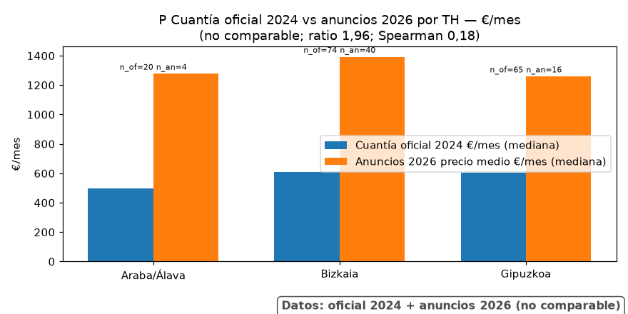{width=15cm}\
*Figura 6.5. Discrepancia entre el alquiler oficial de 2024 y la oferta observada en 2026: mezcla declarada, no comparable. Fuente: `data/resultados/P_oficial_vs_anuncios_por_TH.png`.*

Solo 7 municipios conservan `n_precio > 0`; los 53 restantes son Tier C/D: tienen precio en la colección, pero no muestra suficiente para publicarlo como estadística municipal. La cobertura describe la oferta; no sustituye el dato oficial en todos los municipios.

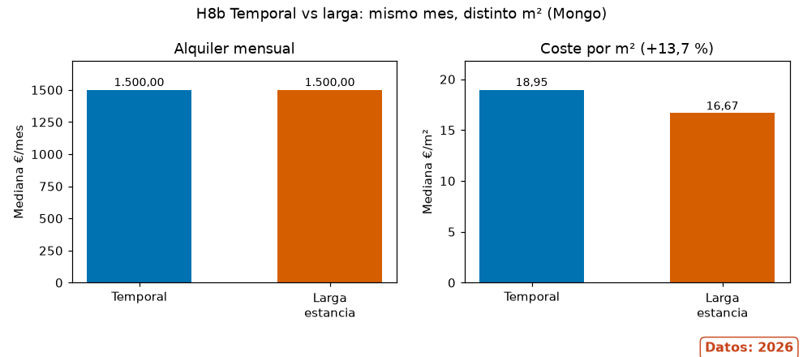{width=12cm}\
*Figura 6.6. Precio por metro cuadrado según modalidad, anuncios de 2026. Fuente: `data/resultados/H8b_modalidad_mediana_eur_m2.png`.*

El alquiler temporal no entra en la capa y conviene decir cuánto pesa. De los 594 anuncios, 268 son temporales, en 38 municipios, casi la mitad de la oferta publicada. Se descartan porque un contrato temporal no es vivienda habitual: el precio incluye amueblado y suministros y la estancia no se rige por la ley de arrendamientos urbanos. La diferencia se ve en la figura: por mes cuesta lo mismo que la larga estancia (1.500 € de mediana en ambas), pero se pide sobre 80 m² en vez de 90 m², de modo que el metro cuadrado sale un 13,7 % más caro (18,95 €/m² frente a 16,67 €/m²). Incluirlo habría subido el precio por metro cuadrado de la capa sin mover la mediana mensual, que es justo el error que se evita al separarlas.

La colección de habitaciones se puede usar, pero no tal cual. Son 201 anuncios en 9 municipios, extraídos de la sección de vivienda compartida, y esa sección no solo lista habitaciones: mezcla también pisos completos con el alquiler entero. La prueba está en el extremo alto de la colección bruta, que llega a 109.000 €/mes, una cifra imposible para una habitación y normal para una vivienda. En vez de descartar la colección entera se aplica una regla de plausibilidad explícita y reproducible: se elimina el anuncio cuyo precio alcanza o supera el alquiler mediano de una vivienda completa en su propio municipio, tomado de la misma fuente oficial de 2024 que el resto de la capa. Una habitación no puede costar más que el piso entero típico del municipio; si lo cuesta, el anuncio no es una habitación.

El corte deja 140 anuncios utilizables y descarta 60 (30,0 %), que son precisamente los pisos enteros colados en la sección. Con ese conjunto, la mediana de una habitación en Euskadi es de 545 €/mes, el 31,7 % del salario joven de 2026. Por municipios, Bilbao queda en 580 € (80 anuncios, 33,7 %), Donostia en 600 € (29, 34,9 %), Barakaldo en 500 €, Vitoria-Gasteiz en 400 € y Getxo en 560 €.

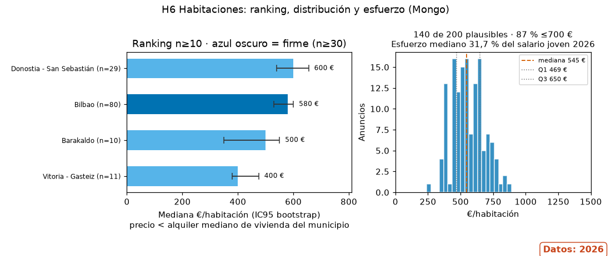{width=15cm}\
*Figura 6.7. Precio de habitación por municipio y distribución de los 140 anuncios utilizables, ya sin los pisos enteros que el portal lista en la sección de vivienda compartida. El ranking exige n≥10 y el color separa la muestra firme (n≥30) de la indicativa. Fuente: `data/resultados/H6_habitaciones_mediana_rango.png`.*

La comparación con el piso entero es el resultado que importa: en Bilbao una habitación cuesta 580 € frente a los 850 € del alquiler mediano de vivienda, un 31,8 % menos; en Donostia, 600 € frente a 995 €, un 39,7 % menos. Compartir alivia el esfuerzo, pero no lo resuelve: con esos precios el esfuerzo se queda en el 33,7 % y el 34,9 %, por encima del 30 %. Y la muestra no es un censo: solo Bilbao supera los 30 anuncios utilizables, Donostia se queda en 29 y el resto es indicativo, sin ranking municipal.

El Tier se deriva solo del número de anuncios: A con 30 o más, B de 10 a 29, C de 1 a 9 y D sin anuncios. El Tier A tiene 4 municipios, el B 3, el C 57 y el D 188. Solo 7 llegan a A o B, y de ellos los 4 del Tier A son los que superan el umbral de 30 anuncios que exige la regla del proyecto. Por eso el ranking de la sección 6.5 tiene cuatro barras y no siete.

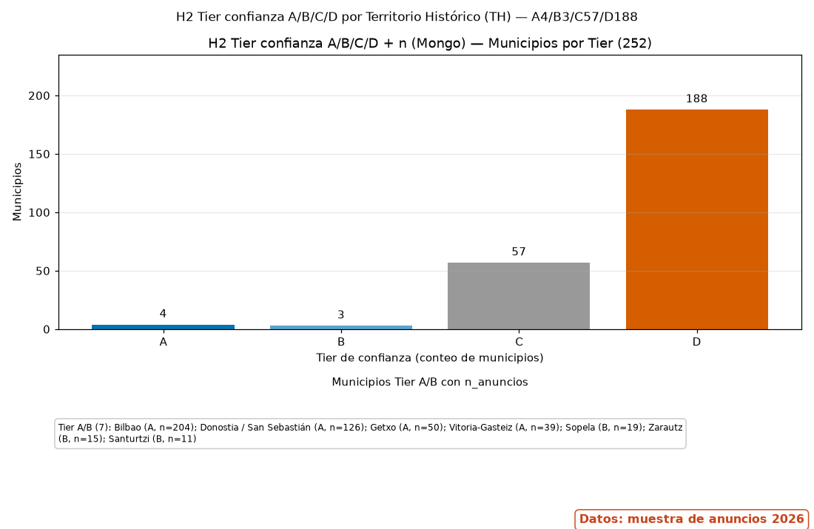{width=12cm}\
*Figura 6.8. Tier A/B/C/D según cobertura y tamaño de muestra, contada sobre los anuncios de 2026. Fuente: `data/resultados/H2_tier_confianza_ABCD.png`.*

La cobertura se mide en población joven, no en municipios: los 50 municipios con dato son el 19,84 % del total, pero concentran el 71,21 % de la población de 18 a 34 años (334.753 personas). Los 4 municipios del Tier A reúnen el 70,38 % de los anuncios. La capa no es todo el territorio, pero cubre a la mayoría de la población joven.

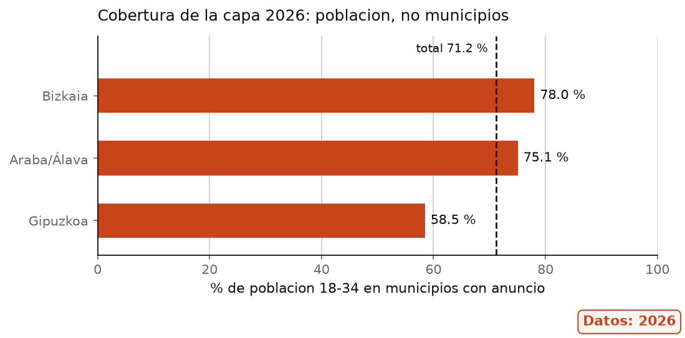{width=13cm}\
*Figura 6.9. Cobertura de la capa 2026 por población de 18 a 34 años, no por número de municipios. Fuente: `docs/presentacion_v2/assets/M26_cobertura.png`.*

## 6.5 O3. La capa 2026: qué dice el esfuerzo

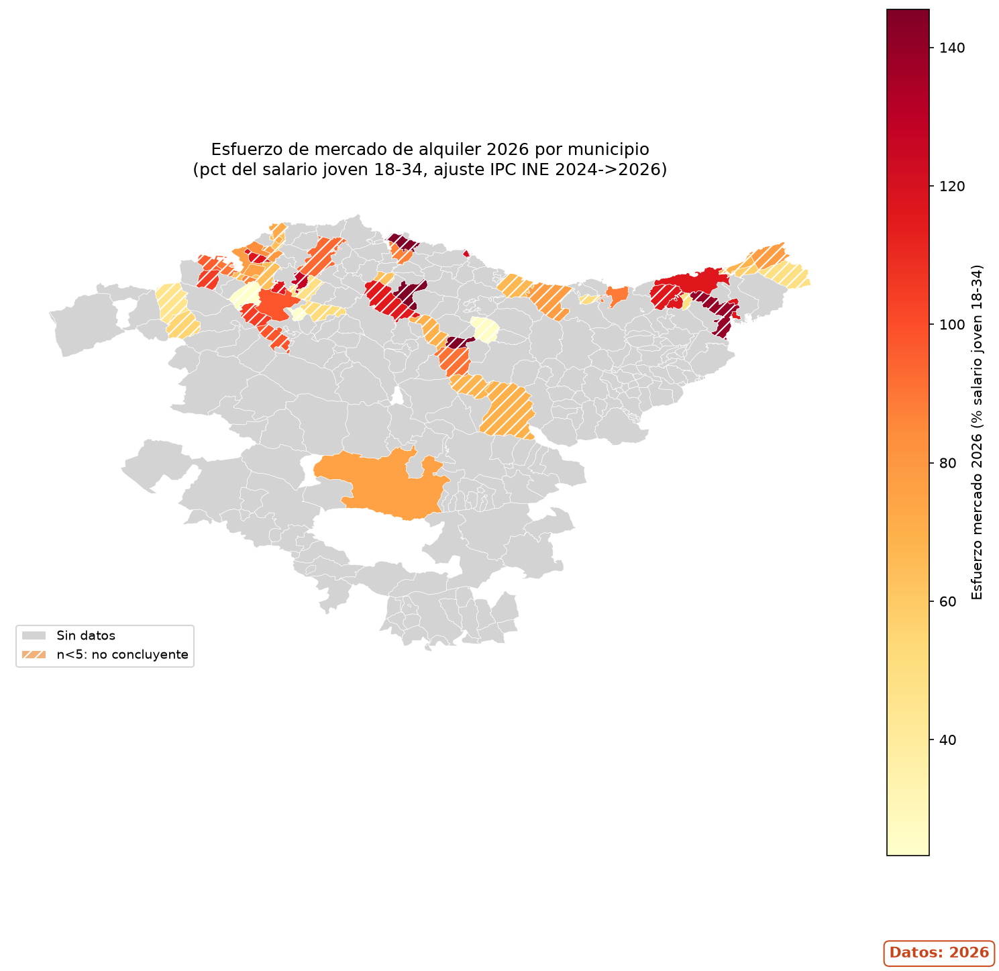{width=15cm}\
*Figura 6.10. Esfuerzo con oferta de mercado de 2026. Capa separada de la de 2024; no se resta. Fuente: `docs/presentacion_v2/assets/M26_mapa_coropletico_2026.png`.*

El esfuerzo de 2026 divide el precio mediano del anuncio entre el salario joven de 2024 ajustado por IPC: el numerador es de 2026 y el denominador se actualiza para no mezclar años. En los cuatro municipios con muestra suficiente el resultado no admite duda de signo:

| Municipio | Anuncios válidos | Esfuerzo 18–34 (2024) | Precio mediano 2026 | Esfuerzo 2026 |
|---|---:|---:|---:|---:|
| Bilbao | 68 | 37,69 % | 1.687,50 € | 98,19 % |
| Donostia / San Sebastián | 58 | 38,17 % | 2.000,00 € | 116,37 % |
| Getxo | 39 | 28,60 % | 1.350,00 € | 78,55 % |
| Vitoria-Gasteiz | 37 | 33,37 % | 1.300,00 € | 75,64 % |

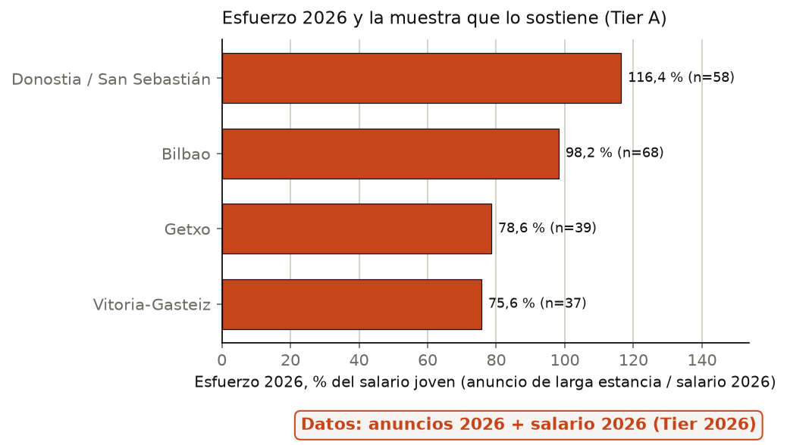{width=15cm}\
*Figura 6.11. Esfuerzo de 2026 con la muestra que lo sostiene, solo Tier A. El Tier se calcula sobre todos los anuncios de 2026, pero la barra usa solo los de larga estancia con precio válido, que son los comparables al contrato oficial: de ahí que cada `n` sea menor que el del Tier (Bilbao, 68 frente a 204; Donostia, 58 frente a 126). El Tier B queda fuera del ranking porque sus 4 a 8 anuncios comparables no llegan al umbral. Sin línea de umbral: el 30 % es del esfuerzo de 2024 y aquí cambian numerador y denominador. Fuente: `docs/presentacion_v2/assets/M26_ranking_esfuerzo_muestra_2026.png`.*

Donostia (116,37 %) y Bilbao (98,19 %) ponen el alquiler de anuncio por encima del salario joven mensual: trabajar no cubre el alquiler. Getxo y Vitoria-Gasteiz se quedan en 78,55 % y 75,64 %. Santurtzi, Zarautz y Sopela, con 4 a 8 anuncios comparables, no entran en la comparación y se leen como indicativo.

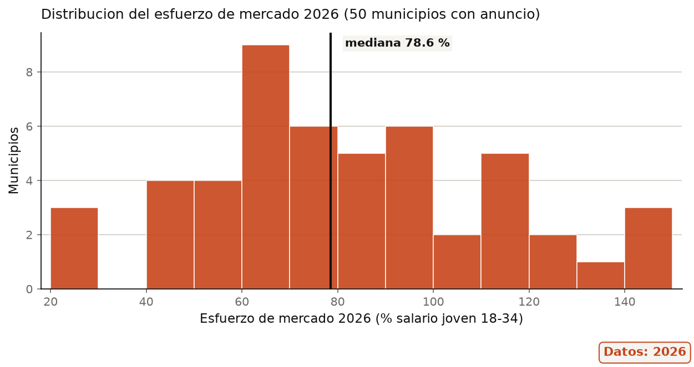{width=13cm}\
*Figura 6.12. Distribución del esfuerzo con anuncios de 2026. Fuente: `docs/presentacion_v2/assets/M26_hist_esfuerzo_mercado.png`.*

La mediana de la capa es 78,55 % con el salario ajustado y 57,77 % con la renta de 2024 como denominador. En esos mismos 50 municipios, la mediana oficial de 2024 era 30,70 % y la base salario de 2024, 44,57 %. No son comparables: cambia el numerador (anuncio frente a contrato) y, en la primera cifra, también el denominador.

Por tipo, la mediana es 78,55 % para 1–2 habitaciones (123 anuncios), 81,95 % para 3 (94) y 116,37 % para 4 o más (60). El esfuerzo sube con el tamaño. La cifra de 4+ no describe el precio típico de una persona sola.

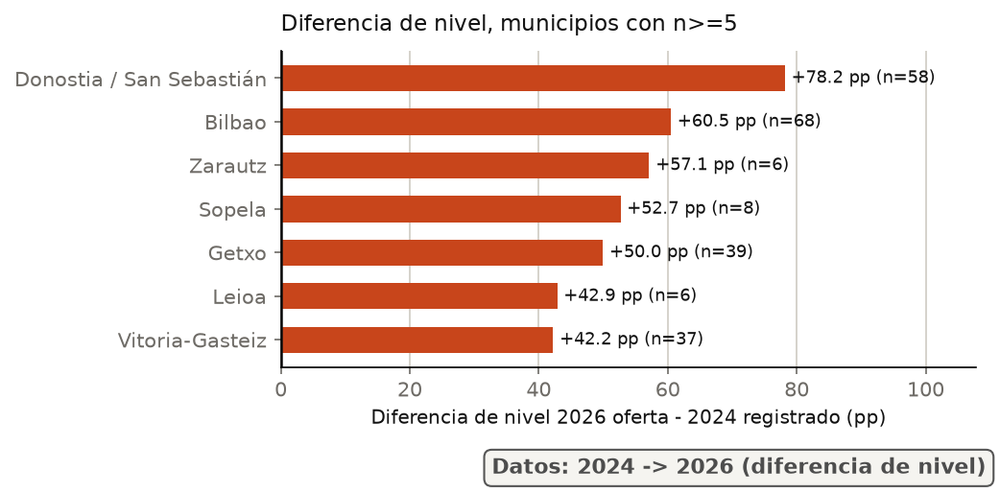{width=15cm}\
*Figura 6.13. Diferencia de nivel entre el esfuerzo registrado de 2024 y el de oferta de 2026, en puntos porcentuales, solo en los municipios con al menos 5 anuncios. No es una variación temporal: cambia la fuente del numerador. Fuente: `docs/presentacion_v2/assets/M26_brecha_n5.png`.*

La distancia entre las dos capas se puede medir sin restarlas como serie: en los 7 municipios con al menos 5 anuncios, la diferencia de nivel mediana es de 52,7 puntos porcentuales. Parte de esa distancia es el cambio de fuente y parte es el tipo de vivienda: la superficie mediana del anuncio es de 90,0 m² y la del alquiler registrado, de 80,7 m². Un anuncio es una vivienda más grande y más cara que el contrato medio de 2024, y esa diferencia no se corrige restando.

## 6.6 La respuesta y sus límites

En la capa registrada, el esfuerzo mediano en los 159 municipios con alquiler oficial es 26,61 %, y 40 municipios (25,16 %) superan el 30 %. El máximo oficial es Barakaldo, con 38,50 %, y la tabla de la sección 6.2 lo ordena por renta joven, no por precio: los municipios industriales de la ría y de Pasaia pesan más que los de renta alta, y Getxo, con la renta joven más alta, se queda en 28,60 %.

En la capa de oferta, la mediana sube a 78,55 % con el salario ajustado. En los cuatro municipios con muestra suficiente, el esfuerzo va de 75,64 % en Vitoria-Gasteiz a 116,37 % en Donostia, y en Donostia y Bilbao el alquiler de anuncio supera el salario joven mensual. Esa capa cubre el 71,21 % de la población de 18 a 34 años con el 19,84 % de los municipios.

Las dos respuestas no se suman ni se restan. La diferencia de nivel mediana entre ambas es de 52,7 puntos porcentuales (sección 6.5), y una parte es cambio de fuente: anuncio frente a contrato y vivienda de 90,0 m² frente a 80,7 m². Leerla como evolución sería el error que el capítulo 1 advierte.

Lo que no se puede afirmar: un municipio sin dato no es asequible, un esfuerzo alto no prueba causalidad y la vivienda protegida es flujo, nunca stock. Los 93 municipios interpolados y los que tienen anuncio sin muestra no permiten ordenar municipios.


```{=openxml}
<w:p><w:r><w:br w:type="page"/></w:r></w:p>
```

# 7. Dificultades y decisiones

> El capítulo anticipa las preguntas difíciles: qué falló, qué se decidió y qué coste tiene cada decisión.

## 7.1 Tabla de decisiones

| Dificultad | Decisión | Evidencia | Coste declarado |
|---|---|---|---|
| Solo 64 de 252 municipios tienen anuncio y 60 tienen precio | Ranking principal con alquiler oficial; anuncios como capa aparte | `mongo_esfuerzo_por_municipio.csv` | No se rankean 252 municipios |
| 60 municipios con precio, pero solo 7 con `n_precio > 0` | Gating Tier A/B; en C/D el precio queda a nulo por diseño | `pipeline_tier_por_municipio` | 53 municipios con precio no publican estadística |
| No hay salario juvenil municipal | Renta media como proxy, declarada | `renta_joven_18_34` | Falacia ecológica posible |
| Anuncios 2026 y renta/alquiler 2024 | Dos capas separadas, sin resta | `M26_*` y `mongo_*` | No hay serie temporal |
| 357 ficheros en disco, 355 en manifiesto y 353 en HDFS | Tres inventarios con propósito distinto | manifiestos y `GETCONTENTSUMMARY` | Hay que explicar la diferencia |
| HDFS solo conserva raw | Excepción expresa de la profesora | brief del reto | Silver y gold no están en HDFS |
| El `OPEN` de HDFS falló por DNS del datanode el 12-11 | Recuperación por SHA y verificación fechada | `hdfs_recuperacion_un_fichero.py` | El 13-11 devuelve `HDFS_REC OK`; el estado puede cambiar |
| Kafka no entregaba metadata el 12-11 | Evidencia v8 y tests offline; no se afirma revalidación | `KafkaAdminClient` y tests | El 13-11 el topic responde; se fecha |
| El topic antiguo `anuncios_inmobiliarios` sigue existiendo | No se borra: el clúster es compartido y sería destructivo | `describe_topics` | 1.420 mensajes de prueba conviven con el topic vigente |
| Dos colecciones de habitaciones con 201 documentos cada una | Se declara la deuda; no se borra sin confirmar | `_facts.json` | Duplicado silencioso si no se documenta |
| 406 de 406 promociones sin `NumViviendas` | VPO como flujo, no como stock | `etxebide_promociones` | No se puede contar viviendas disponibles |
| Dos índices 2026 definidos pero no creados | Se declaran; no se crean en una demo sin ventana | `mongo_indexes.py` | El pipeline 2026 no está optimizado |
| Falta `auditoria_lagunas_silver.csv` | No se regenera para no mover el gold de 53 a 54 | `transform/run_all.py --check` | Queda una comprobación en rojo |

## 7.2 Cobertura y proxy

La cobertura es la dificultad principal. Un municipio sin anuncio no es un municipio barato: es un municipio sin evidencia. La renta media tampoco es el salario de una persona joven; se usa porque es el dato municipal disponible y se declara como proxy.

El precio medio se calcula para 60 municipios, pero solo 7 lo publican con muestra. Los 53 restantes son Tier C/D: el pipeline les pone `n_precio = 0` y deja mínimo, máximo y mediana a nulo. La regla evita presentar una mediana de dos anuncios como precio municipal.

## 7.3 Infraestructura

El estado del clúster cambió durante el proyecto. El 12-11 el `OPEN` de HDFS fallaba por DNS del datanode y Kafka no entregaba metadata; el 13-11 la recuperación por SHA devuelve `HDFS_REC OK SHA_TAMANO_IGUALES` y el topic responde con una partición y factor de replicación 1. Cada comprobación lleva su fecha; una avería de red no se convierte en una afirmación sobre el código.

## 7.4 Deuda declarada

Quedan cinco deudas: dos índices 2026 sin crear, dos colecciones de habitaciones duplicadas, un topic legacy, un pipeline fuera del orden principal y una comprobación de silver en rojo. Ninguna impide responder a la pregunta, pero todas cambian lo que se puede afirmar sobre rendimiento y consistencia.


```{=openxml}
<w:p><w:r><w:br w:type="page"/></w:r></w:p>
```

# 8. Límites y verificación

> El capítulo separa lo que el sistema demuestra de lo que solo describe y reúne los comandos que permiten comprobarlo.

## 8.1 Límites de los datos

- La renta es media, no salario juvenil municipal.
- El alquiler oficial no cubre todos los municipios; la interpolación no crea evidencia.
- Los anuncios no representan el parque completo ni el alquiler regulado.
- La capa 2026 y la 2024 no son comparables como serie temporal.
- La VPO es flujo de promoción, no stock disponible.

## 8.2 Límites del método

El proyecto describe asociaciones territoriales, no relaciones causales. Un esfuerzo alto no implica que la causa sea el precio: también dependen la renta, el empleo y la oferta. El tier de confianza ordena la evidencia; no es una medida de calidad de vida.

## 8.3 Verificación

| Comprobación | Comando | Resultado esperado |
|---|---|---|
| Tests | `pytest -q tests` | 293 passed, 2 skipped (295 recogidos) |
| Gobernanza | `python scripts/verificar_gobernanza.py` | 53 cabeceras, 49 ids, 47 scripts, 40 nodos |
| Manifiestos | `python scripts/run_pipeline.py --check` | 355 raw + 183 silver, 0 errores |
| Deck | `python scripts/verificar_cifras_deck.py` | 41/41 |
| Memoria | `python docs/memoria/build.py --check` | tokens y figuras resueltos |
| HDFS | `python scripts/hdfs_recuperacion_un_fichero.py` | `HDFS_REC OK SHA_TAMANO_IGUALES` |
| Índices | `python analysis/mongo_indexes.py` | `COLLSCAN` 594 → `IXSCAN` 1 |
| Silver | `python transform/run_all.py --check` | 1 laguna: `auditoria_lagunas_silver.csv` |

`run_pipeline.py --check` es una comprobación previa de hashes, no una ejecución completa: comprueba que el manifiesto de raw y el de silver cuadran con el disco. La comprobación de staleness de silver es la de `transform/run_all.py --check`, y esa sí tiene una laguna declarada.

## 8.4 Trabajo futuro

Tres mejoras pendientes: completar los dos índices 2026, unificar las colecciones de habitaciones y sustituir la renta media por una renta juvenil municipal cuando exista. Ninguna cambia la conclusión; las tres mejoran la confianza.


```{=openxml}
<w:p><w:r><w:br w:type="page"/></w:r></w:p>
```

# 9. Anexos

## A. Glosario

| Término | Definición |
|---|---|
| `codigo_ine` | Código oficial de cinco dígitos que identifica un municipio |
| Raw | Copia inmutable del original, con SHA-256 y `.FROZEN` |
| Silver | CSV normalizado y cruzado por `codigo_ine` |
| Gold | CSV y PNG listos para el informe |
| Tier | Nivel de confianza A/B/C/D según cobertura y muestra |
| IDW | Interpolación por distancia inversa para municipios sin alquiler oficial |
| Esfuerzo | Porcentaje de la renta que consume el alquiler |

## B. Fragmentos de código

**Carga idempotente** (`storage/mongo.py:152`). La colección se construye en staging, la anterior se copia a backup y el rename publica el resultado de una vez.

```python
def replace_collection(name, docs):
    db = get_db()
    staging = f"{name}__staging"
    backup = f"{name}__backup"
    db[staging].drop()
    db[staging].insert_many(docs)
    if name in db.list_collection_names():
        db[backup].drop()
        db[name].aggregate([{"$out": backup}])
    db[staging].rename(name, dropTarget=True)
    return len(docs)
```

**Explain antes/después** (`analysis/mongo_indexes.py:125`). El `hint` fuerza el barrido completo; la segunda llamada usa el índice ESR.

```python
filtro = {
    "ubicacion.codigo_ine": "20069",
    "modalidad": "larga_estancia",
    "precio_eur": {"$lte": Decimal128("1000")},
}
antes = _explain(an, filtro, hint={"$natural": 1})  # COLLSCAN 594
despues = _explain(an, filtro)                     # IXSCAN 1
```

**CRUD y comprobación** (`storage/clean_mongo.py:311`). Las cuatro operaciones se ejecutan sobre una colección temporal que se borra al final.

```python
coll.insert_one({"nombre": "demo", "precio": 100})
coll.find_one({"nombre": "demo"}, {"_id": 0})
coll.update_one({"nombre": "demo"}, {"$set": {"precio": 120}, "$inc": {"visitas": 1}})
coll.delete_one({"nombre": "x"})
```

**Tier y `n_precio`** (`analysis/mongo_aggregations.py:658`). El tier sale solo de `n_anuncios`; en C y D el precio municipal se anula por diseño.

```python
{"$addFields": {
    "tier": _tier_expr(),  # A >=30, B 10-29, C 1-9, D 0
    "n_precio": {"$cond": [{"$in": ["$tier", ["A", "B"]]}, "$_n_precio", 0]},
}}
```
