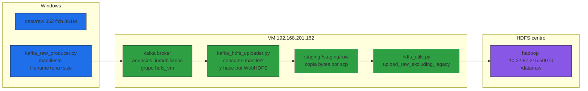

# Design: hdfs-windows-vm-kafka

## Architecture

<accTitle>Flujo Windows Kafka VM y Hadoop</accTitle>
<accDescr>Describe el flujo Windows Kafka VM y Hadoop con manifiesto por Kafka y put WebHDFS desde la VM.</accDescr>

## Decisions

| Decision | Choice | Alternatives rejected | Why |
|----------|--------|-----------------------|-----|
| Kafka lleva manifiesto, no bytes crudos | `kafka_raw_producer.py` envía JSON {rel, size, sha} por Kafka; los bytes viajan por `scp` a `/staging/raw` | Enviar binarios por Kafka | Ficheros de hasta 114M exceden `max.message.bytes` (1M) y serían ineficientes |
| Consumidor VM hace put WebHDFS | `kafka_hdfs_uploader.py` escucha grupo `hdfs_vm` y para cada manifiesto sube con `hdfs_utils.upload_raw_excluding_legacy` + `read_file_sha256` | Put desde Windows directo | La profe exige bytes pasan por la VM |
| Subset de prueba 10 primero, luego full | Gate produce 10 manifiesto para validar extremo a extremo, luego se escala al full | Subir 861M a la primera | Evita perder tiempo si el venv falla |
| venv en la VM con `hdfs==2.7.3` | `~/.venv` + `pip install hdfs==2.7.3` | Apt / sin venv (sin pip) | Hoy la VM no tiene pip; venv aísla y reproduce Windows |

## Known Limitations

| Limitation | Evidence | Mitigation |
|------------|----------|------------|
| Kafka transporta control, no datos grandes | 114M fichero > 1M límite | Documentar: Kafka orquesta, `scp` lleva bytes |
| HDFS raw vacío (0 hijos, tras borrado 2026-11-06) | `LISTSTATUS raw=0` | Re-subida vía este flujo; estado resumible nuevo |
| VM 8 GB libres (55%) | `df -h ~` | Staging 861 MB cabe; borrar staging tras subir |
