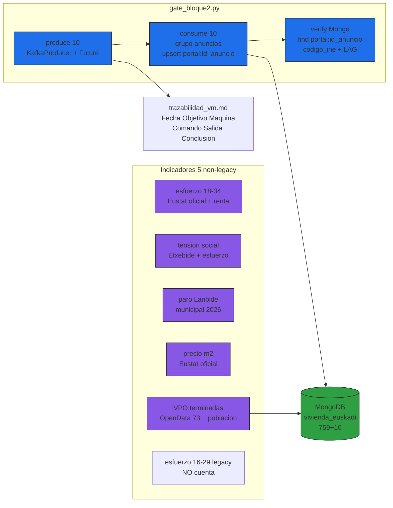

# Design: integracion-indicadores-10

## Architecture

<accTitle>Flujo Kafka-Mongo y 5 indicadores</accTitle>
<accDescr>Describe el gate extremo a extremo que encadena Kafka y MongoDB y el conteo de 5 indicadores distintos sin usar el legacy.</accDescr>

## Decisions

| Decision | Choice | Alternatives rejected | Why |
|----------|--------|-----------------------|-----|
| Gate subset 10, no 759 | 10 deterministas ordenados por (portal,id_anuncio) | 759 en gate | Evita inundar broker, reproduce `huella_subset` SHA256 estable; 759 ya está en topic |
| VPO como 5º indicador | `vpo_municipal` ‰ (0-50) desde Open Data Euskadi 73 + `dim_municipios` | Alquiler mediana anuncios (foto 2026) | VPO es oficial, municipal, 2 fuentes por `codigo_ine`, pipeline ya existe; precio anuncios es foto no comparable con precio oficial |
| Legacy 16-29 archivado | No cuenta como indicador | Contarlo como 5º | Sería el fallo de sobreventa detectado en defensa; el contrato ya lo marca legacy |
| Trazabilidad VM obligatoria | Toda salida VM > `docs/trazabilidad_vm.md` | Log aparte o chat | El repo ya usa ese patrón (Bloque 1); una sola fuente evita huecos de evidencia |
| HDFS procesado fuera | No se sube silver (solo-raw) | Subir 228M a `/procesado` | Decisión firmada 2026-11-05; silver regenerable, HDFS-01 queda SHALL originales + SHOULD procesados |

## Known Limitations

| Limitation | Evidence | Mitigation |
|------------|----------|------------|
| `min.insync.replicas=2` con RF=1 | `server.properties` vs topic RF=1 | Documentar como deuda; no cambia el gate por upsert idempotente |
| Tensión/paro calculados en silver, expuestos por Mongo | `calcular_tension_social.py`, `municipios.empleo` passthrough | Declarar silver justificado con flag/is_imputed; el conteo no cambia por el origen |
| Consumer `max_messages=2` con timeout TimeoutException | `kafka_vm.md` §6 | TimeoutException es terminación normal del consumidor, no fallo |
