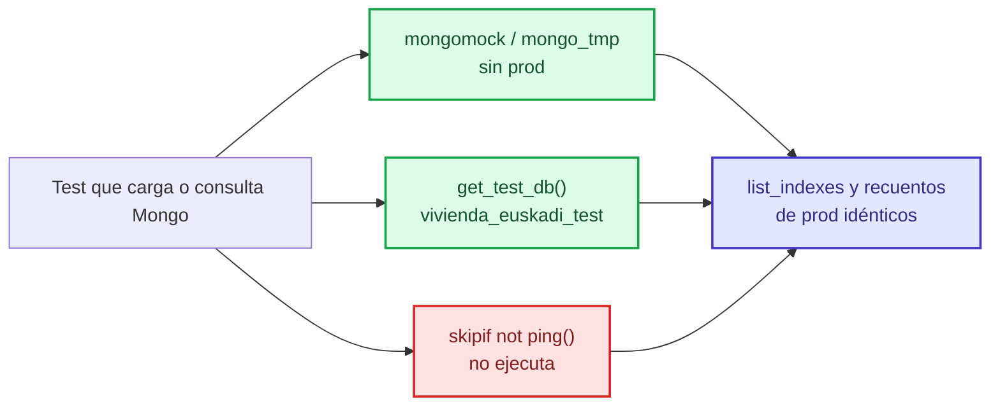

# Design: 2026-11-10-defensa-v9-p0

## Technical Approach

Blindar la evidencia de C13/T4 y el guion de defensa **sin recargar datos**:

1. Restaurar los 4 índices de `anuncios` con `ensure_indexes()` (solo metadatos, idempotente), con autorización de escritura y coordinación con el agente paralelo; verificar `list_indexes()`.
2. `explain` read-only: el "antes" fuerza COLLSCAN con `hint:{"$natural":1}`; el "después" usa el índice ESR presente. Sin drop/create en prod.
3. Tests aislados: `mongomock`/`mongo_tmp`, `get_test_db()` o `skipif(not ping())`; prohibido `load_anuncios()` sobre prod.
4. Guion y atribución del incidente con las cifras canónicas del baseline v9.
5. Barrido documental P1 + manifiestos D-01/D-11 + gate H-SA-01/H-M1 + flags HM-03.

Alineado con `proposal.md` (approach 1-3) y con los deltas `mongodb-y-analisis` (INDICES-01), `aislamiento-tests` (AISLAMIENTO-01..03) y `presentacion-de-resultados` (CONCLUSION-01).

## Architecture Decisions

### D1 — Restaurar con `ensure_indexes()`, no drop/recreate
**Choice:** ejecutar `analysis/mongo_indexes.py:62-94` una vez, con autorización de escritura; verificar `list_indexes()` → 4 índices en `anuncios` (24 índices en 16 vivas).
**Alternativas rechazadas:** (a) drop/recreate manual: redundante, `create_index` ya es no-op si existe; (b) restaurar desde `anuncios__backup`: el `$out` no copia índices (`incidente_p0_mongo.md:26`); (c) recargar `load_all()`: reescribe colecciones y exige `clean_all` (fuera de alcance).
**Rationale:** no toca documentos (594 íntegros, `incidente_p0_mongo.md:31-39`) y devuelve el estado del baseline (`00_baseline_v9.md:151`).

### D2 — `explain` read-only con `hint:{"$natural":1}`; no drop/create
**Choice:** el "antes" fuerza COLLSCAN con hint; el "después" usa el índice ESR presente; `list_indexes()` idéntico antes/después.
**Alternativas rechazadas:** (a) drop/create en el demo: muta prod y es la causa del incidente (`plan_fixes_v9.md:66-74`); (b) eliminar el explain de `main()`: pierde la salida COLLSCAN→IXSCAN del demo (R-6, `verificacion_rubrica_fixes.md:126`); (c) hint con índice específico: no demuestra el barrido completo.
**Rationale:** el nivel 10 de C13 admite «antes/después **o con/sin índice**» (`rubrica_reextraida.md:58`); el hint reproduce el COLLSCAN sin mutar. Evidencia ejecutada: `informe_mongo_v9.md:92-105`.

### D3 — Filtro canónico `20069` (1 doc); `48020` (8) y `48001` (0) documentados
**Choice:** el demo usa `20069` para que IXSCAN sea demostrable (`after.totalDocsExamined=1`).
**Alternativas rechazadas:** `48001` (filtro por defecto del helper) devuelve 0 docs y debilita la demo (`informe_mongo_v9.md:100-105`); `48020` (8) es válido pero menos compacto.
**Rationale:** el delta INDICES-01 fija `20069` como canónico (`specs/mongodb-y-analisis/spec.md:8-9`); la rúbrica no exige un número concreto.

### D4 — Aislamiento con `mongomock`/`mongo_tmp` + `skipif`; no base de test dedicada
**Choice:** `test_mongo_geo.py` usa el fixture `mongo_tmp` (`tests/test_load_mongo.py:37-43`) o `get_test_db()`; los tests de explain llaman a la versión read-only; `skipif(not ping())` cuando no se pueda aislar.
**Alternativas rechazadas:** (a) base de test poblada: requiere recarga y no prueba el geo real; (b) deseleccionar tests en CI: no arregla la mutación local (H-T1); (c) dejar `load_anuncios()` en prod: es la causa del incidente (`tests/test_mongo_geo.py:13`).
**Rationale:** mongomock ya es el patrón del repo (`tests/test_load_mongo.py:21-43`); coste mínimo. Riesgo aceptado: se pierde la aserción geo real (424/594); se compensa con una lectura read-only en el gate o documentándolo (R-4).

### D5 — No recargar Mongo ni ejecutar `load_all()`
**Choice:** solo `ensure_indexes()` (metadatos); no `load_all`/`clean_all` ni recarga de colecciones.
**Alternativas rechazadas:** recargar para "dejarlo limpio": reescribe staging/backup, necesita `clean_all` para HM-03 y puede duplicar con el agente paralelo.
**Rationale:** el silver está generado y los 594 docs son íntegros (`incidente_p0_mongo.md:31-39`); recargar no aporta evidencia y sí riesgo (H-SA-02).

### D6 — Guion y atribución con cifras canónicas
**Choice:** corregir `docs/guion_defensa.md:9,10,33,44,51` (IXSCAN real con filtro, referencing por `codigo_ine`, 24 índices) y `incidente_p0_mongo.md:9-13` (el mutador es `test_mongo_geo.py`, no `test_load_mongo.py`).
**Alternativas rechazadas:** reescribir el guion desde cero: pierde el hilo O1-O4 y los 10 criterios; aplicar "embedding→referencing" a `guion_defensa_12min.md:143-146`: corrompe una línea ya correcta (R-3).
**Rationale:** el tribunal contrasta cifras; las correcciones son locales y verificables con `grep`.

### D7 — Barrido documental con las cifras canónicas; manifiestos con generador; gate ampliado
**Choice:** (a) `grep -n` de cada cifra vieja y sustitución por 594 / 16+14 / 11 / 8 / 204-126-50-39 / 235+2 / IXSCAN con filtro / 28+8 PNG; (b) regenerar `_meta/ingestion_manifest.json` con `extract/generar_ingestion_manifest.py` y declarar `ingestion_manifest.json` excluido del manifest silver; (c) ampliar el escáner de `verificar_gobernanza.py` a `os.environ.get(...)` y el regex de IDs a `chart_*` (46→50).
**Alternativas rechazadas:** regenerar docs desde artefactos: coste alto y no es el defecto; editar el JSON a mano: rompe la procedencia; dejar el conteo en 46: la cabecera «0 env sin declarar» es falsa (`verificar_gobernanza.py:64-65` vs `gate_extremo_a_extremo.py:195` y `transform/_raw_guard.py:68`).
**Rationale:** coste S por fichero y mejor ratio coste/beneficio (`plan_fixes_v9.md:60-62`); D-01 lo acredita el disco (`docs/raw_manifest_sha256.txt:320,322` vs `_meta/ingestion_manifest.json:2879,2897`).

### D8 — HM-03 flags de calidad: solo con autorización
**Choice:** `clean_all()` tras la carga solo si hay autorización de escritura; si no, documentar los flags ausentes como limitación.
**Alternativas rechazadas:** ejecutar `clean_all()` sin autorización: viola el guardrail; marcar flags a mano: no es reproducible.
**Rationale:** los pipelines no dependen de los flags (`informe_mongo_v9.md:179`); riesgo 3/10 (`plan_fixes_v9.md:164`).

## Data Flow

```mermaid
flowchart LR
    accTitle: Flujo read-only del explain de indices
    accDescr: ensure_indexes restaura metadatos; el antes fuerza COLLSCAN con hint natural; el despues usa el indice ESR presente; list_indexes queda invariante.

    autorizacion["Autorizacion de escritura + coordinacion agente paralelo"]
    ensure_indices["ensure_indices()<br/>crea 4 indices de anuncios (idempotente)"]
    explain_antes["explain antes<br/>hint natural 1<br/>COLLSCAN 594"]
    explain_despues["explain despues<br/>indice ESR presente<br/>IXSCAN 1"]
    verificacion["list_indexes()<br/>invariante antes/después"]

    autorizacion --> ensure_indices --> explain_antes --> explain_despues --> verificacion

    classDef write fill:#fef9c3,stroke:#ca8a04,stroke-width:2px,color:#713f12
    classDef readonly fill:#dcfce7,stroke:#16a34a,stroke-width:2px,color:#14532d
    classDef check fill:#e0e7ff,stroke:#4338ca,stroke-width:2px,color:#312e81
    class autorizacion,ensure_indices write
    class explain_antes,explain_despues readonly
    class verificacion check
```

## File Changes

| File | Action | Description |
|---|---|---|
| `analysis/mongo_indexes.py` | Modify | `explain_before_after` / `explain_promo_before_after` / `index_report` read-only con hint; filtro por defecto `20069` |
| `analysis/run_analisis_mongo.py` | Modify | `main()` ejecuta la versión read-only; argparse 11 pipelines + 8 CSV |
| `tests/test_mongo_geo.py`, `tests/test_mongo.py`, `tests/test_mongo_indices.py` | Modify | mongomock/`get_test_db`/`skipif`; sin drop/create en prod |
| `docs/guion_defensa.md`, `docs/guion_defensa_12min.md` | Modify | IXSCAN real con filtro, referencing, 24 índices, cifras canónicas |
| `openspec/audit/v9_2026-11-10/incidente_p0_mongo.md`, `verificacion_dinamica.md` | Modify | atribución del incidente y P1-1 |
| `docs/**`, `README.md`, `AGENT.md`, `openspec/project.md` | Modify | barrido H-02…H-07/H-14/H-15/DS1-*/DS2-* |
| `data/procesado/_meta/ingestion_manifest.json` | Modify | regenerar con `generar_ingestion_manifest.py` (D-01) |
| `data/procesado/manifest_sha256.txt` | Modify | declarar `ingestion_manifest.json` excluido (D-11) |
| `scripts/verificar_gobernanza.py`, `.env.example` | Modify | escáner `os.environ.get`, 50 IDs, declarar `GATE_LIVE`/`RAW_GUARD_AUDIT_LOG` |

## Interfaces / Contracts

- `explain_before_after(codigo_ine="20069", modalidad="larga_estancia", precio_max=1000)` → `{"filtro", "before", "after"}`; `before` con `hint:{"$natural":1}` y `after` con el índice presente; `list_indexes()` invariante.
- `index_report()` y `explain_promo_before_after()` read-only; ningún camino de demo crea/dropea índices en prod.
- Tests: prohibido `load_anuncios()` / `replace_collection()` sobre prod; usar `mongo_tmp`, `get_test_db()` o `skipif(not ping())`.
- Gate: 50 cabeceras de requisito (incluidos 4 `chart_*`), 0 env sin declarar, 11 pipelines.

## Testing Strategy

| Layer | What to Test | Approach |
|---|---|---|
| Unit | explain read-only, aislamiento | `pytest` con `mongomock`/`mongo_tmp`; aserción de stages y `totalDocsExamined` |
| Integration | suite hermética | `pytest tests -q` verde sin `-k`/`--deselect`; `list_indexes()` y recuentos de prod idénticos antes/después |
| E2E | demo de defensa | gate offline + `run_analisis_mongo` read-only (no requerido para este diseño) |

## Known Limitations

- **HDFS/Kafka caídos:** no se revalida C2/C3 en vivo; se usa el histórico v8 (`00_baseline_v9.md:160-163`; `plan_fixes_v9.md:21`).
- **El flujo Kafka es Windows>Kafka>HDFS y nunca pasa por Mongo:** `storage/kafka_raw_producer.py:49-79` → `storage/kafka_hdfs_uploader.py:92-186`; `README.md:272,296`.
- **El agente paralelo puede mutar Mongo:** `plan_fixes_v9.md:28`. Por eso la restauración se verifica después y el barrido va después de restaurar.
- **C-2 pre-existente fuera de alcance:** `openspec/project.md:38` (Kafka→Mongo), `:30` (Docker Desktop) y `docs/guion_defensa.md:5` (HDFS/Kafka como disponibles) — `verificacion_rubrica_fixes.md:97-102,111`; el delta de presentación lo declara fuera de alcance (`specs/presentacion-de-resultados/spec.md:47-53`).
- **DS2-25:** la huella vigente de 11 pipelines no está registrada; requiere ejecutar `run_analisis_mongo.py` (fuera de guardrails) — `doc_sweep_2.md:96,113`.
- **HM-06:** `anuncios_habitaciones_unificados` y `_bigdata` duplican 201 `_id`; decisión de cuál es canónica pendiente — `informe_mongo_v9.md:182`.
- **R-4:** al aislar `test_mongo_geo.py` se pierde la aserción geo real (424/594); compensar con lectura read-only en el gate o documentar — `verificacion_rubrica_fixes.md:83,124`.
- **Filtro `48001` → 0 docs:** el demo debe usar `20069` — `informe_mongo_v9.md:100-105`.

## Migration / Rollout

No hay migración de datos. Orden: (1) índices, (2) explain read-only, (3) tests, (4) guion/atribución, (5) barrido, (6) manifiestos/gate. Rollback: `git checkout --` de tests/docs; Mongo no se toca (restauración idempotente).

## Open Questions

- [ ] ¿Escritura en Mongo autorizada para `ensure_indexes()` y `clean_all()`? (`plan_fixes_v9.md:221`)
- [ ] ¿Filtro canónico `20069` confirmado? (el delta INDICES-01 lo fija: `specs/mongodb-y-analisis/spec.md:8-9`)
- [ ] ¿HM-03 se ejecuta o se documenta?

## Evidencia y guardrails

**Ejecutado (sondas v9, solo lectura):** `pymongo` (`list_indexes`, `explain` con/sin hint), `grep`/`sha256sum`, `read_file` — `informe_mongo_v9.md:12-18`, `doc_sweep_1.md:12-18`, `plan_fixes_v9.md:206-211`.
**Solo leído en esta fase:** propuesta, deltas, plan de fixes, informes de auditoría, código y docs citados. No se ejecutó Mongo, `pytest`, gates ni generadores; no se modificó código, datos, Mongo, HDFS ni Kafka; no hubo commit/push.
