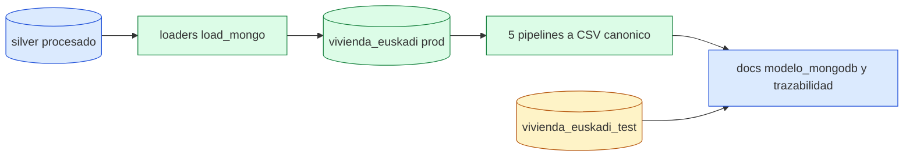
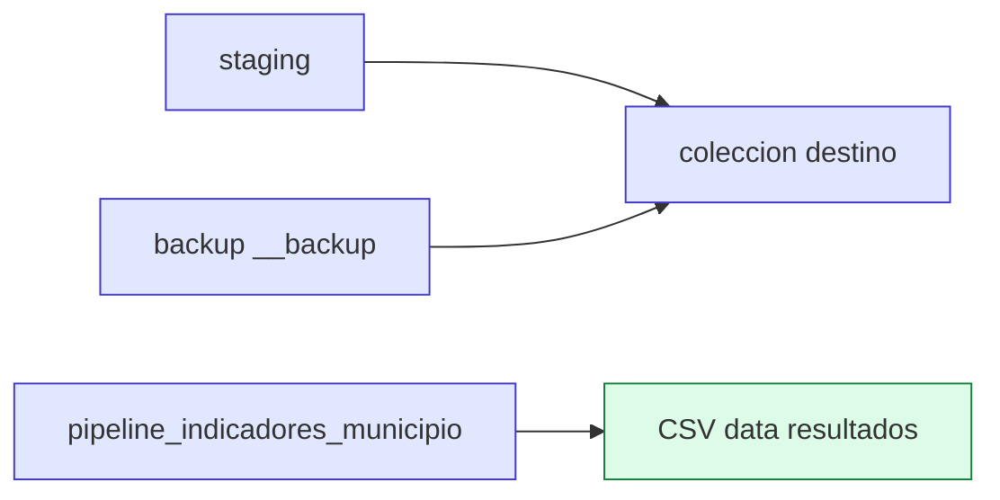

# Design: bloque-3-mongo-pymongo

## Technical Approach

Cerrar RA3/Tema 8 con cambios mínimos y medidos: `explain(executionStats)` antes de conservar índices, reutilizar `replace_collection`/`exportar_tres_csv`, tipar excepciones con log y evidenciar en `docs/modelo_mongodb.md`. Pruebas solo en `vivienda_euskadi_test`; prod por conteo antes/después. HDFS solo lectura: sin tocar `data/raw`/raw HDFS, sin subir procesado, sin carpeta nueva.

## Architecture Decisions

| Decisión | Elección | Alternativa rechazada | Por qué |
|---|---|---|---|
| Índices medidos | Solo si `explain` da COLLSCAN→IXSCAN con `totalDocsExamined=1` (ESR, geo sparse, multikey, parcial con consulta real) | Crear/documentar sin medir | Sin medición no hay evidencia RA3 |
| Backups | `replace_collection`: staging+backup+rename (`storage/mongo.py`) | `drop()`+`insert_many` | Pierde backup y deja ventana inconsistente |
| `validar_renta` | Justificación firmada en `EXCLUIDOS` (`run_all.py:249`), QA bajo demanda | Paso de `run_all` | No es transformación; alarga orquestador y arriesga gate 130 |
| Limpieza | Función canónica único `$unset`+`deleted_count`, 759 intacto | `$set: null` / limpieza duplicada | Confunde ausente con nulo; diverge por colección |
| Transacciones | READ §11 + atomicidad documental (`marcar_calidad_municipio`); commit/abort solo sonda en test | Forzar replica set en standalone | Standalone no soporta transacción multidocumento |
| Excepts | `except (TypeError,ValueError)`+log en `_money`, `_to_decimal`, `drop_demo_index`, `explain_*` | `except Exception: pass` / relanzar todo | Silencia `DuplicateKeyError`; relanzar rompe loaders |
| Agregación | Generalizar `exportar_tres_csv` a 5 CSV reutilizando 8 pipelines | Reescribir pipelines en exportador | Duplica `$group/$lookup/$unwind` |

## Data Flow

Flujo: silver → `load_*` → `replace_collection` (staging→backup→rename) → `ensure_indexes`/`explain_before_after` → limpieza canónica → 5 pipelines → CSV. Pruebas: CRUD y consistencia solo sobre `get_test_db()`; conteos prod antes/después.

## Requirement Mapping

| Req | Componente | Ficheros | Tests |
|---|---|---|---|
| INDICES-01 | `mongo_indexes.ensure_indexes` + `explain_before_after` | `analysis/mongo_indexes.py`, `docs/modelo_mongodb.md` | `tests/test_mongo_indices.py` |
| MODELO-01 | 7 preguntas §5 literales | `docs/modelo_mongodb.md` | `tests/test_mongo.py` (conteos/tipos) |
| RESPALDO-01 | `replace_collection`, geo 424, listing 15 colecciones | `storage/mongo.py`, `docs/modelo_mongodb.md` | `tests/test_mongo_geo.py`, `test_mongo.py` |
| RENTA-01 | Justificación firmada en `EXCLUIDOS` | `transform/run_all.py` | `tests/test_mongo_orquestador.py` |
| LIMPIEZA-01 | Función canónica `$unset`+`deleted_count`, 759 intacto | `storage/clean_mongo.py` | `tests/test_mongo_pymongo_pro.py` |
| TRANSACCIONES-01 | READ §11 + atomicidad documental | `storage/mongo.py`, `docs/modelo_mongodb.md` | `tests/test_mongo_consistencia.py` |
| PYMONGO-01 | Excepts tipados + CRUD con contadores | `storage/load_mongo.py`, `analysis/mongo_indexes.py`, `storage/clean_mongo.py` | `tests/test_mongo_pymongo_pro.py`, `test_mongo_consistencia.py` |
| AGREGACION-01 | 5 pipelines → CSV canónico | `analysis/mongo_aggregations.py`, `analysis/run_analisis_mongo.py` | `tests/test_mongo_pipeline.py` |

## Interfaces / Contracts

- `replace_collection(name, docs) -> int`: staging + backup + rename; nunca `drop()` directo sobre prod.
- Función canónica de limpieza: `update_many(..., {"$unset": {...}})` y retorna dict con `matched_count/modified_count/deleted_count`; invariante post-limpieza: 759 anuncios.
- CSV: `mongo_esfuerzo_por_municipio.csv` (252), `mongo_alquiler_por_municipio.csv` (252), `mongo_modalidades.csv` (2) + 2 nuevos desde `pipeline_accesibilidad_extendida` y `pipeline_vpo_por_municipio`.
- Trazabilidad: cada comando VM/Mongo en `docs/trazabilidad_vm.md` con Fecha/Objetivo/Máquina/Comando/Salida/Conclusión.

## Testing Strategy

| Capa | Qué | Cómo |
|---|---|---|
| Gate | `pytest tests` 130 passed | Suite completa tras cambios |
| Índices | COLLSCAN tras drop, IXSCAN con `totalDocsExamined=1` | `explain_before_after` + `_explain` |
| CRUD | `matched/modified/deleted` en test | `demo_crud_operations` sobre test DB |
| Consistencia | Commit/abort en test o READ; prod intacta | `test_mongo_consistencia`, conteo antes/después |
| Agregación | 8 pipelines `$group/$lookup/$unwind`, 5 CSV | Recuentos 252/252/2 |

## Threat Matrix

N/A — no routing, shell, subprocess, VCS/PR automation, executable-file classification, or process-integration boundary.

## Known Limits

- Parcial: solo se documenta/crea si una consulta real lo justifica con `explain`; si no, queda como evaluado y rechazado.
- Geo: 424 Point reales, resto `None` por falta de silver (evidencia: `docs/modelo_mongodb.md`); no inventar coordenadas.
- Transacciones: standalone sin replica set → READ justificado, no commit/abort forzado.
- HDFS/raw: evidencia en trazabilidad (manifest 353/184, `git status` sin `data/raw`); cero escrituras HDFS.

## Migration / Rollout

Sin migración de datos. Cambios idempotentes y reversibles: revertir código, regenerar CSV, test DB desechable. Prod intacta por defecto.

## Open Questions

- [ ] ¿Existe consulta real que justifique índice parcial, o queda documentado como evaluado?
- [ ] Confirmación de la profesora para subir procesado (pendiente; Bloque 3 no lo sube).
