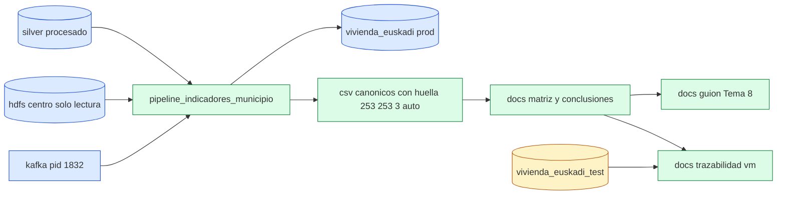
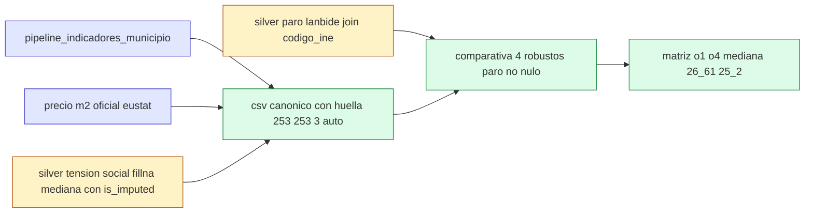

# Design: bloque-4-conclusiones-entrega

## Technical Approach

Cerrar RA4 (PLAN_10 16-18) con cambios mínimos y medidos: pipeline Mongo verdadero para tensión social y paro Lanbide o silver justificado sin perder `metodo_imputacion` ni `fillna` mediana sin flag `is_imputed`; comparativa de 4 robustos con matriz O1-O4 cerrada; y guion Tema 8 de 1 página con la cadena offline actual. Sin tocar `data/raw` ni raw HDFS, sin carpeta nueva, sin subir procesado; prod intacta por defecto (solo lectura o test con `MONGO_ALLOW_DESTRUCTIVE=1`).

## Architecture Decisions

| Decisión | Elección | Alternativa rechazada | Por qué |
|---|---|---|---|
| Tensión social y paro Lanbide | Pipeline Mongo verdadero si la fuente existe en Mongo; si no, silver justificado sin inventar valores | Forzar pipeline sin fuente Lanbide/Etxebide en Mongo, relleno manual o extrapolación | Sin fuente no hay pipeline verificable; el silver con justificación documentada es el gate de PLAN_10 |
| Imputación | Preservar `metodo_imputacion` en toda salida y todo `fillna` mediana con flag `is_imputed` | `fillna` mediana silencioso sin flag, o eliminar `metodo_imputacion` del CSV final | La imputación silenciosa oculta la ausencia de dato y rompe la trazabilidad de Eje D (159 oficial + 93 IDW sensibilidad) |
| Universo O1 | Oficial 18-34: mediana 26,61 y 25,2% sobre 30 (40/159) como canónico | Usar 16-29 como canónico o los 252 como si fueran 159 oficiales | 16-29 es legacy (mediana oficial 43,5% no comparable); IDW 93 solo sensibilidad |
| 4 robustos | Bilbao 173, Donostia 113, Getxo 40, Vitoria-Gasteiz 39 con paro Lanbide no nulo o silver justificado | Ranking firme con Barakaldo (n=13) o ranking firme Getxo 40 vs Vitoria-Gasteiz 39 | n>=30 es línea de decisión; Getxo vs Vitoria difiere en 1 anuncio y puede invertirse con un solo anuncio nuevo |
| Guion Tema 8 | 1 página con embedding, índices y atomicidad, cadena offline HDFS centro + Kafka pid 1832, 10 criterios y lagunas, 16-29 legacy y 18-34 canónico | Guión anterior "sin HDFS ni Kafka" o guión multipágina sin criterios del rubric | La cadena real ya no es solo offline local: HDFS centro (lectura) + Kafka pid 1832 documentan Tema 8 |
| Limitantes HDFS/prod | Solo lectura HDFS centro y Mongo prod; escrituras solo en `vivienda_euskadi_test` con `MONGO_ALLOW_DESTRUCTIVE=1` | Tocar `data/raw`/raw HDFS, crear carpeta nueva o subir procesado | Gate Bloque 4: raw y HDFS intactos, procesado sin subir, prod intacta por defecto |

## Data Flow

Flujo: silver y HDFS centro solo lectura → `pipeline_indicadores_municipio` sobre Mongo prod en lectura → CSV canónicos con huella (`mongo_esfuerzo_por_municipio.csv` 253 líneas, `mongo_alquiler_por_municipio.csv` 253 líneas, `mongo_modalidades.csv` 3 líneas: cabecera incluida, verificable con `wc -l`) → joins silver para paro Lanbide y tensión (`metodo_imputacion` + `is_imputed`) → comparativa 4 robustos → matriz O1-O4 en `docs/conclusiones_municipios.md` → guion Tema 8 y `docs/trazabilidad_vm.md`. Test DB solo para pruebas destructivas.

## Requirement Mapping

| Req | Componente | Ficheros | Tests |
|---|---|---|---|
| INDICADORES-01 | 5 indicadores: esfuerzo 18-34 canónico, esfuerzo 16-29 legacy, tensión social, paro Lanbide, precio m2 | `analysis/mongo_aggregations.py` (`pipeline_indicadores_municipio`, `pipeline_alquiler_por_municipio`, `pipeline_modalidades`, `pipeline_top_municipios_por_esfuerzo`), `analysis/run_analisis_mongo.py`, `docs/matriz_indicadores.md` | `tests/test_mongo_pipeline.py`, `tests/test_mongo_comparativa.py`, `tests/test_contrato.py` |
| RESPUESTA-01 | 4 robustos Bilbao 173, Donostia 113, Getxo 40, Vitoria-Gasteiz 39 con paro Lanbide no nulo o silver justificado; matriz O1-O4 mediana 26,61 oficial 18-34, 25,2% sobre 30, advertencia Getxo 40 vs Vitoria 39 (1 anuncio) | `docs/conclusiones_municipios.md`, `data/resultados/comparativa_3_municipios_mongo.csv` (a extender a 4 filas), `docs/matriz_indicadores.md`, `docs/trazabilidad_vm.md` | `tests/test_mongo_comparativa.py`, `tests/test_mongo.py` (conteos n y tipos) |
| CONCLUSION-01 | Guion Tema 8 1 página con embedding, índices, atomicidad, cadena offline HDFS centro + Kafka pid 1832, 10 criterios, lagunas, 16-29 legacy y 18-34 canónico | `docs/guion_defensa.md`, `docs/trazabilidad_vm.md`, `docs/conclusiones_municipios.md` | `tests/test_contrato.py`, `tests/test_raw_guardrails.py`, `tests/test_raw_inmutable.py` |

## Interfaces / Contracts

- CSV canónicos con huella: `mongo_esfuerzo_por_municipio.csv` 253 líneas y `mongo_alquiler_por_municipio.csv` 253 líneas (252 datos + cabecera) y `mongo_modalidades.csv` 3 líneas (2 datos + cabecera): 253 y 253 y 3 auto con huella, regenerables desde `analysis/run_analisis_mongo.py`.
- Preservación de imputación: toda fila con imputación conserva `metodo_imputacion` y todo `fillna` mediana va con flag `is_imputed` explícito; prohibido `fillna` silencioso.
- Comparativa 4 robustos: columnas `codigo_ine` a 5 dígitos, `n_anuncios`, `esfuerzo_joven_pct_18_34`, `precio_medio_eur`, `tasa_paro_lanbide_pct` no nula o justificación silver; Vitoria-Gasteiz (`01059`, n=39) calculada con el mismo pipeline que los otros tres.
- Matriz O1-O4: mediana 26,61 oficial 18-34, 25,2% sobre 30 (40/159), advertencia textual de Getxo 40 vs Vitoria-Gasteiz 39 (1 anuncio, no ranking firme).
- Trazabilidad: cada entrada en `docs/trazabilidad_vm.md` con Fecha/Objetivo/Máquina/Comando/Salida/Conclusión; HDFS centro solo lectura, Kafka pid 1832 verificado por `LISTEN` 9093/9094 y `java pid=1832`.
- Prod intacta por defecto: lecturas y conteos antes/después; escrituras solo sobre `get_test_db()` (`vivienda_euskadi_test`) con `MONGO_ALLOW_DESTRUCTIVE=1`.

## Testing Strategy

| Capa | Qué | Cómo |
|---|---|---|
| Gate | `pytest tests` 130 passed, Bloque 3 archivado (759 anuncios) intacto | Suite completa tras cambios; sin regresiones de pipelines |
| CSV huella | 253 y 253 y 3 auto con huella, regenerables | `wc -l` 253/253/3 + hash reproducible; regenerar reproduce los mismos datos |
| Indicadores | Tensión/paro con pipeline verdadero o silver justificado; `metodo_imputacion` e `is_imputed` presentes | `test_mongo_pipeline.py`, `test_contrato.py` (columnas y flags) |
| Respuesta | 4 robustos con paro Lanbide no nulo, O1-O4 26,61/25,2, advertencia 1 anuncio | `test_mongo_comparativa.py` + lectura de `conclusiones_municipios.md` |
| Conclusión | Guion 1 página, 10 criterios, lagunas, 16-29 legacy, HDFS centro + Kafka pid 1832 | `test_contrato.py` + verificación de páginas y marcas legacy |
| Guardrails | Sin `data/raw`, sin carpeta nueva, procesado sin subir, prod intacta | `git status` sin `data/raw`, conteo Mongo prod antes/después |

## Threat Matrix

N/A — no routing, shell, subprocess, VCS/PR automation, executable-file classification, or process-integration boundary.

## Known Limits

- Parcial: pipeline Mongo verdadero solo si la fuente (Lanbide/Etxebide) existe en Mongo; sin fuente, silver justificado y sin inventar valores.
- Tensión social: juicio percentil (0-100), no métrica física; 73 alta / 102 media / 77 baja.
- Paro Lanbide: vintage 2026 mezclado con renta 2024; `tasa_paro_aprox_pct` es NaN en 252, nunca usarla.
- Proxy de renta joven: no es salario real; 93 municipios IDW solo sensibilidad.
- Getxo 40 vs Vitoria-Gasteiz 39: 1 anuncio de diferencia, no ranking firme; Barakaldo (n=13) queda fuera del ranking por n<30.
- HDFS/raw: solo lectura de HDFS centro; cero escrituras en `data/raw`/raw HDFS, cero subida de procesado; Kafka pid 1832 verificado en VM.

## Migration / Rollout

Sin migración de datos. Cambios idempotentes y reversibles: revertir docs y CSV regenerados (sin commit); prod y raw/HDFS intactos por defecto.

## Open Questions

- [ ] ¿Existe fuente Lanbide/Etxebide en Mongo que permita pipeline verdadero para paro/tensión, o queda silver justificado?
- [ ] ¿Persiste Kafka pid 1832 en VM en la fecha de defensa, o hay que re-verificar con `LISTEN` y anotar en trazabilidad?
- [ ] Confirmación de la profesora para subir procesado (pendiente; Bloque 4 no lo sube).
