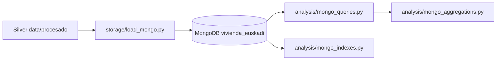

# Design: Fase MongoDB

## Arquitectura

## Decisiones

### Colecciones

- `municipios`: dimensión maestra (252), `_id = codigo_ine` (string).
- `anuncios`: 759 anuncios, `_id = ObjectId`, índice único `(portal, id_anuncio)`.
- `alquiler_oficial`: 253 municipal + 1569 sección, `_id = ObjectId`.
- `indicadores`: 252 filas de `analisis_variables_base`.

### Embedding vs referencing

- Embed en `municipios`: demografía, empleo, accesibilidad, transporte resumen, contexto vivienda. Se leen juntos y cambian poco.
- Embed en `anuncios`: `ubicacion`, `equipamiento[]`, `auditoria`, `historico_precios[]`.
- Referenciar por `codigo_ine`: anuncios → municipios; alquiler → municipios.
- No denormalizar indicadores calculados (`n_anuncios`, `esfuerzo_*`); se generan en aggregation.

### Tipos BSON

- `_id` municipio: string 5 dígitos.
- dinero: `Decimal128`.
- contadores: `int`.
- tasas/distancias: `double`.
- booleanos: BSON bool.
- fechas: `Date`; años: `int`.
- arrays: `equipamiento: [string]`, `historico_precios: [object]`, `variantes: [string]`.
- geo: GeoJSON Point.

### Índices

- `anuncios`: `{ ubicacion.codigo_ine: 1, modalidad: 1, precio_eur: 1 }` (ESR).
- `anuncios`: `{ ubicacion.coordenadas: "2dsphere" }`.
- `anuncios`: `{ portal: 1, id_anuncio: 1 }` único.
- `anuncios`: `{ equipamiento: 1 }` multikey.
- `municipios`: `{ territorio: 1, nombre_canonico: 1 }`.
- `alquiler_oficial`: `{ codigo_ine: 1, distrito: 1, seccion: 1 }` único.

### Shard key

Candidato: `ubicacion.codigo_ine` hashed para `anuncios`. Riesgo: solo 252 valores y distribución desigual. A escala actual no es necesario; se documenta como decisión conceptual.

### Transacciones

No se requiere transacción multidocumento en el flujo principal. La carga usa `update_one(..., upsert=True)`, atómica a nivel de documento. Si se denormalizara una mediana municipal, habría caso de transacción; el modelo evita esa denormalización.

### Accesos principales

- Anuncios por municipio + modalidad + rango de precio + equipamiento.
- Perfil municipal completo en una lectura.
- Estadísticas de alquiler por municipio desde sección.
- Esfuerzo joven combinando municipios + alquiler + renta.
- Proximidad geográfica a capitales.
- Comparativa temporal vs larga estancia.
"""