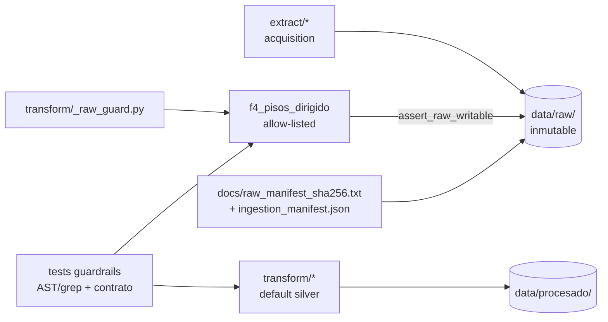

# Design: raw-immutability-hardening

**Change:** `raw-immutability-hardening`
**Specs:** `openspec/changes/raw-immutability-hardening/specs/{contrato-datos,inmutabilidad-raw,extraccion-datos}/spec.md`
**Engram:** `sdd/raw-immutability-hardening/{proposal,spec,design}`
**Estado:** Design (no implementado)

---

## 1. Contexto

Los datos crudos (`data/raw/`) solo están protegidos por convención: marcador
`.FROZEN` escribible, manifest SHA-256 (`docs/raw_manifest_sha256.txt`, 317
entradas) y dos smoke tests. Los transforms pueden escribir en raw por defecto.
Este diseño endurece la inmutabilidad por defecto sin infraestructura nueva y
mantiene los 59 tests existentes.

Fuentes de verdad: spec consolidada en Engram `sdd/raw-immutability-hardening/spec`
y los specs por capacidad bajo `openspec/changes/raw-immutability-hardening/specs/`.

## 2. Objetivos

1. Raw inmutable por defecto; mutación solo vía opt-in razonado (`--write-raw --reason`).
2. Guard compartido `transform/_raw_guard.py::assert_raw_writable(reason)`.
3. `enriquecer_codigo_ine.py` escribe en silver por defecto.
4. Lots dirigidos (`f4`) con nombre único (segundos + token), sin colisión, append-only.
5. Temp dir seguro en Windows (`tempfile.gettempdir()`, crear parent).
6. `muni_resolve` con claves normalizadas (`norm()`) y fallback fuzzy.
7. Dedup determinista de `anuncios_unificados` + salidas aditivas (nunca reducir).
8. Guardrails estáticos + contrato de datos (`docs/data_contract.md`).

## 3. No objetivos

- Infraestructura (Mongo, Kafka, HDFS).
- Read-only a nivel SO (`chmod`/`attrib`).
- Abstracción completa `RawWriter` (fase posterior).
- Cambio de esquema de Mongo o pipeline de agregación.

## 4. Decisiones de diseño

| ID | Decisión | Rechazado | Razón |
|---|---|---|---|
| D1 | Guard compartido `assert_raw_writable(reason)` en `transform/_raw_guard.py` | Validación dispersa por script | Un único punto de control auditable |
| D2 | `enriquecer_codigo_ine` default silver; raw requiere `--write-raw --reason` | Mantener default raw con `--silver` opcional | Inmutabilidad por defecto, opt-in explícito |
| D3 | `f4` genera nombre con `YYYYMMDDHHMMSS` + token UUID, reintenta si existe | Fecha solo (`YYYYMMDD`) | Evita colisiones same-day |
| D4 | Temp dir vía `tempfile.gettempdir()` + `mkdir(parents=True)` | Hardcode `/tmp` | Windows-safe, respeta `TMPDIR` |
| D5 | `NAME2CODE` y `MANUAL_MAP` se normalizan con `norm()` | Solo fuzzy fallback | Exact match funcional para acentos/barras |
| D6 | Dedup ordenado por prioridad explícita + reporte; salidas aditivas | Dedup en orden de entrada | Reproducibilidad |
| D7 | Enforcement por guardrails estáticos (AST/grep) + tests | Revisión manual | Automatizable en CI |
| D8 | Reconciliar `docs/raw_manifest_sha256.txt` (drift 312 vs 317) | Dejar drift | Test de contrato sin ruido |
| D9 | Contrato humano en `docs/data_contract.md` + spec OpenSpec | Solo spec | Consumible por humanos y agentes |

## 5. Arquitectura



Reglas de capa:
- `extract/*` MAY crear nuevos ficheros raw (adquisición).
- `transform/*` NO escribe en `data/raw/` salvo opt-in vía guard.
- Salidas derivadas viven en `data/procesado/` y son aditivas.

## 6. Componentes

### 6.1 `transform/_raw_guard.py` (nuevo)

```
def assert_raw_writable(reason: str | None) -> None
```

- Valida que `reason` sea `str` no vacío tras `strip()`.
- Si vacío/`None`/whitespace → `raise ValueError`.
- Registra el motivo vía logger `"raw_guard"` (nivel INFO) con timestamp.
- No crea archivos; la auditoría queda en logs de ejecución.
- Importable desde cualquier transform (`sys.path[0]` = `transform/`).

Opcional (no requerido por spec, útil para tests):
```
def _audit_message(reason) -> str
```

### 6.2 `transform/enriquecer_codigo_ine.py`

Firma:
```
main(force: bool = False, silver: bool = True,
     write_raw: bool = False, reason: str | None = None) -> int
```

CLI:
```
--force
--silver            (compat; ya es default)
--write-raw         (opt-in raw in-place)
--reason TEXT       (obligatorio con --write-raw)
```

Comportamiento:
- Si `write_raw`:
  - si `reason` vacío → log error + `return 2` (sin escribir).
  - `assert_raw_writable(reason)`.
  - `silver = False`.
  - `_check_frozen(force)` (marker).
  - emite aviso de deprecación (log WARNING) por escritura in-place.
- Si no `write_raw`: `silver = True` (ignora `--silver` ausente).
- `dest_dir = PROCESADO` si silver else `RAW_DIR`.
- `sufijo = "_enriquecido"` si silver else `""`.

Compatibilidad: llamadas existentes `main()` quedan en silver. `--silver` sigue aceptado (no-op informativo).

### 6.3 `transform/f4_pisos_dirigido.py`

- Importa `assert_raw_writable` y la invoca antes de escribir el lot:
  `assert_raw_writable("f4 directed scrape lot")`.
- Nombre de lot:
  ```
  def _nombre_lote(raw_dir: Path) -> Path:
      while True:
          ts = datetime.now().strftime("%Y%m%d%H%M%S")
          token = uuid.uuid4().hex[:8]
          path = raw_dir / f"anuncios_pisos_dirigido_{ts}_{token}.json"
          if not path.exists():
              return path
  ```
- `guardar_json(raw_path, nuevos, metadata=...)` sin sobrescribir.
- Append-only preservado: si el nombre existe, se genera otro.
- La fusión con `anuncios_pisos.json` y las salidas procesadas se mantienen.
- Expone `_nombre_lote` para tests.

### 6.4 `extract/22_geo_areas_funcionales.py`

- `TMP = Path(tempfile.gettempdir()) / "geo_areas"`; `TMP.mkdir(parents=True, exist_ok=True)`.
- `RAW.mkdir(parents=True, exist_ok=True)`.
- Sin literal `/tmp`.
- Refactor a función `main()` invocada bajo `if __name__ == "__main__"` para que el módulo sea importable sin efectos secundarios; `TMP` se calcula al importar (sin red).
- `ZIP_PATH`, `EXTRACT_DIR`, `SHP` derivados de `TMP`.

### 6.5 `transform/muni_resolve.py` + `extract/entity_resolution.py`

Objetivo: un espacio de claves normalizado compartido.

- `entity_resolution.norm()` es la implementación canónica (regex `[\s\-_/]+` → espacio, NFKD, lower).
- `muni_resolve` importa `norm` desde `entity_resolution` en lugar de redefinirlo.
- `MANUAL_MAP` se mueve a `entity_resolution` (claves ya normalizadas) y se importa en `muni_resolve`.
- `entity_resolution._mapa()` incorpora los alias de `MANUAL_MAP` (setdefault) para compartir resolución.
- `muni_resolve._load_dim()` construye `NAME2CODE` con claves `norm(nombre_canonico)` y `norm(variante)`.
- `resolver_codigo(municipio, codigo_ine)`:
  1. Si `codigo_ine` válido (dígito, zfill, en `VALID_CODES`) → `(codigo, CODE2NAME[code])`.
  2. `key = norm(municipio)`.
  3. Si `key in MANUAL_MAP` → resolver código por nombre canónico.
  4. Si `key in NAME2CODE` → `(code, CODE2NAME[code])`.
  5. Fuzzy: mejor `difflib.SequenceMatcher(None, key, norm(nombre))` con umbral `>= 0.85`.
  6. Si no supera → `(None, None)`.

`MANUAL_MAP` (normalizado):
```
"donostia san sebastian": "Donostia/San Sebastián"
"donostia san sebastian ": ...
"arrasate": "Arrasate/Mondragón"
"vitoria": "Vitoria-Gasteiz"
"arrankudiaga zollo": "Arrankudiaga"
```
(claves pasadas por `norm`).

### 6.6 `transform/unificar_anuncios.py`

Dedup determinista:
- Cada registro se etiqueta con `_source_order` (int) según origen:
  - base: fotocasa=0, pisos=1, realtyapi=2
  - lots dirigidos: 10 + índice ordenado por nombre de fichero.
- Antes de dedup, ordenar por `(_source_order, portal, id_anuncio)`.
- Dedup por `(portal, id_anuncio)` conservando el primero (menor `_source_order`).
- Emitir reporte:
  - stdout: `Anuncios tras dedup: N (eliminados: M)`.
  - `data/procesado/dedup_report.json` con `{total, unicos, eliminados, duplicados: [{portal,id_anuncio,source_order}]}`.
- Salida final ordenada por `(portal, id_anuncio)` para reproducibilidad.

Salidas aditivas:
- `unificar_anuncios` sigue escribiendo `anuncios_unificados.json` (completo) y `.csv` con el esquema base.
- Los transforms downstream NO reducen el CSV; o bien añaden columnas o escriben fichero separado.

### 6.7 Transforms downstream (aditivos)

Afectados: `generar_fingerprint.py`, `enriquecer_equipamiento_realtyapi.py`,
`rescatar_features_nlp.py`.

Regla: mutan el JSON en lugar; al regenerar el CSV deben conservar todas las
columnas existentes y añadir las nuevas.

Implementación de referencia:
- Cargar CSV existente en `df_prev`.
- Mutar JSON.
- Construir `df_new` con columnas base + nuevas.
- Para cada columna de `df_prev` ausente en `df_new`, añadirla (alineando por
  `(portal, id_anuncio)` cuando sea posible; si no, dejar vacía).
- Escribir `df_new` (superset garantizado).

Alternativa aceptable: escribir la feature en un fichero separado
(`anuncios_unificados_<feature>.csv`) y no tocar el canónico.

### 6.8 `extract/main_ingest.py` y manifest

- `--mode replay-raw` sigue siendo el mecanismo para re-congelar lots dirigidos.
- Reconciliación de `docs/raw_manifest_sha256.txt`: regenerar con un script
  auxiliar (o comando documentado) que:
  - recorra `data/raw/`,
  - excluya `.FROZEN`, `.gitkeep`, `ingestion_manifest.json`,
  - emita `<sha256>  <ruta_relativa>` ordenado.
- Conteo resultante debe coincidir con ficheros existentes.

### 6.9 `docs/data_contract.md` (nuevo)

Contenido mínimo:
1. Capas (raw inmutable vs procesado).
2. Reglas raw (solo extract/* crea; transforms no escriben salvo guard).
3. Manifest (docs + ingestion) y exclusiones.
4. Esquema `codigo_ine` (5 chars, zfill, nulos preservados).
5. Canónico `anuncios_unificados` (JSON + CSV base).
6. Resolución de municipios (`norm()`, manual map, fuzzy >= 0.85).
7. Lots dirigidos (formato nombre, append-only).
8. Temp dir (gettempdir).
9. Salidas aditivas (superset de columnas).

## 7. Contratos de datos

### 7.1 Raw

- Directorio: `data/raw/`.
- Inmutable por defecto.
- Excepciones del manifest: `.FROZEN`, `.gitkeep`, `ingestion_manifest.json`.
- `codigo_ine`: string 5 chars o `None`/vacío.

### 7.2 Canónico procesado

`data/procesado/anuncios_unificados.json` (lista de registros anidados) y
`data/procesado/anuncios_unificados.csv` con columnas base:

```
id_anuncio, portal, modalidad, precio_eur, superficie_m2, habitaciones,
es_outlier_superficie, codigo_ine, municipio, titulo, subtitulo, equipamiento
```

Toda salida derivada que se presente como enriquecimiento del canónico MUST
tener superset de estas columnas.

### 7.3 Lots dirigidos

Nombre: `anuncios_pisos_dirigido_{YYYYMMDDHHMMSS}_{token}.json`
(`token = uuid4 hex[:8]`). Schema guard existente (`_es_lote_valido`) se mantiene.

### 7.4 Resolución de municipios

- `norm()`: NFKD → ascii, lower, `[\s\-_/]+` → espacio, colapso de espacios.
- Mapa de dimensión y `MANUAL_MAP` usan claves normalizadas.
- Fuzzy fallback con umbral `>= 0.85`; si no supera → `(None, None)`.

## 8. Flujos de datos

1. **Extracción**: `extract/*` crea raw → manifest actualizado.
2. **Enriquecimiento INE**: por defecto silver (`*_enriquecido` en procesado).
   Raw in-place solo con `--write-raw --reason` + `_check_frozen`/guard.
3. **Unificación**: dedup determinista + reporte → canónico.
4. **Features downstream**: mutan JSON; CSV preserva/añade columnas.
5. **Lots dirigidos**: f4 escribe lot único en raw vía guard; luego se integran
   en unificación con schema guard.

## 9. Manejo de errores

- `assert_raw_writable("")` → `ValueError` (no escribe).
- `enriquecer_codigo_ine --write-raw` sin `--reason` → exit code 2, sin escritura.
- f4: si el nombre generado existe, reintenta; nunca sobrescribe.
- geo: crea temp dir; si falla la creación, error explícito.
- muni: sin match → `(None, None)`; no lanza.

## 10. Idempotencia

- f4: nombres únicos por ejecución; re-ejecutar no sobrescribe lots previos.
- unificación: mismo input en distinto orden → mismo output y orden.
- manifest: replay-raw valida hashes sin mutar raw.

## 11. Estrategia de pruebas (guardrails)

Nuevos tests (nombres exactos propuestos por la exploración):

1. `test_raw_manifest_complete` — todo fichero raw (salvo excepciones) está en
   `docs/raw_manifest_sha256.txt` y hashes coinciden.
2. `test_no_transform_writes_raw` — scan AST/grep de `transform/*.py` por
   escrituras a `data/raw`/`RAW_DIR`; allow-list solo `f4_pisos_dirigido.py`
   y solo si invoca `_raw_guard.assert_raw_writable`.
3. `test_f4_filename_unique` — `_nombre_lote()` devuelve nombre con 14 dígitos
   (`YYYYMMDDHHMMSS`) + token; dos llamadas difieren.
4. `test_geo_temp_not_tmp_root` — `22_geo_areas_funcionales.TMP` no contiene
   `/tmp` literal y su parent existe tras `mkdir`.
5. `test_muni_resolve_accented_slash` — `resolver_codigo("Donostia/San Sebastián", None)`
   y `"Arrasate/Mondragón"` resuelven al código canónico sin fuzzy.
6. `test_unificados_columns_superset` — para cada CSV de enriquecimiento
   (`*_enriquecido*.csv`, `anuncios_unificados*.csv`), sus columnas son superset
   del canónico; vistas analíticas (`*_residencial*.csv`, `*_habitaciones*.csv`)
   quedan fuera del check.
7. `test_raw_guard_reason` — `assert_raw_writable("ok")` no lanza;
   `assert_raw_writable("")`/`None` lanza `ValueError`.

Patrones de scan para (2):
```
RAW_WRITE_PATTERNS = [
  r"to_csv\([^)]*(RAW_DIR|data/raw|data\\\\raw)",
  r"to_json\([^)]*(RAW_DIR|data/raw|data\\\\raw)",
  r"open\([^)]*(RAW_DIR|data/raw|data\\\\raw)[^)]*['\"][wa]",
  r"guardar_json\(\s*(RAW_DIR|.*raw)",
  r"\.write_text\([^)]*(RAW_DIR|data/raw|data\\\\raw)",
]
```
Allow-list: `f4_pisos_dirigido.py` solo si contiene `assert_raw_writable`.

## 12. Trazabilidad

| Requisito | Componente | Test |
|---|---|---|
| CONTRATO-RAW-01 | `_raw_guard`, enriquecer default, scan | `test_no_transform_writes_raw` |
| CONTRATO-RAW-02 | reconciliación manifest | `test_raw_manifest_complete` |
| CONTRATO-RAW-03 | `_zfill` existente | `test_crudos` (existente) |
| CONTRATO-PROC-01 | unificar dedup | nuevo test dedup (opcional) |
| CONTRATO-PROC-02 | downstream aditivo | `test_unificados_columns_superset` |
| CONTRATO-RESOLVE-01 | muni_resolve + entity_resolution | `test_muni_resolve_accented_slash` |
| INMUT-01 | enriquecer flags | manual/CLI |
| INMUT-02 | `_raw_guard` | `test_raw_guard_reason` |
| INMUT-03 | scan | `test_no_transform_writes_raw` |
| INMUT-04 | enriquecer flags | manual/CLI |
| EXTRACCION-TEMP-01 | 22_geo | `test_geo_temp_not_tmp_root` |
| EXTRACCION-LOT-01 | f4 | `test_f4_filename_unique` |

## 13. Archivos a crear/modificar

Crear:
- `transform/_raw_guard.py`
- `docs/data_contract.md`
- `tests/test_raw_inmutable.py` (ampliar) o nuevo `tests/test_raw_guardrails.py`

Modificar:
- `transform/enriquecer_codigo_ine.py`
- `transform/f4_pisos_dirigido.py`
- `extract/22_geo_areas_funcionales.py`
- `transform/muni_resolve.py`
- `extract/entity_resolution.py`
- `transform/unificar_anuncios.py`
- `transform/generar_fingerprint.py`
- `transform/enriquecer_equipamiento_realtyapi.py`
- `transform/rescatar_features_nlp.py`
- `docs/raw_manifest_sha256.txt` (reconciliación)

## 14. Riesgos y mitigaciones

- Default silver sorprende callers legacy → aviso de deprecación + `--write-raw`.
- Scan estático evitable con paths dinámicos → revisar también literales y code review.
- Drift manifest → reconciliar en este mismo cambio.
- Cambio muni_resolve altera dedup → comparar before/after counts.
- Temp Windows → crear dirs, honrar `TMPDIR` vía `gettempdir()`.

## 15. Plan de rollout

1. Añadir `_raw_guard.py`.
2. Cambiar defaults de `enriquecer_codigo_ine`.
3. f4 naming + guard.
4. geo temp.
5. muni_resolve + entity_resolution.
6. unificar dedup + reporte.
7. downstream aditivo.
8. reconciliar manifest.
9. escribir `docs/data_contract.md`.
10. añadir guardrails tests.
11. ejecutar `pytest tests -q` (esperado: 59 + nuevos en verde).

## 16. Supuestos

- Python 3.12, pytest; sin nuevas dependencias.
- Los tests de guardrail se ejecutan desde la raíz del repo.
- `data/raw/` existe y `.FROZEN` presente.
- La reconciliación del manifest se hace en este mismo cambio.
